# Loagaeth Analysis

A reproducible, dependency-free toolkit for studying John Dee's Enochian / Angelical
system as **data** - above all the *Liber Loagaeth* (the 49 tables of letters,
British Library Sloane MS 3189), plus the Great Table, the 91 governors, the 19 Calls,
the Heptarchia and the Sigillum.

It has one discipline and one promise. The discipline: **no apparent pattern counts as
a finding until it beats a null model** that preserves the text's own texture, so we
report what fails as loudly as what survives. The promise: everything runs on the
Python standard library alone, with fixed seeds, so every number in these docs is one
command away from being reproduced or refuted.

> This does **not** decipher the Loagaeth. It maps the structure, shows what looks like
> real word-formation, rules out a stack of popular "keys," and ships the recursive
> engine we used to tell structure from coincidence. The meaning is still sealed and
> probably opens only from an external anchor (the attested sense of one name).

---

## What you need

- Python 3.8+ . Nothing else. No pip install for the core.
- Optional: an LLM backend (an Anthropic API key, **or** a local Ollama) only if you
  want the engine to propose new hypotheses on its own - see [Self-improving loop](#self-improving-loop).

## What you get when you run it

Two layers you can run independently:

**A. The Loagaeth analysis** (`src/`) - characterizes the 49 tables and prints:
the entropy/structure profile, the scale-free name-network and its hubs, the master
stem **CHASTOR** and its coverage, the **productive morphology** (a stem + a closed set
of prefixes/suffixes), the per-table signature names, the bridge to the Calls, and the
**refutation tests** (what died against the strong null).

**B. The recursive pattern engine** (`engine/`) - the self-feeding loop that sweeps 12
probes (gematria, geometry, symmetry, numerology, kabbalah, frequency, skip-ciphers...)
across the whole Enochian corpus, each probe with its own null model, dedupes against a
persistent memory, writes only what is new, and labels every finding `candidate` vs
`known` (circular/by-construction) with a p-value verdict.

```bash
# A - the Loagaeth analysis (writes results/*.json)
python src/run_all.py

# B - the recursive engine, one full sweep (writes engine/results/*)
cd engine && python loop.py --rodadas 13
```

---

## How to load the data yourself

Every dataset is plain JSON under `data/` (study data) and `engine/data/` (the Enochian
sources the engine reads). Load any of them directly:

```python
import json

# the Loagaeth itself: {"meta": {...}, "leaves": {"1a": [rows...], "1b": [...], "2a": [...]}}
loa = json.load(open("data/loagaeth_tables.json", encoding="utf-8"))
leaves = loa["leaves"]
dense_1a = "".join(leaves["2a"])          # a dense 49x49 table as one letter stream

# the derived word list (segmented): [{"word","occurrences","leaves","in_leaf1"}, ...]
vocab = json.load(open("data/loagaeth_vocabulary.json", encoding="utf-8"))["vocabulary"]
```

Or use the shared helpers in `src/load.py`, which handle letters, tables, n-grams and
null models for you:

```python
import sys; sys.path.insert(0, "src")
import load
load.table_text(1)         # all letters of table 1 (both sides)
load.dense_stream()        # the whole book as one stream
load.spaced_words()        # word tokens from the two word-spaced leaves (1a, 1b)
```

See [`docs/DATA.md`](docs/DATA.md) for every file, its fields, and what it contains, and
[`docs/SOURCES.md`](docs/SOURCES.md) for where each dataset comes from (the Loagaeth
transcription, the Great Table, the governors, the gematria systems).

---

## Layout

```
data/                         study data (impersonal, English keys)
  loagaeth_tables.json        the 49 tables (Sloane MS 3189). '?' = null cell
  loagaeth_vocabulary.json    segmented word list with per-leaf counts
  loagaeth_segmentation.json  the segmentation model + its precision/recall
  loagaeth_crossing.json      cross-check of recurrent words vs the Call lexicon
  call_lexicon.json           attested Angelical vocabulary (for the bridge test)
  hive_graph.json             the name-network (nodes/edges) as data
src/                          LAYER A - the Loagaeth analysis
  load.py                     shared loader + helpers (letters, tables, n-grams, nulls)
  a01..a06_*.py               the six analyses
  a07_null_models.py          shuffle + order-k Markov surrogate generators
  a08_refutations.py          the patterns that FAILED the strong null
  a09_letter_grammar.py       letter positional roles (z~331) + same tongue as the Calls
  a10_territory.py            per-table territory map of the master names
  a11_lineages.py             CHAST vs GETH: morphology, territory, co-location, syntax
  a12_empire.py               the "seven Lords", title-nesting, vowel twins, CHA-core test
  a13_numbers.py              governors' numbers: head digit + 2-3-6 block, midpoint regime change
  a14_anzach.py               ANZACH profiled and compared with CHASTOR
  a15_book_geometry.py        full grids vs chessboard diamonds, text direction, noise tables
  a16_letters.py              letter counts + gematria, hidden-name test, positions, segments, U register
  a17_kingdom.py              sides/heights, mirrors, the 7x7 plan, the two houses
  a18_markup_decoding.py      Peterson's marks, leaf titles, decoding tables 25b-28b (two currents)
  a19_machine.py              Soyga vs Loagaeth, 2-D rule, compression, language model, generator
  a20_energy_fibonacci_gd.py  letter energy by realm, Fibonacci, 7x7 division, GD rearrangement
  a21_index_heptarchy_numbers.py  Peterson's index checked, dense-line gold standard, Heptarchy numbers, gematria
  a22_robustness_and_depth.py     findings under other readings, diamond roads, memory, repeats, Zipf
  a23_name_discovery.py           unsupervised name discovery, families, grammar
  a24_book_architecture.py        acrostics, pyramid cross, dialects, book order, two currents, verses
  a25_bridges.py                  other systems inside the Loagaeth, name constellation
  a26_letter_names.py             Dee's letter names as a reading layer (construction), letter profiles per side
  a27_doubts.py                   data-driven segment borders, irregular rows, open manuscript checks
  a28_names_deep.py               name territories, houses, genealogy, vowel mirrors, hidden names, currents
  a29_architecture_deep.py        change rate, diamond halves, leaf 1 in the tables, particles
  a30_anchors.py                  glossed Call words in the tables, diaries, leaf titles
  a31_grammar.py                  two-level grammar (names + letters) vs letter models; one vs five grammars
  a32_one_language.py             Loagaeth/Calls models reading the Great Table, governors, Heptarchy
  a33_diary_anchors.py            Dee's glosses and the angels' statements about the book, tested
  a34_vowel_paradigms.py          words one vowel apart, vowel series, grades of the master stems
  a35_nalvage_coordinates.py      Nalvage's table/number references for the first Call, looked up
  a36_soyga_calibration.py        Soyga tables regenerated (Reeds) -> error rate and confusions of the scribe
  a37_mixed_decoding.py           25b-28b re-decoded: row blocks and zones (writes data/loagaeth_mixed_decoded.json)
  a38_open_leads.py               every k-th letter, tables 43-48 as a pattern, Heptarchic number layouts
  a39_long_repeats.py             long repeats against surrogates; names joined to names
  a40_formulas.py                 memory of the text (held-out), compounds, one-letter variants of passages
  a41_sound_classes.py            do the letter changes follow sounds? classes fixed beforehand, three data sets
  a42_repeat_map.py               where repeats fall (sister sides, distance), drift of spelling, compounds re-tested
  a43_recency.py                  does the text remember what it just wrote? echo by lines and sides, a model with a cache
  a44_positive_control.py         the same blind tests on a text with sentences (King James Bible) and on controls
  a45_variation_channel.py        what decides which variant of a formula is written
  a46_generator.py                three machines write a false book; what they fail to reproduce
  a47_templates.py                templates with a free slot; is there anything beyond five letters of context?
  a48_beyond_five_elsewhere.py    the same limit on the chessboard leaves and the diamonds, with a shape-matched control
  a49_leaf_and_junctions.py       the two sides of a leaf cell by cell; does the text run on from row to row?
  a50_chessboard_order.py         leaves 25b-28b: order of the diagonals of each colour (writes data/loagaeth_chessboard_streams.json)
  a51_word_points.py              the points between words in tables 2a-5a: a gold standard (writes data/loagaeth_word_points.json)
  a52_origin_of_formulas.py       the imprint of a language (English, Latin) and of a hand making letters at will
  a53_second_transcription.py     kondor.de against Peterson: independent witness or copy?
  a54_source_checks.py            tests taken from the diaries: leaf 1 as a table of words, leaf 1 as a key, the nine letter rows, leaf 18
  make_catalog.py                 builds viz/names_catalog.html (template: catalog_template.html)
  make_figures.py             draws every figure in figures/ from the results
  make_viz_data.py            builds viz/loagaeth_viz_data.js for the 3D viewer
viz/                          loagaeth_3d.html - interactive three.js viewer
                              name_finder.html - type any name, find it (and its pieces, letters, repeats)
                              across the Loagaeth and the four Watchtowers (data: search_data.json)
                              path_view.html - draw a name as a connected king-move path through any
                              leaf's grid, with an anagram control (data: search_data.json)
figures/                      all figures as SVG (regenerated by run_all.py)
  run_all.py                  runs everything -> results/summary.json
engine/                       LAYER B - the recursive pattern engine
  enoch.py  fontes.py         Great-Table derivation + Dee's primary sources
  nucleo.py                   data, gematria, statistics, persistent memory
  sondas.py                   the 12 probes, each with its own null model
  loop.py                     the self-feeding runner
  llm_agent.py                optional: an LLM proposes new hypotheses (API key or Ollama)
  data/                       the Enochian source JSON the engine reads
  README.md                   how the engine works, probe by probe
docs/
  SOURCES.md                  provenance of every dataset (the "where did this come from")
  DATA.md                     every dataset's fields + how to load it
  EXPLORED.md                 everything we tried: what held up, what we threw out
  EXPERIMENTS_72_hypotheses.md the full 72-hypothesis audit across the whole system
  METHODOLOGY.md              the null models and why Markov is the real bar
  SESSION_FINDINGS.md         every finding with its numbers and method
  RESEARCH_LOG.md             the process, question by question, each result tagged
```

---

## Read this first: what the diaries say the book is

The diaries that record the reception of the book (Sloane 3188; *A True and Faithful Relation*) say
what it is and how it is to be read, and this study read them late. In short:

- every leaf is 49 × 49 squares; on the first leaf a square holds a word, on the others a letter;
- on the page, leaves 25b–28b carry two series of letters on alternate squares, turned half round from
  one another, and leaves 29–48 are the same chessboard with only one series written (the "diamonds"
  of this repository are how the transcription prints them, not what the page shows);
- "every letter here bringeth furth the Names of God: But … they are but one Name";
- the 49 tables answer to "49 voyces, or callings", the Keys that open 48 of them; the first has none;
- "There is no other reading of the Book, but the appearing of the Ministers and Creatures of God";
- "Interpret not, till your understanding be furnished."

So the tables are not a discourse awaiting translation, and the measurements below — no sentences,
words almost never repeated, a text made of recurring names — describe an instrument, as the record
says, not a message. The full record, with page references and a table setting each statement
beside what was measured, is in [`docs/WHAT_THE_SOURCES_SAY.md`](docs/WHAT_THE_SOURCES_SAY.md).

**For the complete summary and how to use the names in practice, see
[`docs/FINDINGS_AND_PRACTICE.md`](docs/FINDINGS_AND_PRACTICE.md).**

### The findings at a glance

The book is not a message to decode — it is an instrument of names set to a beat. These four figures
carry the heart of it.

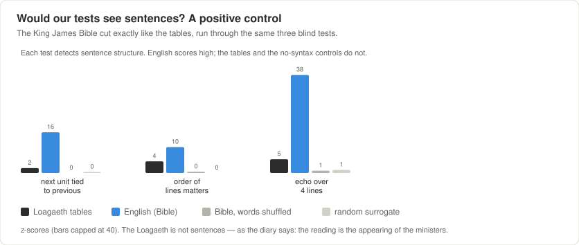

*The same three blind tests detect sentence structure in the King James Bible (cut exactly like the
tables) but not in the tables themselves, nor in the no-syntax controls. The Loagaeth is not prose.*

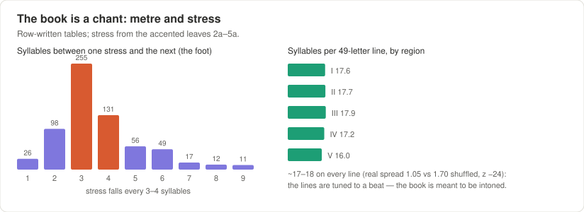

*Every 49-letter line is tuned to ~17–18 syllables with a stress every three to four — a real metre,
constant across the book. It is made to be intoned.*

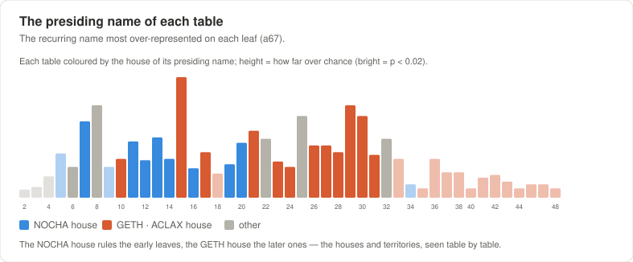

*Most tables have one recurring name over-represented on them (a working list for the practitioner).
The NOCHA house rules the early leaves, the GETH · ACLAX house the later ones.*

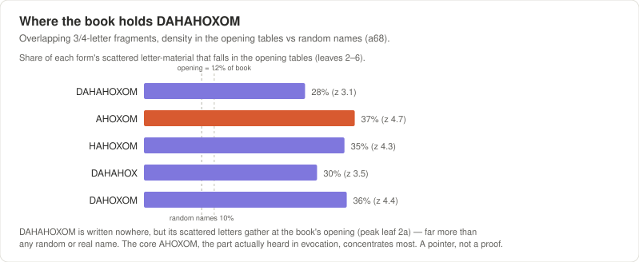

*A name reported in evocation. It is written nowhere, but its scattered letters gather, far above
chance, at the book's opening — peak on leaf 2a, the first table a Call opens. A pointer, not a proof.*

## Everything we discovered

Run `src/run_all.py` for the live numbers. Every claim below beat a null model or is true
by direct inspection; the module that reproduces it is named in brackets. The full write-up
with method is in [`docs/SESSION_FINDINGS.md`](docs/SESSION_FINDINGS.md); what we ruled out
is in [`docs/EXPLORED.md`](docs/EXPLORED.md); the whole process, question by question, with each
result tagged REAL / REFUTED / INCONCLUSIVE / DESCRIPTIVE, is in
[`docs/RESEARCH_LOG.md`](docs/RESEARCH_LOG.md).

**The one-line picture:** the Loagaeth is not a cipher to translate — it is the **name-book
of the Angelical language**. It is written in the *same tongue* as the 48 Calls, but its
content is that language's **names**, with a real grammar and a political geography, and
with the meanings of the proper names still sealed.

### Structure
- **It is a catalog of names, not prose** `[a01,a03]` — 195,548 letters; entropy 4.03 bits,
  conditional 3.44 (strong syllable structure); type/token 0.81; no prose-like grammar.
- **A scale-free name-network** `[a02]` — ~4,300 recurring-string nodes, a heavy tail of a
  few dominant hubs (the "hive").

### The master stem CHASTOR
- **CHASTOR rules the book** `[a03]` — 184 occurrences across 35 of 48 tables (72.9%); with
  NOCHASTOR, 61 more across 27. **CHUSTOR** is its A→U vowel twin.
- **Productive morphology** `[a04]` — CHASTOR takes a closed prefix set (NO- 77, NE- 24,
  ZI- 18, NA- 12, OL- 11): NOCHASTOR, NECHASTOR, ZICHASTOR, NOCHASTORAD… The **family
  forest**: three roots take ≥3 prefixes — CHASTOR (8), DAX (4), CHADAX (3). CHASTOR is the
  trunk.

### The alphabet is a real grammar

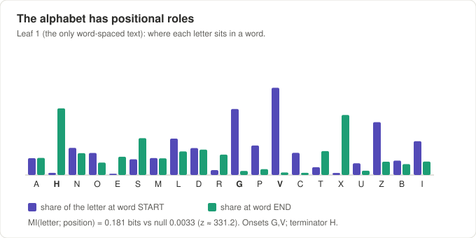

- **Letters carry positional roles** `[a09]` — mutual information MI(letter; position) =
  0.181 bits vs a within-word-shuffle null of 0.003, **z ≈ 331**. **G, V are onsets; H is a
  terminator.** Names parse as `[onset][root][terminator]` (ZURAH = ZU·RA·H, NOGAH = NO·GA·H).
- **Same Angelical tongue as the Calls** `[a09]` — the per-letter word-ending profile
  correlates **Loagaeth↔Calls r = 0.71** vs Loagaeth↔English r = 0.22 (control). Same
  sound-grammar, different lexicon. The Loagaeth is the *more alien / older* layer.

### A political geography of names

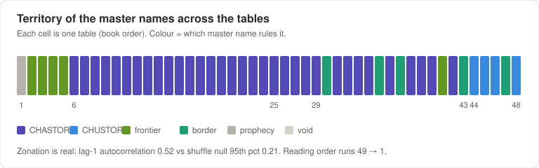

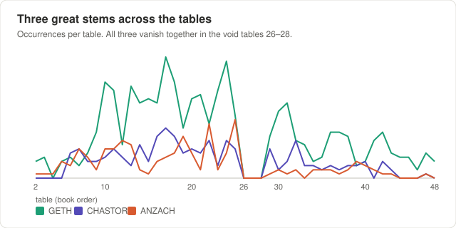

- **Territorial map** `[a10]`, dataset `data/loagaeth_territories.json` — the book is
  partitioned. **CHASTOR** rules the heartland (tables 6–25) and a second realm (29–43);
  **CHUSTOR** rules the end (44–48); the opening (2–5) holds small independent realms;
  table 1 is the prophecy (and the *last* leaf in reading order). The zonation is real:
  per-table CHASTOR counts have lag-1 autocorrelation 0.51 vs a shuffle null of 0.20.
- **Refined honestly** — only CHASTOR is a true dynasty; CHUSTOR is a lone twin (no
  prefix-family); the opening realms share no large family. One empire + a twin + small realms.
- **Per-table signature names** `[a05]` — all 48 tables have a distinct local name; none are
  CHASTOR-family.

### The readable layer, and the sealed one
- **A small real bridge to the Calls** `[a06]` — ~20 whole words in the prophetic leaf 1 are
  attested Angelical with known meanings: MAD (of god), IAD (the god), GAH (spirits), ORS
  (with darkness), ZIR (I am), GOHO (sayeth), VORS ("now the seas appear", recurs 47×). These
  are the shared sacred **particles**.
- **The proper names are sealed** — an exhaustive lexicon search finds **zero** glosses for
  CHASTOR or its family. The master names have no attested meaning in any source we hold.

### The one unexplained number

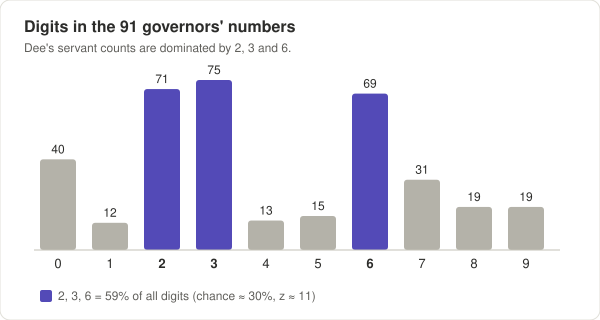

- **The 2/3/6 anomaly** — the numbers Dee attached to the 91 governors are dominated by the
  digits 2 (71×), 3 (75×), 6 (69×): 59% of all digits vs a chance ≈ 30%, **z = 11.4**. 62 of
  91 numbers contain a 6. Its architecture is now partly decoded (head digit + permuted 2·3·6
  block, head shared per Aethyr in the second half) — see the section on the governors'
  numbers below; the exact choice of each head and permutation is still open.

### The empire, examined closely

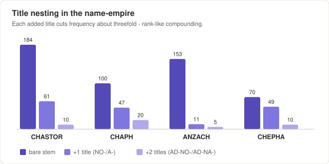

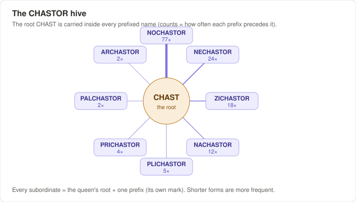

- **The queen is a stem, carried inside her titled forms** `[a12]` — a few stem-names plus a
  shared, stackable title-chain: CHASTOR 184 ⊃ NOCHASTOR 61 ⊃ ADNOCHASTOR 10; CHAPH 100 ⊃
  NOCHAPH 47 ⊃ ADNOCHAPH 20; ANZACH 153 ⊃ NOCHANZACH 11 ⊃ ADNOCHANZACH 5. Each added title
  cuts frequency about threefold — rank-like compounding. ANZACH is a second great stem.
- **The "seven Lords"** listed elsewhere in the project (CHASTOR, HANZACH, ALGETHA, ADNOCHA,
  ADNACHA, ACHEPHA, ANTANTO) are real frequent strings, but they overlap and nest inside this
  compounding system rather than being seven independent beings.
- **CHAST vs GETH** `[a11]` — CHAST is a head-stem (fixed -OR ending, variable prefixes); GETH is
  the most pervasive element (504×, 43 tables) and ends in the terminator H. They are not rivals
  (territory correlation exactly at the frequency null) and form no phrase together.
- **Shorter is stronger; numbers don't encode power** — name length vs frequency ρ = −0.39;
  gematria vs frequency ρ = +0.11.
- **Provenance warning** — the sefira/planet/talisman "powers" attached to these names in the
  wider project's grimoire are convention (its own generator says "constructed, not
  deciphered"); one name even received two incompatible assignments.
- **Literature check** — none of these names appear in the 81 reference books held by the project.

### The governors' numbers — decoded architecture

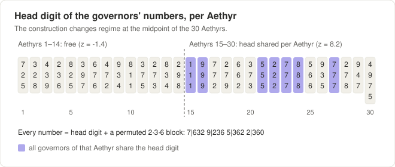

- **Number = [head digit] + [a permuted 2·3·6 block, sometimes zero-padded]** `[a13]` — e.g.
  7|632, 9|236, 5|362, 2|360. Against a null that shuffles every digit (so the 2/3/6 excess is
  already priced in): the block co-occurs in one number z = 7.6, is contiguous z = 9.0, sits at
  the end z = 8.3; exact duplicates z = 8.5; anagram pairs 92 vs 20.6, z = 13.7.
- **The head digit belongs to the Aethyr — only in the second half.** Aethyrs 1–14: no rule
  (z = −1.4). Aethyrs 15–30: governors share their first digit (z = 8.2); seven Aethyrs have all
  three identical. The construction changes regime at the midpoint of the 30.
- Head digit is unrelated to part, tribe or name. A search over 30 candidate rules (Aethyr-name
  gematria in all 13 systems, index transforms, sums), with a null that re-runs the whole search
  on shuffled heads, finds nothing (best 4/16 vs 4.3 by chance, p = 0.83).
- **The block prefers its natural order**: "236" ascending in 13 of 30 numbers vs 5 expected if
  all six orders were equal (p = 0.0005).

### ANZACH, the sibling stem
- **153 occurrences, 39 tables** `[a14]` — wider than CHASTOR, and present in tables 2–5 where
  CHASTOR is absent. Built the same way: **NO·CHA·NZACH** parallels **NO·CHA·STOR**, with the
  same title nesting (ANZACH ⊃ HANZACH ⊃ NOCHANZACH ⊃ ADNOCHANZACH).
- It stands alone as a **word in the prophetic leaf 1**. No rivalry or precedence with CHASTOR
  (territory at the density null; each comes first 17 of 34 times).

### The book's physical geometry — four segments `[a15]`

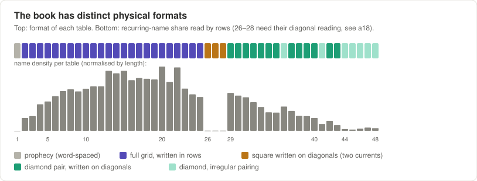

- **Tables 2–25a are full 49×49 grids written in rows.** From side 25b on, the text runs on
  diagonals — see the decoding of 25b–28b below.
- **Tables 29–48 are diamonds.** One side of each leaf has rows of 1, 3, 5 … 49 … 3, 1 letters
  (1201 cells), the other 2, 4 … 48, 48 … 4, 2 (1200 cells): 1201 + 1200 = 2401 = 49². These are
  exactly the **two colours of a chessboard** on a 49×49 grid, each written along the diagonals
  (the paper turned 45°). Both sides of a leaf together are **one** 49×49 table.
- **The language runs along those diagonals.** Rebuilding the square from the two diamonds and
  reading its rows or columns gives pure noise (recurring-name share 0.001, conditional entropy
  4.0 bits), while the diagonals as written carry the names (0.15, 3.24 bits). This is the
  geometric form of Peterson's remark that Kelley "skipped every other letter" and that the
  paper was reoriented.
- **Tables 25b–28b are squares written on the diagonals** (decoded below). Read by rows they look
  like noise — an earlier version of this analysis called them noise; that was a reading-direction
  error, corrected by module `a18`.
- **Tables 44–48** use an irregular diamond pairing and almost no recurring names — the end of
  the book is a distinct fourth segment.
- **Method note:** the diamond tables hold half the letters per side, so raw per-table counts
  (as in the territory map) are not comparable across the two formats. Normalised by length,
  CHASTOR's density is steady from table 6 to 43.

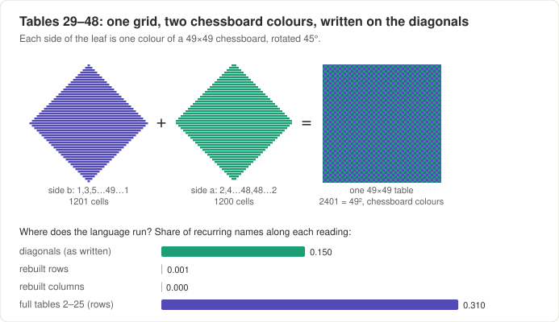

### The no-doubled-letter rule

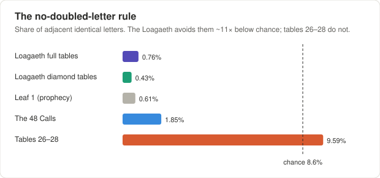

- The Loagaeth almost never writes the same letter twice in a row: 0.76% in the full tables,
  0.43% in the diamonds, 0.61% in leaf 1, against 8.6% expected from its letter frequencies —
  **about 11× below chance**. The Calls avoid doubles more loosely (1.85%). Tables 26–28 read by
  rows sit at chance (9.6%) only because that is the wrong direction; read on their diagonals they
  drop to 1.5% (0.2–0.4% in the cleanest currents).

### Tables 25b–28b decoded: two currents on the diagonals `[a18]`

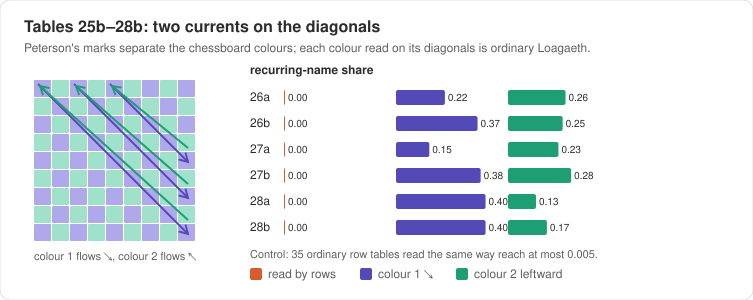

- **Peterson's transcription marks every letter of leaves 25b–28b** with one of two signs (`~`, `/`,
  `` ` `` or a space). Aligned to the 49×49 grid (2,401 letters = 2,401 cells), **each sign falls on
  exactly one chessboard colour** — about 1,200 / 1,201 cells, the same two colours that tables
  29–48 write as separate diamonds.
- **Read colour by colour along the diagonals, these tables are ordinary Loagaeth.** One colour
  runs **down-right** (↘) on the main diagonals; the other runs **leftward** (↖ on the same
  diagonals, or ↙ on the anti-diagonals — one binary choice per face). Recurring-name share: rows
  0.001 → decoded **0.27** (best currents 0.37–0.40, as high as row-written tables); conditional
  entropy 3.82 → 3.05 bits. **Control:** 35 ordinary row-written tables read by exactly the same
  procedure reach at most **0.005**.
- Example decoded line (27b ↘): `YSCHINER·OXAD·LOZAD·ALZACH·CHANTOX·AGETH·CHADAX·TAPHERO` — familiar
  names. In the decoded text: CHASTOR 16×, ANZACH 12×, GETH 85×, NOCHA 51×, ADNOCHA 15×. **CHASTOR's
  realm is continuous from table 6 to 43**; the earlier "void" at 26–28 was a reading artefact.
- **The turn falls at the exact middle of the book:** sides 1a–25a are written in rows; from 25b
  the text runs on diagonals. In a 49-leaf (98-side) book, 25a is side 49 — 49 sides in rows, 49 on
  diagonals. (Descriptive, noticed after seeing the data.)
- The decoded text is published in `data/loagaeth_diagonal_decoded.json`.

### Leaf titles `[a18]`

- Each leaf carries a heading (e.g. 26b *Draxph intayfalg*, 27b *Vincal leorna rvh*, 28b *Larvh
  gohonp babbabor*); all are extracted to `data/loagaeth_leaf_titles.json`. The heading of **5b,
  *Zvchastors plohodmax argednon***, names **ZUCHASTOR(S)** — the master name in its U form — on the
  leaf just before CHASTOR's realm begins (table 6). Headings of 3b, 4a, 7a, 8a carry ALGE/ALGETH.
- Titles are **not** drawn from their own leaf: 15% of a title's 4-grams occur in its leaf vs 16%
  in other leaves.

### Every letter, mapped `[a16]`

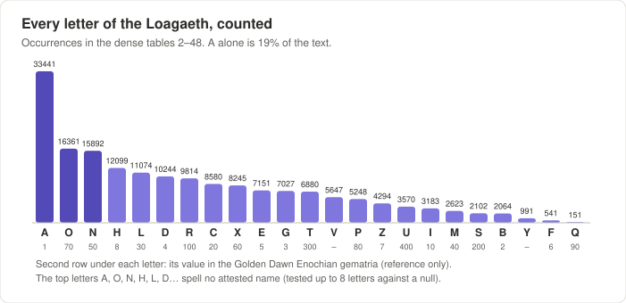

- **A is 19% of the text**, twice the next letter (O 9.2%, N 9.0%, H 6.8%, L 6.3%, D 5.8%, R 5.5%…);
  Q, W, K are practically absent. The figure gives each letter's value in the Golden Dawn Enochian
  gematria for reference; the full set of values in all 13 systems is in `results/16_letters.json`.
- **The top letters spell no name.** For the top 3 to 8 letters (AON, AONH, AONHL…), no attested
  Call word or recurring Loagaeth word is an exact anagram (the chance of a hit for a random
  frequent set is shown alongside). English coincidences such as AONH → "NOAH" are exactly what
  this null is there to discount.
- **Letter values do not track frequency** in any gematria system after correction for 13 tests.

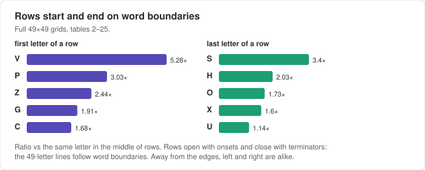

- **Rows of the 49×49 grids follow word boundaries.** The first letter of a row is an onset far
  more often than mid-row (V 5.3×, P 3.0×, Z 2.4×, G 1.9×); the last is a terminator (S 3.4×,
  H 2.0×, O 1.7×, X 1.6×). This edge effect is the whole of the left/right difference: away from
  the three outer columns, left and right halves have the same letter mix.

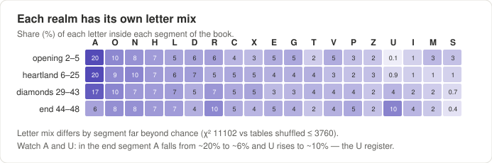

- **Each realm has its own letter mix** — far beyond chance (χ² ≈ 11,100 vs ≤ 3,800 when tables
  are shuffled between segments). The opening favours S and M; the diagonal squares 26–28 T and X;
  the diamonds R and U.

### The U register `[a16]`

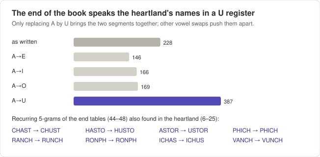

- **The end of the book (44–48) speaks the heartland's names with A turned into U.** Its recurring
  5-grams overlap the heartland's 228 times as written, **387 times after A→U** — and every other
  vowel swap lowers the overlap (A→E 146, A→I 166, A→O 169). CHAST→CHUST, HASTO→HUSTO,
  RANCH→RUNCH, RAPHA→RUPHU, APHAR→UPHUR. In the end segment A falls to 6% and U rises to 10%.
- This revives, in a sharper form, an earlier A↔U idea that failed when tested across the wrong
  grouping of tables. Caveat: with a single transcription we cannot rule out a scribal habit in
  those leaves rather than a deliberate register.

### The kingdom: plan, houses, sides `[a17]`

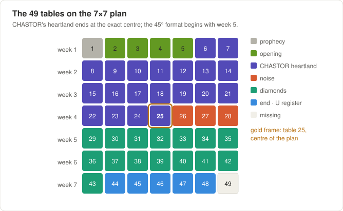

- **On the 7×7 plan of the 49 tables**, table 25 is the exact centre (week 4, position 4), and the
  writing turns from rows to diagonals **between its two sides** (25a | 25b); the diamond format
  begins with **week 5** (table 29); the U-register end starts at 44. Descriptive: these positions
  were noticed after seeing the data and cannot carry a p-value.

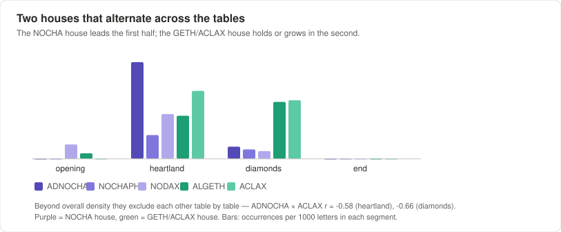

- **Two houses exclude each other table by table.** With overall name density removed, the NOCHA
  house (ADNOCHA, NOCHAPH, NODAX) and the GETH/ACLAX house (ALGETH, ACLAX) are anti-correlated,
  and it holds **inside** each realm, so it is not just "they live in different places":
  ADNOCHA × ACLAX r = −0.58 in the heartland (p = 0.004) and −0.66 in the diamonds (p = 0.007);
  NODAX × ALGETH −0.60 in the heartland (p = 0.001); NOCHAPH × ACLAX −0.73 in the diamonds
  (p = 0.002). The NOCHA house leads the first half; the GETH/ACLAX house holds or grows in the second.
- **Sides and heights:** against an exact baseline (a k-letter name can only start in the first
  49−k columns), **no great name prefers the left or the right**. **ALGETH sits in the lower half**
  of the full grids (29% in the upper half vs 49% expected, z = −3.1, passes correction for 14
  tests); GETH leans low and the NOCHA family leans high without passing it.
- **No mirror symmetry** ("as above, so below" taken literally): a diamond row is *less* like its
  mirror row than like a random row of the same length (0.029 vs 0.047), and in the full grids a
  row matches its mirror no more than any other row of the same table (0.071 vs 0.073).

### Machine or language? The Book of Soyga as a yardstick `[a19]`

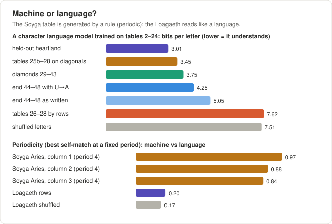

- Dee also owned *Aldaraia sive Soyga*, whose letter tables are **generated by an algorithm** (Jim
  Reeds). Its Aries table's columns are periodic (best self-match 0.97, 0.88, 0.84 at period 4).
  The Loagaeth is not (0.20, barely above shuffled 0.17). (Soyga columns were extracted locally from
  J. Kupin's 2014 edition for comparison only; they are not redistributed.)
- **No 2-D generation rule:** the letter above adds nothing to predicting a cell (H 3.95 → 3.94 bits);
  the letter to the left does (3.09). It is a 1-D language written line by line.
- **A language model reads it like a language.** Trained on tables 2–24 (4-fold held-out:
  3.01 bits/letter), it reads the diagonal-decoded tables at 3.44, the same tables by rows at 7.62
  (≈ shuffled 7.51), the end at 5.05 — and **4.25 once U is turned back into A**, an independent,
  machine-learning confirmation of the U register.
- **A machine can write Loagaeth-like text:** an order-5 model trained on the heartland produces
  lines such as `ARCHINADOXT·ANZACH·ADATHNOLZANTAGEM…` with the right doubled-letter rate. Simple
  local rules are enough to produce the surface of the language — consistent with a constructed or
  inspired tongue, not with a cipher.

### Is the end "denser"? Letter energy by realm `[a20]`

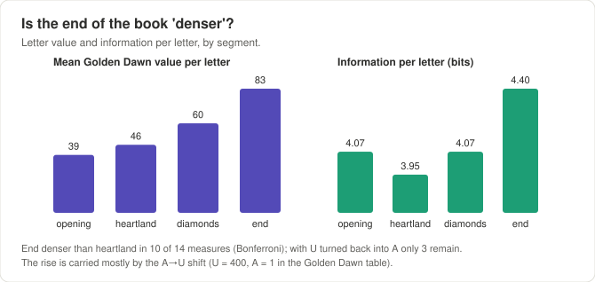

- Treating each letter's gematria value (13 systems) or its information content (surprisal) as an
  "energy", the end segment is **denser than the heartland in 10 of 14 measures** after correction.
  In the Golden Dawn table the mean value rises steadily: opening 38.8 → heartland 45.6 → diamonds
  60.0 → end 83.2.
- **But the rise is carried by the A→U shift** (U = 400, A = 1 in that table): with U turned back
  into A it vanishes in all but 3 measures. What survives is information: the end uses rarer letters
  (+0.17 bit per letter even without the U shift, p < 0.001). Gematria tables are later conventions;
  read this as a property of the letter mix, not as proof of power.

### Fibonacci, gradual division, Golden-Dawn rearrangement — all negative `[a20]`

- **Fibonacci:** gaps between successive CHASTORs are Fibonacci numbers 1.0% of the time vs 1.5% at
  random; CHASTOR starts on Fibonacci columns 17.7% vs 18.6% expected; segment borders are neither
  Fibonacci numbers nor at the golden section (30.3 of 49).
- **Gradual division:** 7×7 sub-blocks differ beyond chance only through the row-edge effect; the
  central row (the Watchtowers' "Great Cross" position) is not special (names 0.264 vs 0.280).
- **Golden Dawn style:** cutting each row-written table into four quadrants around the central
  cross and trying all 24 arrangements, **the original order wins in 35 of 35 tables** — the
  quadrants are not misplaced.
- **Pyramid arithmetic** (true by construction): each odd diamond is two stepped pyramids,
  1+3+…+49 = 625 = 25² above and 576 = 24² below (1201 = 25² + 24²); the even diamond holds
  2·24·25 = 1200.

### Peterson's Index Verborum, and a gold standard for dense text `[a21]`

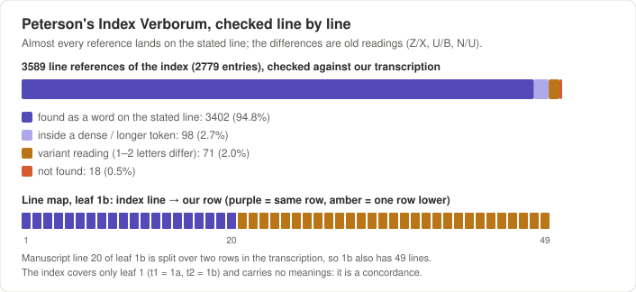

Joseph Peterson's *Index Verborum of the "Angelic Language" from Liber Logaeth* (1986, Esoteric
Archives `angelix.htm`) lists 2,779 word forms as `word t<side> line[*count]`. Checked against our
transcription:

- **It covers leaf 1 only.** `t1` = leaf 1a, `t2` = leaf 1b (98% / 96% of their words are found
  there, ≤ 11% on any other leaf). There is no `t3`. It is a **concordance, not a dictionary** — it
  carries no meanings, so it cannot unseal CHASTOR or any other name.
- **97.5% of its 3,589 references land on the stated line.** 2.0% are variant readings that differ
  by one or two letters — the classic confusions of Dee's hand (Z/X, U/B, N/U, R/X); 0.5% are not
  found.
- **The line map exposed a split line.** In leaf 1b, the index's line 20 is our rows 20 + 21 and
  every later line sits one row lower: the transcription breaks manuscript line 20 in two. Leaf 1b
  therefore has 49 lines, like 1a and like every table.
- **Only 164 of our 3,672 leaf-1 tokens are not indexed as such**, mostly one- to three-letter
  particles (A, NA, GEM, AX…).

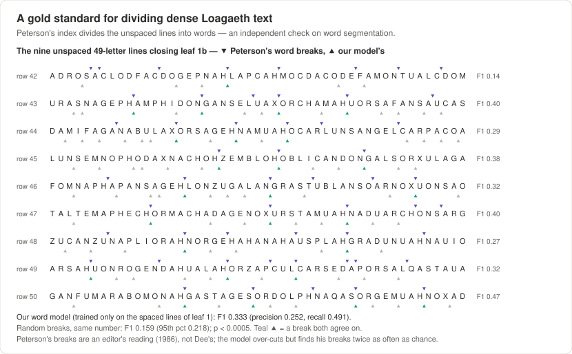

**Completing what was missing.** Leaf 1b ends with nine lines of 49 letters written without spaces.
The index still divides them into words — an editor's reading, but one our methods never saw. That
makes it a **gold standard for segmenting dense Loagaeth text**. A simple word model trained only on
the spaced lines of leaf 1 recovers Peterson's breaks with F1 **0.33**, against **0.16** for the same
number of random breaks (95th percentile 0.22, p < 0.0005). The model over-cuts (precision 0.25,
recall 0.49): the dense lines are made of longer words than the spaced ones. **REAL** — the dense
text carries word structure that agrees with an independent reader.

**Letter counts and the Heptarchy (7 kings, 7 princes, 42 ministers, 49 good angels).** Of the 21
letter counts, 3 are divisible by 7 (3.6 expected), 1 by 42 (0.6), 1 by 49 (0.5) — chance. The
total, 177,226, is a multiple of 7, which mostly follows from the book being built of 49 × 49
squares (2,401 = 7⁴ letters per table). The clear contrast is **B**: it opens every one of the 49
Heptarchic names (16% of their letters) but is 1.2% of the Loagaeth. **REFUTED** as numerology.

**The top letters as a string (AONHLDRC…).** Frequency order is a property of the count, not a text.
As contiguous strings: AON 66× (97 expected from letter pairs), AONH 1×, ONHL 1×, nothing of length
5+; DRC is strongly avoided (1 vs 56). No Watchtower name, Call word or index word contains AON.
**REFUTED.**

**Gematria of the counts.** The true counts are A 33,441, O 16,361, N 15,892, H 12,099 (digit roots
6, 8, 7, 3). The "6 and 5" in a pasted calculation came from mistyped numbers with an extra digit
(334,441, 166,361, 158,892). The Golden Dawn values of all 21 letters sum to **1,486** (the pasted
1,446 gave Q = 50 instead of 90), and that sum is the same in every order, so it says nothing about
frequency. "A = 6, B = 5" is real — it is Crowley's column (and two GD-derived columns) in our
bundled tables. Digit roots of large counts fall on each of 1–9 about 1/9 of the time.

### Tables 25b–28b re-decoded: where rows end and diagonals begin `[a37]`

Module a18 read each chessboard colour of these faces along one diagonal. Two of the fourteen
colours still read badly (26a and 27a, 5.0 and 5.5 bits per letter against ≈ 2.5–3 for the others).
Letting the letter model choose, for each colour, a block of top rows written **by rows** and zones
for the rest:

| Face, colour | before | now | layout found |
|---|---|---|---|
| 27a, first colour | 5.52 | **2.74** | rows 1–28 written by rows (on that colour), then ↘ diagonals |
| 26a, first colour | 5.01 | **2.92** | rows 1–8 by rows; upper-right triangle and the band ↘; lower-left triangle by rows; a corner of 90 letters (band, columns 1–12) still unclear |
| 25b, second colour | 3.72 | **3.18** | rows 1–5 by rows, then ↖ diagonals |
| the other 11 colours | 2.4–3.6 | same | one diagonal direction, as in a18 |

- **About 1,500 letters that were noise are now text**: `ANTOXADNACLANZIDUOCHATHA`,
  `ALZIDUACHOTHALZIDUATHALZA`, `NOZACLOXADNATOXELGRADAXO`, `PANTAXALODNADONTAXALGRAAX`… The seven
  faces read at 2.86 bits per letter overall (3.25 before); master names found rise from 349 to 384.
- **Checks.** The ten colours that already read well are given no row block by the same search (0 of
  10). And the search finds **5 rows** on 25b knowing nothing of Peterson's note that this leaf has a
  third series in its first five rows.
- **What it means.** The turn from rows to diagonals at the middle of the book is not a clean cut:
  on 25b, 26a and 27a the scribe still starts one colour by rows and goes over to the diagonals part
  way down the page — 5 rows, then 8, then 28 — before the pure two-current pages 27b–28b.
  **REAL (new; corrects a18 for 26a and 27a).** Later modules now use this reading.

In the 3D viewer (Square view, "Show the two currents") the row-written blocks are tinted green, the
diagonal zones keep their arrows, and the unclear corner of 26a is dimmed.

| 27a: rows 1–28 by rows, then diagonals | 26a: five zones |
|---|---|
| 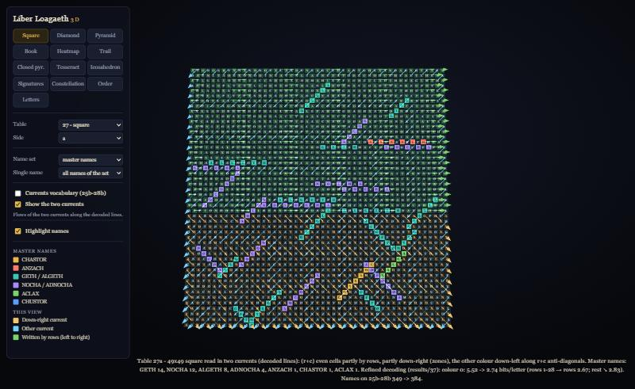 | 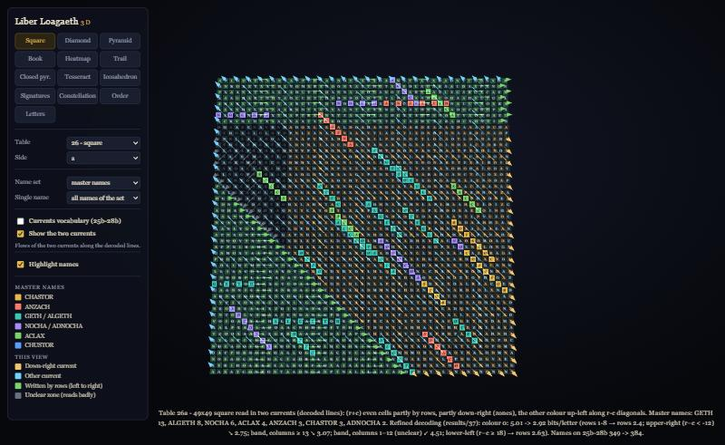 |

### Three leads from the literature, tested `[a38]`

- **Laycock's "every k-th letter":** taking every 2nd … 12th letter of the tables gives text that the
  Calls' model reads no better than shuffled letters (6.3–6.8 vs 6.46 bits; the plain text 5.40).
  **REFUTED.**
- **Leaf 43a's note that tables 43–48 are a pattern "to be filled":** their sides are not copies of
  one another (same-cell identity 6.9%, vs 8.2% among diamonds 29–42) and repeat *less* inside
  (2.4% of 6-letter strings recur, vs 5.6%). In the transcription they are full, distinct text.
  **REFUTED (as replication).**
- **Heptarchy — a rule in the six numbered 7×7 tables?** No affine placement (5–7 cells of 49, as in
  shuffles), no drift of numbers down the rows that survives six tests (best p 0.012). The layouts
  behave as free scrambles; T5 and T7 carry the known damaged cells (duplicates 3, 7, 15, 18 / 17;
  missing 17, 28, 32, 35 / 27). **REFUTED.**

### The names, as a catalogue to consult

`viz/names_catalog.html` (built by `src/make_catalog.py`) lists the 67
recurring names — the master names, the 49 discovered by a23, the ones found under them by a28 —
one row each, counted along the whole side (a name cut by the end of a line is counted too),
under a shared band that is the whole book from table 2 to 48: the mark on each of
the 94 sides is as strong as the name is frequent there. Rows are grouped by family and coloured by
house. Opening a name shows its letters with Dee's letter names (and, labelled as such, the
practitioner's sense of each letter), the sides where it is heaviest, its count by part of the
book, its longer forms and one-letter variants, the letters that touch it, and passages.

Serve the repository (`python -m http.server 8860`) and open
`http://127.0.0.1:8860/viz/names_catalog.html`; the file also opens directly from disk.

### Long repeats, formulas and controlled variation `[a39, a40]`

A reader of this study pointed out that strings longer than ten letters repeat in the book, and asked
why we assume there are no sentences. Both points tested.

- **Long repeats are real.** Distinct strings that occur twice or more inside a line, against a
  Markov-3 surrogate: 12 letters, 549 vs 116; 14 letters, 94 vs 11; 16 letters, 5 vs 1. The longest:
  ADNACHEPHALZEDNOC (17, twice on 19b), ADNOCHANTANTOXAL (19a, 22a), ACHEDNOCHALZINTO (21b, 23b),
  CHASTORANTANTOXA (21b, 24b). One repeat of 16 letters is expected by chance in a text this
  repetitive; the count at 12–14 letters is the evidence. **REAL.**
- **How long is the memory?** Half the sides against the other half: 259 strings of 12 letters are
  shared. A letter model trained on the first half only produces 120 with three letters of context
  and 521 with five. The book needs more than three and no more than five: formulas of about six
  letters, chained. No longer unit is needed. **BOUNDED.**
- **No syntax between names.** Of 693 successive names inside lines, the next is not tied to the
  previous one (1.007 bits vs 1.051 when names are shuffled inside each side, p 0.86). Sentences
  are **not shown** — which is not the same as shown absent.
- **One compound, not two `[a42]`.** A first test (names shuffled inside each side) gave two
  fixed-order compounds, OXAD+NOCHA and GETH+ACLAX. The shuffle was misled: OXAD+NOCHA is also
  OX+ADNOCHA, two names that overlap. Searching the strings themselves in Markov-3 surrogates:
  OXADNOCHA 23 vs 16.4 (p 0.07) — **REFUTED, a correction of our own result**; GETHACLAX 17 vs 3.8
  and GETHACLAXTO 6 vs 0.25 (p < 10⁻⁶, never reversed) — **REAL.** GETH is followed by ACLAX, the
  two names of the same house.
- **Repeats are neighbours `[a42]`.** 387 pairs of sides share a string of 12 letters. Half fall
  inside one part of the book (20% if sides are relabelled at random), and inside a part they are
  closer than chance (7.2 tables apart vs 8.1; within one table 14.7% vs 11.1%, p 0.001). The two
  sides of one leaf are not favoured (p 0.19). Closest sisters: 20a–22a, 21b–24b, 21b–25a (4–6
  times what their sizes predict). **REAL (local reuse).**
- **Almost no memory inside a side `[a43]`.** A letter model given a cache of what it has just read
  on the same side barely improves (2.920 → 2.906 bits per letter), and the gain is the same with
  the lines of the side shuffled: what a side reuses is its own vocabulary, not what was written
  just before. Long strings (8 letters) are echoed no more one line below than thirty lines below.
- **A faint echo over four lines `[a43]`.** Short strings (5 letters) recur 1–4 lines below 9% more
  often than with the lines shuffled (16.3 vs 15.0 per thousand, z 5.4), and no more at 5–16 lines
  (z 1.0); the echo leans to the same columns (17.5% within three columns vs 16.0%, p 0.02). The
  window of four lines was chosen after looking at the profile, so the size is honest and the p is
  generous. **REAL but weak.**
- **Across sides the likeness fades slowly `[a43]`.** Neighbouring sides share 15.6 per thousand of
  their 8-letter strings, sides twenty apart 9.3, sides in random order 7.4 (p ≤ 0.015 at every
  distance). The memory of the book lives at the scale of leaves, not of lines. **REAL.**
- **No drift of spelling `[a42]`.** In the 170 one-letter variants between different sides, no letter
  belongs to the earlier side and its partner to the later (A then O 18, O then A 12; best of 8
  tests p 0.125). **NOT SHOWN.**
- **Not copied in place.** The two occurrences of a long repeat start in unrelated columns (within
  two columns in 10% of cases; 14% in shuffles).
- **Controlled variation.** 179 passages of 14 letters recur with exactly one letter changed
  (surrogates: 21–30). The changes are few and recurrent: A/O 31 (ADNOCHA / ADNACHA), A/E 10, A/I 8,
  E/O 8, H/L 7 (NOCHANT / NOCLANT), P/T 7 (CHAPHAL / CHATHAL), L/R 7, L/N 7, M/N 6, G/Z 5, S/Z 4.
  **REAL.**
- **It is not the copyist.** The confusions measured on the Soyga tables (Z/X, N/U, I/Y, I/L, C/E)
  account for 2 of the 179 changes. The variation belongs to the text.
- **Do the changes follow sounds? `[a41]`** Checked with classes fixed beforehand (manner: stops,
  fricatives, nasals, liquids; place: lips, tongue tip, back). Consonant changes stay inside a manner
  class 41% of the time against 21% by letter frequency — but Markov-3 surrogates, which share only
  the letter contexts, give 36% (p 0.18). On 3,457 fresh changes in 10-letter passages: 38.5% vs
  35.5%. The surrogates even produce the same commonest pairs (L/N, L/R, H/L). So the likeness is
  what the positional grammar already gives: letters that fill the same slot are alike. As a rule
  of its own, **REFUTED.**
- **What survives:** consonants that can replace one another share *manner* of articulation more
  than letter frequency allows, and not *place* (place: 35% vs 36%). The same holds in Dee's own
  spaced words of leaf 1 (1,932 pairs differing in one consonant: manner 25.7% vs 20.9%, p < 0.001;
  place 36.4% vs 35.7%, p 0.28). The slots of the language sort consonants the way a pronounceable
  language does. **REAL (property of the grammar).**

### Can our tests see sentences at all? A positive control `[a44]`

"No sign of sentences" is worth something only if the same tests find sentences where they exist.
So the opening 108,000 letters of the King James Bible were treated exactly as the tables reach us
(letters only, no spaces, lines of 49, sides of 49 lines) and run blind through three tests, with
texts that have no syntax as negative controls.

| text | next unit tied to the previous (z) | bits lost when lines are shuffled | echo 1–4 lines below (z) |
|---|---|---|---|
| Bible, English | 15.7 | 0.0250 (z 10.0) | +68% (z 37.8) |
| Bible, words shuffled inside each side | −2.6 | 0.0005 (z 0.5) | +2% (z 0.9) |
| Markov-3 surrogate of the Bible | −0.5 | 0.0011 (z 2.5) | −2% (z −1.1) |
| Markov-3 surrogate of the tables | 0.4 | −0.0008 (z −1.3) | +3% (z 1.2) |
| **Tables 2–24** | **1.9** | **0.0023 (z 4.5)** | **+8% (z 5.3)** |

- **The tests work.** English prose is seen by all three, at the size of the tables; the texts
  without syntax are seen by none.
- **The tables are not prose of that kind.** Units three or more letters apart are not tied to one
  another (z 1.9, against 15.7); the order of lines carries about a tenth of what it carries in
  English; the echo over four lines is about an eighth. **REAL: sentences like those of a natural
  language, running along the rows, would have been detected.**
- **What the tables do have** is the small order-of-lines signal (z 4.5) and the faint echo (z 5.3):
  real, absent from every control without syntax, and far below prose.
- **Units that touch** score everywhere, surrogates included (tables z 20.8, surrogate 13.5): pieces
  of one word. That is the six-letter formula again, not syntax.
- **The Calls are too short to judge** (4,700 letters): at that size the test misses the syntax of
  the Bible itself. Nothing can be said from them with these tools.

### What decides which variant is written `[a45]`

129 frames (three letters, a slot, three letters) take two or more fillers; 3,420 occurrences in
tables 2–24. ADN_CHA takes O 158 times and A 62; ACH_DNO takes A 44, E 23, I 11.

- The choice depends on the **part of the book** (z 8.5) and, inside a part, on the **table**
  (z 3.7): the dialect of the leaf.
- It depends weakly on the **nearest vowel before the frame**, four to nine letters back (z 3.1,
  p 0.007; after the frame z 2.1): the formula reaches a little further than its frame.
- It does **not** depend on the side a/b (p 0.88), the row (p 0.77), the column (p 0.77), or on
  which filler was written the previous time on that side (z 0.3).
- So the variant is not a signal laid over the page. **REFUTED as a positional channel.**

### A false book: what the rules explain and what they leave `[a46]`

Three machines rewrite tables 2–24: G3 (three letters of context), G5 (five), and G5L (five, one
model per side trained on the side and its three neighbours each way).

| measurement | book | G3 | G5 | G5L |
|---|---|---|---|---|
| repeated strings of 12 letters | 365 | 127 | 370 | 378 |
| repeated strings of 14 letters | 70 | 14 | 55 | 53 |
| one-letter variants of 14-letter passages | 110 | 30 | 85 | 74 |
| the 12 master names | 1861 | 1672 | 1853 | 1866 |
| CHASTOR | 122 | 89 | 126 | 123 |
| GETHACLAX | 10 | 2.7 | 5.7 | 9 |
| shared with the next side (per 1000) | 22.0 | 9.6 | 15.5 | 29.9 |
| shared 20 sides away (per 1000) | 9.6 | 9.6 | 15.7 | 8.9 |
| echo 1–4 lines / shuffled | 1.08 | 1.01 | 1.01 | 0.98 |

- **A six-letter machine with the vocabulary of the leaf writes this book.** G5L gives the names,
  the long repeats, the compound and the fading likeness of neighbouring sides, with no rule about
  names, words or sentences in it. **REAL (sufficiency).**
- **The residue**, what no machine gives: the faint echo over four lines; more one-letter variants
  of long passages (110 against 74–85) and more repeats of 14 letters (70 against 53–55). Three
  runs per machine; the gaps are steady but not large. Templates with a free slot were the natural
  suspect; mined below, they turn out to be explained too.

### Templates, and the limit of five letters `[a47]`

- **Templates with one free slot** (a passage written at least four times with two or more fillers:
  AHN_CHASTOR takes O 10 times and E 5; DNO_HANZACH takes C 7 and T 2; DNOC_ANTANT takes L 5 and
  H 3). Of 9 letters: 566 in the book, 582 in the false books of G5L (up to 637). Of 11 letters: 59
  against 52 (up to 70). Of 13: 5 against 1 (up to 2). The machine makes them as well; only the
  handful of the longest is beyond it. **Explained — not a residue.**
- **Is there anything beyond five letters?** The direct test: knowing the five letters before, does
  the letter 6, 7, 8, 10 or 14 places back still help to tell the next one? (Next letters permuted
  inside each context and side, so neither the letter model nor the leaf's vocabulary counts.)

  | letters back | tables 2–24 (z) | false book G5L (z) | Bible cut like the tables (z) |
  |---|---|---|---|
  | 6 | 1.3 | 0.3 | 16.6 |
  | 7 | 1.3 | −0.4 | 17.5 |
  | 8 | −0.8 | −0.2 | 21.6 |
  | 10 | 0.4 | 0.7 | 13.0 |
  | 14 | 0.7 | 1.0 | 7.3 |

  In English the past beyond five letters speaks loudly at every distance. In the tables it is
  silent, exactly as in a book written by the machine. **REAL: inside a side, the row-written
  tables carry no detectable memory beyond five letters of context.** Whatever the book encodes
  along its rows, it is not carried by word order or by anything a longer window could catch.

### The limit of five letters in the other formats `[a48]`

The same test on the chessboard leaves (25b–28b) and the diamonds (29–40, 41–48), each read along
its own road. For each group the Bible is cut into lines of exactly the same lengths, so the
positive control has the same size and shape.

| group | letters | letter 6 / 7 / 8 / 10 back (z) | Bible, same shape (z) |
|---|---|---|---|
| tables 2–24 (rows) | 110,029 | 1.3 / 1.5 / −0.9 / 0.3 | 17.7 / 20.6 / 16.7 / 12.4 |
| leaves 25b–28b (chessboard) | 16,806 | −0.8 / 0.3 / 1.1 / −0.4 | 7.8 / 8.2 / 9.0 / 5.5 |
| diamonds 29–40 | 28,787 | −0.2 / −0.6 / −0.8 / 0.3 | 9.6 / 10.2 / 7.6 / 4.7 |
| diamonds 41–48 (U register) | 19,203 | 0.8 / −1.2 / −1.1 / −0.4 | 8.9 / 7.8 / 8.0 / 2.6 |

- **No format carries memory beyond five letters** along its road, where English of the same size
  and shape shows it every time. In the diamonds the book offers few repeated contexts to test (236
  and 46 occurrences), so the statement there is weaker than for rows and chessboard. **REAL.**
- **A trap, found and removed.** On a diagonal layout neighbouring lines have similar lengths;
  shuffling the lines pairs long with short and lowers the shuffled count by itself. A text with
  no memory at all then shows an "echo" of 1.4. The echo is therefore compared with surrogates of
  the same shape.
- **The echo over four lines, corrected:** rows 1.085 against 1.01 (z 7.0); chessboard leaves 1.73
  against 1.41 (z 3.9); diamonds 29–40 1.41 against 1.33 (z 1.1); diamonds 41–48 1.65 against 1.44
  (z 1.4). The echo is real in the rows and in the chessboard leaves, and **not shown in the
  diamonds**.
- **Order of lines:** chessboard leaves lose 0.0085 bits per letter when their lines are shuffled
  (z 2.3); the diamonds lose nothing — but at that shape the test barely sees the Bible either
  (z 1.1–1.6), so for the diamonds it decides nothing.

### Tests taken from the diaries `[a54]`

- **Leaf 1 is a table of words.** The diary says each of its 49 × 49 squares holds a word. In the
  transcription 25 of the first 30 rows of side 1 have exactly 49 words (the others 47, 48, 50, 54).
  **CONFIRMED.**
- **Leaf 1 is not a key to the other leaves, square for square.** For each of the 42 sides with a
  full grid: does the letter in a cell agree with the first letter, the last letter, any letter or
  the length of the word in the same square of leaf 1, counting squares as transcribed or from the
  right hand? 336 tests against leaf 1 with its rows shuffled: mean z −0.1, one above 3 (chance
  gives 0.5). **REFUTED.**
- **The nine rows of single letters that close leaf 1** read, under the tables' letter model, at
  3.84 bits per letter: between the tables (2.80) and the word rows of leaf 1 with their spaces
  removed (4.79); shuffled letters 6.76. They already hold names of the tables (NACHO, OXAD). They
  are the passage from the language of words to the language of the tables. **DESCRIPTIVE.**
- **The eighteenth leaf**, "of the spirites of the earth" — the only leaf whose content the record
  states — is not set apart from tables 13–24 in letters (sides rank 14th and 23rd of 24 by distance
  from the average) or in how the others read it. NECHASTOR is written 5 times where 1.3 is the
  share of a leaf, too few to count. **NOT SHOWN.**

### The points between words: a gold standard that was in the source `[a51]`

In the first tables the manuscript divides words with a point, and Peterson's transcription keeps
the points and the accents (`a b í m a c h a.v o r t.n a l v m. …`). Our loader kept letters only, so
every module before this one read those tables as unbroken rows. A reader of this study pointed
this out. The points cover 2a, 2b, 3a, 3b in full and parts of 4a, 4b, 5a: 232 rows, 1,425 words.
(The diaries explain why they stop: on 20 June 1583 the words of the book were still "to be
distinguished" and accented; the work was evidently not carried past the fifth leaf.)

- **Two errors of ours, corrected.** HZEMBL and DAHOXI, listed earlier as "local names", are not
  words: DAHOXI is `dah.oxi…` across a point, and HZEMBL is the end of one word of leaf 1 and the
  start of the next (*nethoth zembloh*, *zúnasch zemblagen*; the word is ZEMBL-). Both came from
  reading across word boundaries. **Withdrawn.**
- **Almost every word is written once.** Of 1,425 words, 1,383 are different and 95.2% occur a
  single time. Leaf 1 (Dee's spaced words) 67.5%, the Calls 56.9%, the Bible at the same length
  8.8%. The words are long (mean 8.0 letters; six to ten is the bulk). **REAL — and the plainest
  sign so far that the tables are not sentences of a vocabulary: a text that never repeats a word
  has no lexicon to build sentences from.**
- **The names are pieces of words.** 57 occurrences of catalogue names fall in the pointed rows:
  3 are a whole word, 13 begin one, 11 end one, 20 lie inside one, 10 are cut by a point (24.6
  expected if placed at random, z −4.2). They respect the word boundaries, but they are roots and
  endings inside longer unique words, not words standing alone.
- **Rows end where words end.** The last word of a row has 7.4 letters and the first 8.9, like the
  words inside rows (7.9); rows cutting words blindly would leave pieces of 5.1. So in these tables
  each row holds whole words; the running-on found by a49 (the start of a row fits the end of the
  row above) is the fit of one word to the next, not a word broken in two. The 32 names "split
  between rows" of a49 lie in later tables, which have no points to check them against.
- **Our word-cutters, scored at last against the manuscript:** the word model trained on leaf 1
  finds half of the points with one cut in four right (F1 0.335); letter-surprise peaks F1 0.223;
  random cuts 0.114. Better than chance, far from good: segmentations proposed in this study
  beyond the pointed tables are guesses of that quality.
- **Accents.** 59% of the words carry a stress mark (59 carry two). It falls on the next-to-last
  vowel 391 times, earlier 443 times, on the last vowel 64 times: the stress avoids the end of the
  word. For reading aloud, the points and accents of each row are in
  `data/loagaeth_word_points.json`.

### Where the formulas come from: two imprints `[a52]`

- **A language behind them?** Letter models of English (King James Bible) and Latin (Caesar) read
  the tables at 5.57 and 6.32 bits per letter; leaf 1 at 5.58 and 6.19; the Calls at 5.83 and 6.30.
  All three lean to English, by 0.5–0.75 bits. But the lean is small beside the distance: Latin
  itself is read by the English model at 4.98, and English by its own at 2.93. The commonest pairs
  of the tables (CH, HA, AN, AD, AX, NO) are their own; the pairs that mark English (TH, SH, EA…)
  are as rare in them as in Latin. **A sound-pattern of its own, with a mild English lean.**
- **The hand.** Each figure is observed / expected from the text's own letter frequencies:

  | | letter follows itself | returns after one other (ABA) | vowel/consonant alternation | three consonants | two vowels |
  |---|---|---|---|---|---|
  | Soyga tables (made by a rule) | 0.90 | 1.08 | 1.02 | 0.98 | 0.93 |
  | English | 0.44 | 0.74 | 1.28 | 0.46 | 0.62 |
  | Latin | 0.39 | 0.93 | 1.46 | 0.13 | 0.46 |
  | the Calls | 0.37 | 1.08 | 1.33 | 0.40 | 0.53 |
  | leaf 1 | 0.15 | 0.73 | 1.41 | 0.34 | 0.36 |
  | **tables 2–24** | **0.07** | **0.57** | **1.50** | **0.14** | **0.24** |

  The rule-made tables sit at 1 on every measure, as they should. Languages avoid doubles and
  clusters somewhat. The Calls behave like a language. The tables go further than any language on
  every column: almost no letter after itself, fewer returns, the strictest alternation of vowel
  and consonant, hardly a pair of vowels. Leaf 1 lies between. **REAL: the tables are the most
  regular, most "pronounceable-by-rule" text of the six — more regular than speech.**

### A second transcription on line `[a53]`

kondor.de publishes the 96 sides. Of the rows our parser could align (846, in rows of equal length
23,712 letters) one letter differs. There is no n/u or z/x difference, where an independent reading
of this hand would show hundreds (a36); the word points are on the same seven sides; the 13
irregular rows of tables 2–24 have the same lengths. **It is a copy of Peterson's text, not an
independent witness.** An independent reading (Klein's, unpublished; a critical edition is
announced) remains the one thing that can separate the text from its transcriber.

### The text runs on from row to row `[a49]`

Until here each row was treated as a unit. A letter model reads the first three letters of a row
given the last three of another row of the same side (tables 2–24, 2,208 junctions):

| the three letters are read after… | bits | rows paired at random | z |
|---|---|---|---|
| the row above them (ordinary reading, downwards) | 12.47 | 13.91 | 15.9 |
| the row below them (reading upwards) | 13.83 | 13.92 | 1.0 |
| the row above, the new row read backwards (boustrophedon) | 17.84 | 18.01 | 1.4 |
| the same row on the other side of the leaf | 13.74 | 13.88 | 1.1 |
| (for scale: three letters in the middle of a row) | 7.05 | | |

- **The end of a row tells the start of the next one below**, on almost every side taken alone (44
  of 46 sides, gain 0.5–2.8 bits). Not upwards, not backwards, not across the leaf, and not from
  the last row of a side to the first row of the next (z −0.8). **REAL: the rows of a side are one
  stream, written downwards; each side starts afresh.**
- **The rule against doubled letters crosses the break.** Inside rows a letter follows itself 643
  times where letter frequency predicts 9,250 (93% suppressed). Across the line break: 85 times
  where the same rows in random order give 161 (47% suppressed, z −7.0). Whoever began a row knew
  the letter the row before had ended on.
- **Names straddle the break:** 32 names of the catalogue are split between two rows, against 16.7
  for rows in random order (z 3.0). 13b, rows 45–46: …AHNOCHAS / TORADCLA… (NOCHASTORA); 7a, rows
  39–40: …RGEDACHA / STORLABA… (CHASTOR); 12b, rows 48–49: …HACHANZA / CHANTALZ… (ANZACH).
- **But the break is not invisible.** The junction costs 12.5 bits against 7.1 inside a row: most
  rows still end where a unit ends (rows end in A, O, H; begin in A, V, N, C, P). The stream runs
  on, and the row end is a strong place to pause. This is the small order-of-lines signal of a44
  (z 4.5), now located: it sits at the junctions.
- **The diamonds run on too.** Their diagonals, in the order found by a15, form a stream: start of
  a diagonal given the end of the one before, 13.86 bits against 15.26 at random (z 10.6) in
  diamonds 29–40, and 13.64 against 14.56 (z 6.2) in 41–48; nothing in the opposite order. This
  confirms the order of the diagonals as well as their direction.
- **The chessboard leaves are not settled.** On 25b–28b the stored order of the diagonals shows a
  weak signal both ways (z 2.4 forwards, 3.7 backwards), and colour by colour it changes side: some
  colours run forwards (25b first colour z 3.0; 27b second colour z 3.9), some backwards (25b
  second colour, 26b, 27a second colour, 27b first colour: z 1.9–2.6), some show nothing. The order
  in which the diagonals of each colour follow one another is an open piece of the decoding.
- **Reading for use:** a name cut by the end of a row continues at the start of the row below. The
  catalogue (`viz/names_catalog.html`) counts names along the whole side on the row-written tables
  and the diamonds, and shows the cut with a slash: 51 occurrences of its 67 names are split between
  two lines. The counts of the earlier modules of this study were made line by line and miss them.

### Leaves 25b–28b: the order of the diagonals `[a50]`

a37 fixed the road of each line on these leaves; the junction test of a49 can now say in which
order the lines of a colour follow one another. For each colour, the lines are read in the stored
order and in the opposite one, and the end of each line is asked to predict the start of the next.

- **Two colours settle alone:** 25b first colour and 27b second colour, both read ↘, run in the
  stored order — from the top-right corner towards the bottom-left (z 3.2 and 3.5; opposite order
  −0.5 and −0.4). Checked with two signs the choice did not use: the same letter on both sides of a
  junction once in 85 where random order gives 6.2 (z −2.5), and four catalogue names split between
  two diagonals where random order gives 0.3 (z 6.6). The rejected order shows neither. **REAL.**
- **Pooled by road** (one colour alone has about 43 junctions): the ↘ colours run in the stored
  order (6 blocks, z 3.0 — carried by the two above; the other four show nothing by themselves);
  the ↖ colours run in the **opposite** order (5 blocks, z 3.2; stored order −0.2); the ↙ colours
  also in the opposite order (2 blocks, z 3.0).
- **Check on the blocks that did not settle alone** (451 junctions): read by that rule, the same
  letter meets itself across a junction 21 times where random order gives 36 (z −2.9); with the
  rule reversed, 33 (z −0.6). Split names add nothing there (3 against 3.3). **PROBABLE.**
- **What it means on the page.** A ↖ colour whose diagonals follow one another from the bottom-left
  corner to the top-right is exactly a ↘ stream on a page turned half round. On 25b, 27b, 28a and
  28b one colour is ↘ and the other ↖: one current is read with the leaf as it lies, the other
  with the leaf turned upside down. (a49 found a faint half-turn likeness between the two sides of
  a leaf; the two observations are independent and point the same way, and neither is strong.)
- **Seen on the page.** The images of Sloane 3189 show it directly: on ff.33v–36v every square is
  filled, one series tilted about 45° and the series on the alternate squares turned half round
  from it, so that the leaf is turned to read each. What the junctions made probable is how the
  leaves are written. **CONFIRMED on the manuscript** (orientation; the order of the lines within a
  series still rests on the statistics above).
- **Unsettled:** the row blocks (26a rows 1–8, 27a rows 1–28), the zones of 26a's first colour, and
  the ↘ colours of 26b, 27a, 28a, 28b taken alone. `data/loagaeth_chessboard_streams.json` holds
  each block in the order found, with its status; the rest of the study still reads these leaves
  line by line.

### The two sides of a leaf `[a49]`

Side b against side a, cell by cell, on the 13 leaves with two full 49 × 49 grids (tables 2–24),
against side a paired with side b of other leaves.

| side b is… | equal letters, true pairs | other pairs | p |
|---|---|---|---|
| in the same cell | 8.89% | 8.74% | 0.25 |
| mirrored left–right (what shows through the paper) | 8.58% | 8.39% | 0.15 |
| upside down | 8.96% | 8.75% | 0.15 |
| half-turned | 8.94% | 8.40% | 0.002 |
| transposed | 8.50% | 8.48% | 0.45 |

- **No copying, mirroring or show-through** between the two sides of a leaf. **REFUTED.**
- **A half turn stands out, faintly:** 10 of 13 leaves above the average of their mismatched pairs,
  half a percentage point in all (p 0.002; 0.01 after correcting for five transforms). Too small to
  build on and from one transcription only. **SUGGESTIVE — to be repeated on a second transcription.**

### A ruler for the scribe: the Soyga tables at the back of the manuscript `[a36]`

Eight tables of the Book of Soyga are copied in the same manuscript (fols 58–65) and transcribed on
the same page as the Loagaeth. Jim Reeds found their exact generator in 1998 (code word down the left
column; each cell = the cell above + f(the cell to the left), mod 23). So here we **know what every
cell should be**, and can measure this hand as read by this transcriber — the same chain that gives
us the Loagaeth — without seeing the manuscript.

- Six of the eight tables regenerate at 92–98% agreement (the other two carry an error of the original
  computation, which propagates; Reeds noted it). On those six: **248 errors in 7,560 cells = 3.3%.**
- **What gets confused:** z read as x (31 of 363 = 8.5% — Reeds counted 34 of 477 on the manuscript
  itself), n read as u (6.5%), i/l, c/e, t/l, r/t, y/i.
- **What does not: a → u once in 329, u → a never in 332, a ↔ o never.** The U register of tables
  41–48 (U is 14% of the letters there, A 6%) would need about half of all A's misread; the measured
  rate is 0.3%. And it is not N misread as U either: turning U back into N recovers no heartland
  formulas (233, vs 244 as written and 438 for U → A). **The U register is in the manuscript. REAL —
  closes the open doubt A1.** The A / O vowel series of a34 are safe for the same reason.
- Practical consequence: Z/X and N/U are the letters to distrust in any single reading (ANZACH may
  hide as ANXACH; a U may be an N about once in fifteen).

### Nalvage's coordinates: are the Call's letters located in the tables? `[a35]`

On 13–14 April 1584 the first Call was dictated backwards, and for 61 letters the angel gave a table
and a number: "in the thirteenth Table, 7003, is I"; "the 30th Table, 13025… ascending". Laycock
called the numbers inexplicable; no fit has been published. We looked each one up in our tables under
48 plain indexings fixed in advance (rows or columns, from top or bottom, left or right, count modulo
the table, side a / b / both, tables counted from the start or the end).

- **No indexing finds the letters:** best scheme 9 hits of 61; permuting the letters gives a best of
  9.6 on average (95th percentile 12); family-wise p = 0.79. **REFUTED** for these plain readings.
- **But the numbers are built, not random:** they rise with the table number (Spearman 0.79), and 33
  of the 38 above 1,000 are a round thousand plus a small tail (11004, 27004, 34006, 40006, 312004…) —
  the same "head + tail" habit as the governors' numbers of a13. 29 exceed one table; one exceeds the
  whole book. **DESCRIPTIVE** — they look like composed numbers, not cell addresses.

### Vowel paradigms: the words come in series `[a34]`

Lead from Dee's glosses: POLA "two together" and PALA "two separated" differ by one vowel — and carry
different meanings. Tested on leaf 1, where the word division is Dee's own (2,331 distinct words of
4+ letters), against a null that shuffles all vowels among the vowel slots and all consonants among
the consonant slots (every word keeps its shape):

- **Words one vowel apart: 222 pairs vs 33 expected (max 48 in 300 shuffles; z 33).**
- **Full series — one frame attested with three or more vowels: 17 vs 0.8 expected (max 4; z 18.6):**
  DATH / DETH / DOTH / DUTH · GANS / GENS / GONS / GUNS · **GATH / GETH / GOTH / GUTH** · LATH / LETH /
  LOTH · ANZA / ONZA / UNZA · AXAR / OXAR / UXAR · ARNAH / ORNAH / URNAH · ALDAH / ALDEH / ALDOH ·
  ARGA / ARGE / ARGO · AGES / OGES / UGES · GAST / GEST / GOST · ADEN / ADIN / ADON …
- Words one consonant apart are also far above chance (804 vs 200), so the vocabulary is built in
  families; but vowel change is over-represented even relative to that (ratio 0.276 vs 0.167, z 3.6).
  A↔O and A↔E carry most of it (67 and 63 pairs), then E↔O, A↔U.
- **In the tables every master stem is the dominant grade of such a series:** GETH 600 · GATH 130 ·
  GOTH 45 · GUTH 11; NOCHA 600 · NACHA 250 · NECHA 40; ANZACH 162 · ONZACH 87 · UNZACH 20 · ENZACH 18;
  ACLAX 186 · ACLOX 53; CHASTOR 195 · CHUSTOR 19. (In the tables these counts match letter habits —
  the series are part of the text's fabric, not an extra layer.)

**REAL (new): the language builds its words on consonant frames whose vowel varies.** Two readings
fit, and the data cannot yet choose: (1) a grammar by vowel grade, as in POLA / PALA, where the vowel
changes the sense; (2) the way the text was produced — a speaker varying vowels on favourite frames
(Laycock's view of the Loagaeth as patterned utterance). The U register of the end (A → U) is the same
mechanism applied to a whole section.

### Dee's own record, put to the test `[a33]`

The full text of Dee's diaries for the weeks the book was received (Sloane 3188, Liber Quintus and
its Appendix, in Peterson's edition) and of *A True & Faithful Relation* (EEBO-TCP) was read for every
meaning and every instruction about the book. Dee's margins gloss about 30 words of **leaf 1**
(GOHED "one everlasting…", CANSE "mighty", POLA / PALA "two together / two separated", IUSMACH
"begotten", PHAMAH "I will give", NOSTOAH "it was in the beginning", AMGEDPHA "I will begin anew"…)
and nothing in leaves 2–48. No table name (CHASTOR, NOCHA, ANZACH, GETH, ACLAX, NACHO) is glossed
anywhere; GETH (8×) and ANZACH (1×) do occur as words of leaf 1, without a note.

- **The glossed words do not enter the tables.** Of 25 glossed words of 4+ letters, 21 never occur in
  tables 2–48; PALA, POLA, ADGMACH occur at letter-habit rates (52 found, 56 expected in all).
  Leaf 1 and the tables are two vocabularies of one sound-system. **REFUTED as anchors.**
- **"Read from the right hand to the left" (26 Mar 1583).** In Dee's Angelic script, yes; our Latin
  transcription is already in reading order: a model of leaf 1's own words reads the rows as
  transcribed at 3.57 bits and reversed at 4.97 (diamonds 3.93 vs 5.36; the Calls' model agrees).
  **REAL — direction settled by an independent text.**
- **"The first leaf is the last of the book" (18 Jun 1583).** By its language leaf 1 is nearest to the
  *opening* tables (3.45 bits under the model of tables 2–12, rising steadily to 4.55 for 41–48) — it
  stands at the head of the dialect chain. The 21 words dictated that day for the 49th table are
  equally near the opening and the end (4.06, 4.04) — too short to decide. **DESCRIPTIVE.**
- **"Call 1 belongs to table 2" (11 Jul 1584), so Call n ↔ table n+1.** The Calls do not share more
  letter sequences with their own table than with any other (p 0.63; mean rank 8.8 of 18, chance 8.5).
  The pairing is liturgical, not textual. **REFUTED (as a textual link).**
- **"The eighteenth leaf was of the spirits of the earth" (15 Apr 1583).** Table 18 is the home of
  NECHASTOR (its peak) with DANTAX, NACLOX, TAXNAC; Y is ×2.9 and U nearly absent. **DESCRIPTIVE.**
- **Other statements in the record** (kept in the log): 48 leaves and one never known; each leaf 49 × 49;
  "49 voices… every element hath 49 manner of understandings"; rows 22–23 of leaf 1 are "invitations
  pleasant to good angels" after a "preface of the creation"; three kinds of knowledge (of God, of the
  angels, of nature); "interpret not, till your understanding be furnished"; Kelley understood the
  text while writing and then forgot.

### One language? Loagaeth, Calls, Great Table, Heptarchy `[a32]`

A letter model trained on the Loagaeth (and another on the Calls) reads the names of the other
systems. The score is how much better it reads a string than the same letters shuffled — so it
measures the *order* of letters, not the letter mix.

| Read by the Loagaeth model | gain (bits/letter) | z |
|---|---|---|
| Words of the Calls | 1.14 | 23.6 |
| The 91 governors (Parts of the Earth) | 1.56 | 13.8 |
| The 49 Heptarchic angels | 1.32 | 8.5 |
| Great Table, rows | 0.52 | 3.8 |
| Great Table, columns | 0.41 | 3.6 |
| Watchtower names read by rule (kings, seniors, angels…) | 0.11 | 2.1 |

- **The Calls, the governors and the Heptarchic names share the Loagaeth's sound-pattern** (and the
  Calls model reads Loagaeth pieces at z 18). One phonology runs through 1582–1584. **REAL.**
- **The governors' names are the language-like layer of the Great Table.** They read as words
  (z 14); the names taken from the same table by the geometric rules (kings, seniors, kerubic and
  lesser angels) do **not** read as words beyond their letter mix (z 2.1; lower still for the Calls model).
  The table's rows and columns are only weakly word-like (z ≈ 4). This fits the record: the 91 names
  were delivered first (May 1584) and the table (June 1584) contains them as paths — the rule-read
  names are by-products of the grid, not words of the tongue. **REAL (new).**
- **The Great Table is not rule-generated.** A cell is not predictable from its left or upper
  neighbour (z −0.9, −0.5), unlike a Soyga-type table; doubled letters along rows are fewer than
  chance (4.9% vs 7.7%, z −2.7) but far from the Loagaeth's near-ban.
- **Letter mix:** Calls, Great Table and governors are one alphabet profile (cosine 0.98–1.00); the
  Loagaeth stands a little apart (0.89–0.91) and the Heptarchy further (0.74–0.84, the B-names).

### The shortest "program" of the text `[a31]`

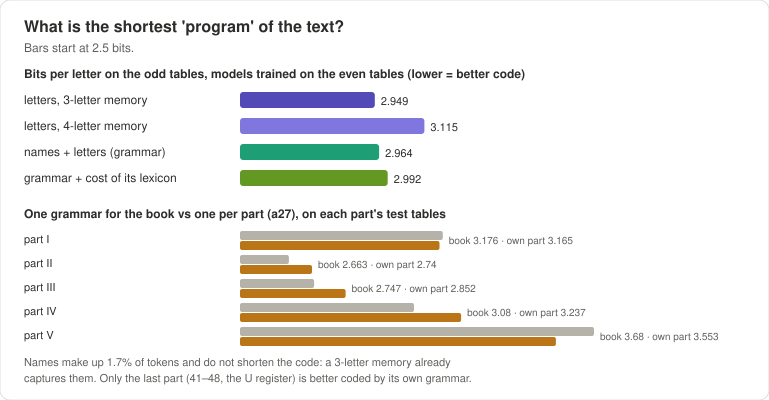

The machine question in its strictest form: is there a description of the book shorter than its
letter habits? A two-level grammar — names from our lexicon (68, from a23/a28) plus single letters
from a 3-letter-memory model — was trained on the even tables and scored on the odd ones.

- **Names do not shorten the code:** grammar 2.963 bits/letter vs 2.949 for letters alone (3-letter
  memory); 2.992 once the lexicon itself is paid for. A 4-letter memory overfits (3.114). Names are
  real (a23), but they are 1.7% of the tokens, and a 3-letter memory already "knows" them.
  **REFUTED** as a hidden code beyond letter habits.
- **One grammar or five?** One grammar for the whole book codes four of the five parts as well or
  better than a grammar of their own (more training text helps); only **part V (41–48, the U
  register)** is better coded by its own grammar (3.55 vs 3.68). The end speaks differently enough
  to need its own model. **REAL.**

So the best "program" we can write for the Loagaeth is short: an alphabet with a 3-letter memory,
a positional grammar at the row edges, a small set of recurring names in two houses, and a shift of
register at the end. It reproduces the surface; it does not open the meaning.

### Anchors for meaning: the Calls, the diaries, the titles `[a30]`

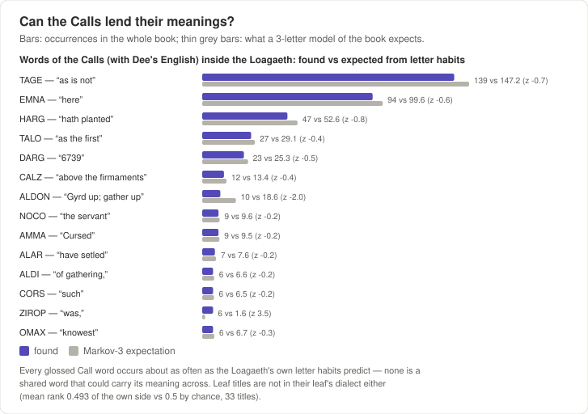

Meaning needs anchors — words whose sense is known. The only glossed Angelic words are those of the
Calls (Dee's English in Sloane 3191).

- **No Call word carries over.** Of 600 glossed Call words (4+ letters), 26 occur 3+ times in the
  Loagaeth, and every one at the rate the book's own letter habits predict: TAGE "as is not" 139 vs
  147 expected, EMNA "here" 94 vs 100, HARG "hath planted" 47 vs 53, CALZ "above the firmaments" 12 vs
  13… ZIROP "was" (6 vs 1.6) is the only excess and does not behave as a word. Nothing passes both
  tests (beyond chance and word-like). **REFUTED** — the Calls cannot lend their meanings to the
  tables; the earlier "23 shared words" of leaf 1 (a06) are letter-habit coincidences at book scale.
- **Dee's diaries (Sloane 3188):** the online page is a table of contents; the text is in print, and the
  manuscript photos are not reachable from here. **OPEN.**
- **Leaf titles are not in their leaf's dialect:** across 33 titles, a model of the own side ranks the
  title at 0.49 on average (0 = best, 0.5 = chance). **REFUTED.**

The meaning of the Loagaeth stays sealed by every anchor we can reach.

### Architecture, deeper: change rate, diamond halves, leaf 1, particles `[a29]`

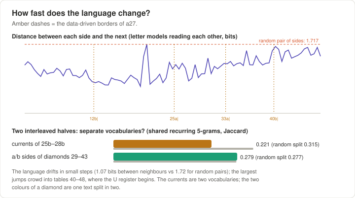

- **The language changes in small steps.** A letter model of each side reads the next one at 1.06
  extra bits on average, against 1.71 for random pairs of sides. The largest jumps crowd into tables
  40–48 (41a→41b, 46a→46b, 47b→48a, 40b→41a…) — where the U register begins — with isolated jumps at
  21a→21b and 36b→37a. **REAL.**
- **The two colours of a diamond are one text.** The a- and b-sides of tables 29–43 share recurring
  5-grams exactly as much as random splits of their lines (0.279 vs 0.277). So the two vocabularies of
  25b–28b are special to the currents, not a property of any interleaving. **REFUTED (for the
  diamonds) — sharpens #83.**
- **Leaf 1's words are not a key to the tables.** Of 1,941 spaced words of 5+ letters, 380 occur in the
  grids, 2,798 times — below the Markov-3 expectation (3,105). Only ALNOTH and MACHES are clearly
  favoured. **REFUTED.**
- **No particle system between names.** Consecutive names on a line are separated by 0–11 letters
  with a flat distribution (68 abut directly — compounds); the few short gaps (NOX, ZID, VAR, OL, AR)
  are too rare to call particles. **DESCRIPTIVE.**

### The names, deeper: territories, houses, hidden names `[a28]`

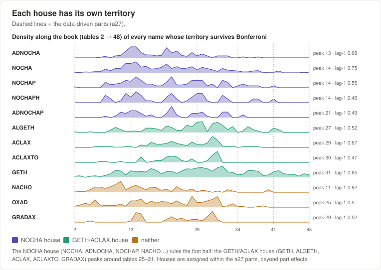

- **Twelve names hold a territory** that survives Bonferroni (lag-1 autocorrelation of their density
  along the book vs shuffled order, p ≤ 0.001): NOCHA, ADNOCHA, NOCHAP, NOCHAPH, ADNOCHAP, NACHO on one
  side; GETH, ALGETH, ACLAX, ACLAXTO, GRADAX, OXAD on the other. **REAL.**
- **The houses are territorial.** Assigned by correlation inside the a27 parts (beyond the parts'
  own differences), the **NOCHA house** (ADNOCHA r 0.83, NOCHAP, NOCHAPH, ADNOCHAP, ADNOCHAPHA, CHADAX)
  peaks in tables ~11–21, and the **GETH/ACLAX house** (ALGETH r 0.66, ACLAXTO, DRAGRA) at ~25–31.
  Most discovered names belong to neither. **REAL.**
- **CHASTOR itself is a weak territory** once measured per letter (p 0.027, not past Bonferroni) — in
  line with the revision of a22: the empire is held by its titled forms and by the two houses, not by
  the bare stem.
- **Genealogy — refuted.** A core appears before its longer forms in 26 of 30 pairs, but 25.5 were
  expected from their counts alone (z 0.29). Titles are not "born" after their core.
- **Vowel mirrors — refuted as a rule.** Among 4,689 frequent strings, 304 pairs differ by swapping two
  vowels and 342 by swapping two consonants; a Markov-3 copy gives 256 and 280 — the same proportion.
  NACHO ~ NOCHA is a strong pair, not an instance of a mirroring law.
- **Hidden names.** Masking the dominant names and rerunning the detector brings up names that were
  in their shadow: **MACHO** (51×, 21 tables), **DNACHAP**, **NOPHAR**, **ANZANO**, **NACHAPA**,
  **DRAXVL**, **RONTANTOXA** (z 10, kin to ANTANTOX).
- **Variants on the two currents** (25b–28b): χ² 14.5 vs 9.5 for random splits (p 0.09) — the currents
  differ in vocabulary (a24) but not, measurably, in which variant of a family they use. **REFUTED.**

### Where does the book really change? Borders without assumptions `[a27]`

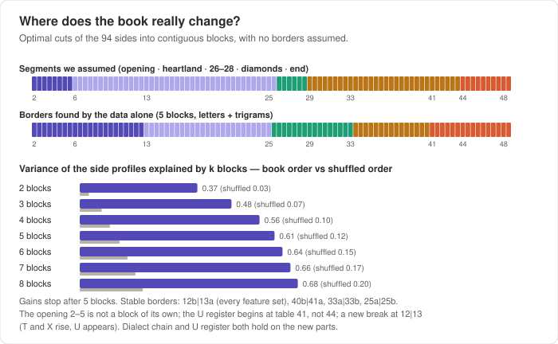

Our four segments (opening 2–5, heartland 6–25, 26–28, diamonds 29–43, end 44–48) were set by eye.
Cutting the 94 sides into contiguous blocks by exact optimisation, with no borders given:

- **Five blocks are enough** (61% of the variance of the side profiles vs 12% for shuffled orders;
  extra blocks add nothing beyond the shuffled gain).
- **Borders found:** **12b|13a**, **25a|25b**, **33a|33b**, **40b|41a**. 12b|13a appears with every
  feature set (letters only, trigrams only, both); 40b|41a in all but one; 25a|25b (where the writing
  turns from rows to diagonals) with trigrams.
- **Revisions.** The "opening" 2–5 is **not** a block of its own — tables 2–12 form one part. The
  **U register starts at table 41**, not 44. And there is a **new break at 12|13**: from table 13, T
  and X roughly double (2.3 → 5.1%, 3.0 → 5.3%) and U appears (0.1 → 1.4%). **REAL / REVISED.**
- **Checks on the new parts** (I 2a–12b · II 13a–25a · III 25b–33a · IV 33b–40b · V 41a–48b): the
  dialect chain holds (each part reads its neighbours best), and the U register is stronger (part V
  shares 242 five-letter formulas with parts I–II as written, 436 with U read as A; other vowels
  ≤ 300).

**Irregular rows (A2).** Of the row-written sides, seven differ from 2,401 letters by a single letter
in a single row (3b, 5a, 7b, 9b, 10b, 11b, 16b, 17b — no 50/48 pairs, so no letter slipped across a row
break: isolated insertions or omissions). Three are systematic: **8b** lacks one letter in every row
from row 5 on (−37: a column dropped), **9a** lacks 376 letters (rows 1–7 hold only 35 each — a damaged
or unfinished block), **12b** lacks one letter in rows 30–33. These need the manuscript to settle.

**U/A in the manuscript (A1).** The transcription page carries photographs of 14 leaf titles only
(e.g. 5b ZVCHASTORS), not of the tables; the U/A question for tables 41–48 stays open until images
of Sloane 3189 can be consulted.

### Are we looking wrong? Every core result under other readings `[a22]`

We were wrong once (tables 26–28 read by rows instead of diagonals). So the main results were
recomputed on altered versions of the book: Z = X, U = V, U read as A, only sides whose rows are
exactly 49 letters, and ten copies with 2% of letters swapped for their look-alikes in Dee's hand.

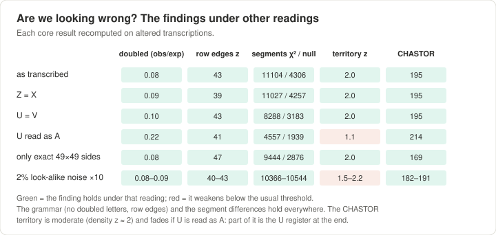

- **Holds everywhere:** the no-doubled-letter rule (0.08–0.22 of chance), the row edges (z ≈ 40),
  the different letter mix of the four segments (χ² far above its null in every version), and the
  names themselves (2% noise loses only ~5% of CHASTORs).
- **Weaker than we said:** the CHASTOR **territory**. Counted per table it is strong (lag-1 0.49,
  p < 0.001); measured per 1,000 letters it is moderate (0.26, z ≈ 2, p ≈ 0.02), and if U is read as
  A it fades (z 1.1), because CHUSTOR at the end merges into it. The realm is real but partly the
  boundary of the U register. **REVISED.**
- **Segmentation, calibrated:** tuned on Peterson's division of eight dense lines and scored on the
  ninth, our segmenter rises from F1 0.33 to **0.36** (random 0.16). It still over-cuts; results that
  rest on substring counts (most of ours) do not depend on it.
- **Table 49 is missing:** no test assumes 49 present tables; the 7×7 plan results use 48.

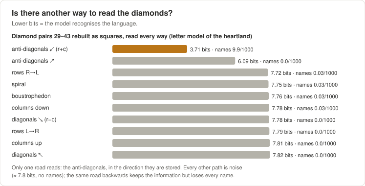

**Another road through the diamonds?** Each diamond pair rebuilt as its square and read ten ways:
only the stored anti-diagonals read as language (3.71 bits, 9.9 names per 1,000 letters); rows,
columns, main diagonals, boustrophedon and spiral are all noise (≈ 7.8 bits, 0 names). Backwards the
same road keeps the information (6.1 bits for a forward model) but loses every name. **REAL — there
is exactly one way to read them.**

### Deeper mathematics `[a22]`

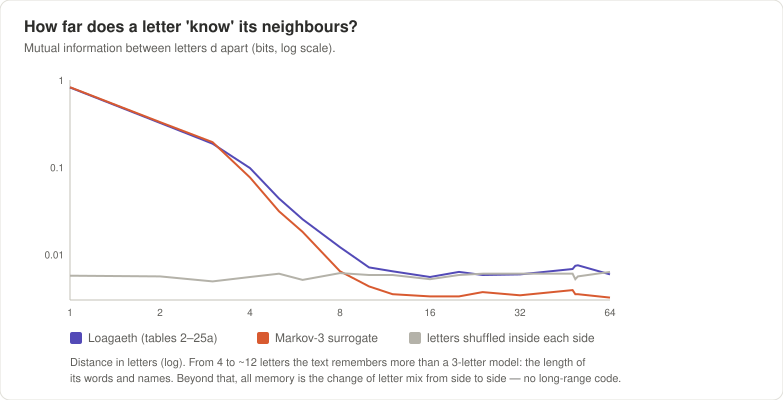

- **Memory of the text (mutual information by distance).** From 4 to about 12 letters the Loagaeth
  remembers more than a 3-letter Markov model (d = 8: 0.012 vs 0.006 bits) — the span of its words
  and names. Beyond ~12 letters every bit of memory equals that of letters shuffled inside each side:
  it is the change of letter mix from side to side, not a long-range code. **REAL (short range) /
  REFUTED (long-range code).**
- **Copying between tables:** the longest string shared by two tables is 16 letters
  (ADNOCHANTANTOXAL), shorter than in a Markov surrogate (18). No block was copied; 12-letter
  formulas shared between tables are 358 vs 206 (the names). **REFUTED (copying).**
- **Compression:** LZMA 3.22 bits/letter vs 3.26 for the Markov-3 surrogate — almost nothing beyond
  local letter habits for an algorithm to exploit.
- **Zipf and Heaps on Dee's own word divisions (leaf 1):** slope −0.61, Heaps β 0.91, 85% hapax at
  the size of the Calls — the same profile as the Calls themselves (−0.69, 0.87, 85%). By its word
  statistics leaf 1 behaves like the Calls. **DESCRIPTIVE.**
- **Vertical structure in the squares:** letters above/below each other share 0.0085 bits vs 0.0079
  with rows shuffled (z 1.7): the squares are written row by row, not as a 2-D design.

### New names, found by the text itself `[a23]`

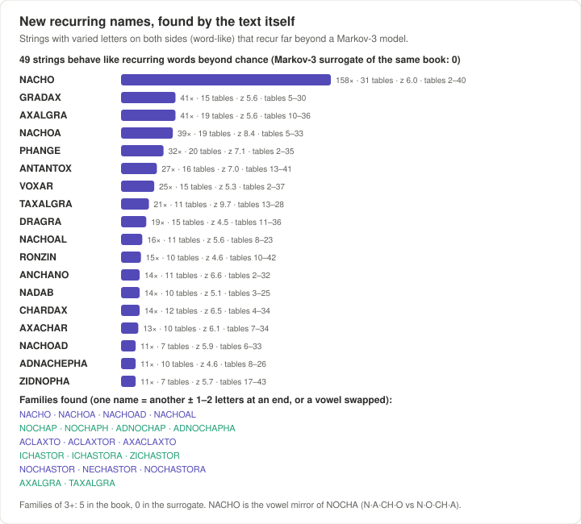

Without telling the program any name, we kept every string of 4–14 letters that recurs (≥ 6×, in
≥ 3 tables), is followed and preceded by varied letters (a word boundary on both sides — Harris's
criterion), and occurs far more than a Markov-3 model of the same book predicts (z ≥ 4.5, Bonferroni
over 3,552 candidates).

- **49 strings survive. The same procedure on a Markov-3 copy of the book finds 0.** **REAL.**
- **Positive control:** it rediscovers NOCHASTOR/ICHASTOR/NECHASTOR, NOCHA/ADNOCHAP, ACLAX, CHADAX
  by itself. It misses the most frequent ones (CHASTOR alone, GETH, ANZACH) because a 3-letter model
  fitted on this book already "knows" them — the test is conservative.
- **New recurring names outside the known families** (count, tables): **NACHO** 158×/31 (and NACHOA,
  NACHOAD, NACHOAL), **AXALGRA** 41/19, **GRADAX** 41/15, **PHANGE** 32/20, **ANTANTOX** 27/16,
  **VOXAR** 25/15, **TAXALGRA** 21/11 (z 9.7), **DRAGRA**, **RONZIN**, **ANCHANO**, **NADAB**,
  **CHARDAX**, **AXACHAR**, **ZIDNOPHA** (mostly in the diamonds), **PHADOL** (tables 2–47),
  **ONDANVAGE** (z 12.2, only tables 3–10), **UCHER** (tables 23–48, the U register).
- **NACHO is the vowel mirror of NOCHA** (N·A·CH·O / N·O·CH·A), both strong, both widespread.
- **Families:** 5 families of three or more members (0 in the surrogate) — NACHO·A·AD·AL;
  NOCHAP·H·ADNOCHAP·ADNOCHAPHA; ACLAXTO·ACLAXTOR·AXACLAXTO; ICHASTOR·ICHASTORA·ZICHASTOR;
  NECHASTOR·NOCHASTOR·NOCHASTORA. Each family is a **core with a few prefixes and suffixes**: written
  as a grammar it takes ~40% of the letters of the list (e.g. core NACHO + endings {–, A, AD, AL}).
- **Limits:** these names barely help segment Peterson's dense lines (F1 unchanged, 0.33), and only
  4% occur inside Dee's spaced words of leaf 1 (0% for random strings) — they belong to the tables'
  own vocabulary.

### The architecture of the book `[a24]`

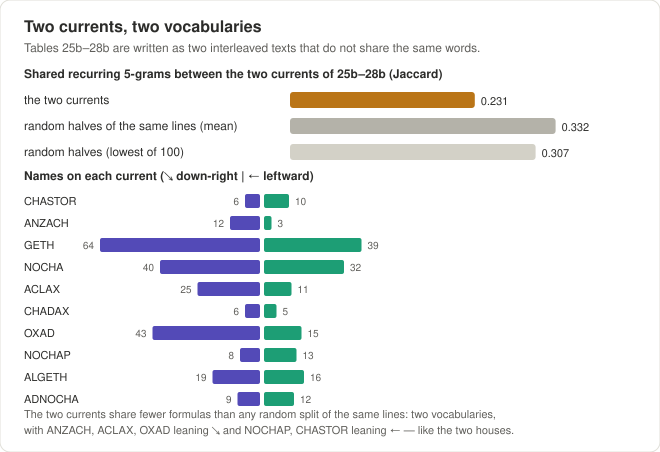

- **The two currents of 25b–28b have two vocabularies.** Their recurring 5-letter formulas overlap
  (Jaccard) 0.231, while every random split of the same lines gives at least 0.31 (mean 0.33). ANZACH
  (12 vs 3), ACLAX (25 vs 11) and OXAD (43 vs 15) lean to the ↘ current; NOCHAP (8 vs 13) and
  CHASTOR (6 vs 10) to the ← current. The interleaved currents are **two texts, not one cut in two** —
  echoing the two houses. **REAL (new).**

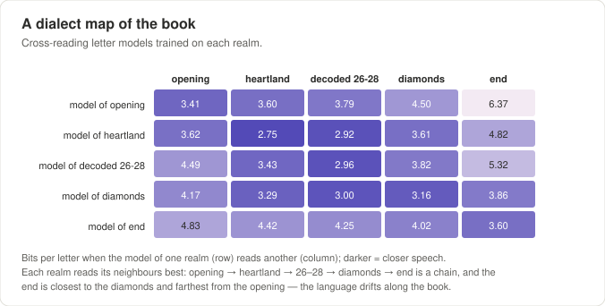

- **A dialect chain.** A letter model of each realm reads its neighbours best: opening → heartland →
  26–28 → diamonds → end. The end is closest to the diamonds (4.06 bits) and farthest from the
  opening (6.40). The language drifts gradually along the book. **REAL.**

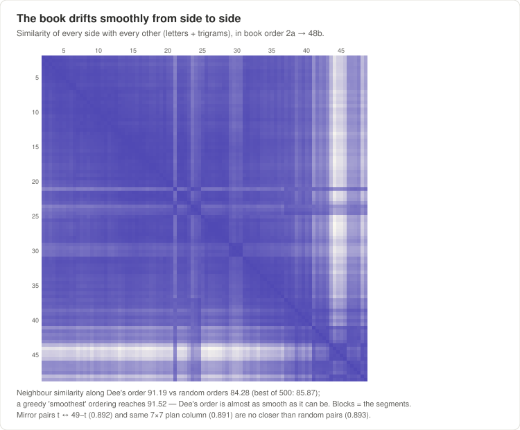

- **Dee's order is nearly the smoothest possible.** Summed similarity of neighbouring sides: 91.2,
  against 84.3 for random orders (best of 500: 85.9) and 91.5 for a greedy "smoothest" ordering.
  Sides a and b of one table are about as alike as b and the next table's a (0.982 vs 0.979): the
  drift is continuous across leaves. **REAL.** Mirror pairs (t ↔ 49 − t) and tables in the same
  column of the 7×7 plan are no closer than random pairs. **REFUTED.**
- **Rows as verses:** a segmenter that never sees row breaks puts a word break at 34% of row breaks
  vs 20% of random positions (≈ 11 standard errors): rows end on word boundaries. **REAL** (the row
  edges again, measured a new way).
- **Acrostics and centres:** no name in the first- or last-letter columns of 36 squares, nor in the
  string of their centre cells (AHAROTNLDOVCHCOA…). **REFUTED.**
- **The pyramid's cross:** in the rebuilt diamonds, name cells are not drawn to the diagonals or the
  centre (z 1.5, 1.5 — slightly away, not toward). **REFUTED.**

### Bridges to the other systems, and the constellation `[a25]`

- **No other system "lives" in the Loagaeth.** Watchtower names occur 735× (Markov-3 expects 798),
  words of the Calls 1,014× (1,093), Aethyr names 2,002× (2,121) — all at chance; the 91 governors 0×
  (1.2 expected); the 49 Heptarchic angels once (BORNOGO, in the heartland; 0.2 expected — not
  significant alone). The frequent shared strings are short (ADNA 501×, RAPH 134×, TOR, TAN, ARN).
  Watchtower strings are rarer in the end (0.26× its share) — the U register again. **REFUTED.**
- **Constellation:** stacking the 36 squares, the busiest 3×3 window of each master name (CHASTOR 5,
  GETH 6, NOCHA 8 …) is inside both nulls (random row; random column). Names have no favourite cell.
  **REFUTED.**

**In the 3D viewer:** "Name set → discovered" overlays these names by family; **Constellation**
shows a name's start cells across the stacked squares beside its null; the **two-currents
vocabulary** toggle colours names on each current of 25b–28b; **Order** shows the 94×94 similarity
terrain with the dialect table.

| Discovered names on 12a | Constellation (NOCHA) vs null | Currents on 26a | Similarity terrain |
|---|---|---|---|
| 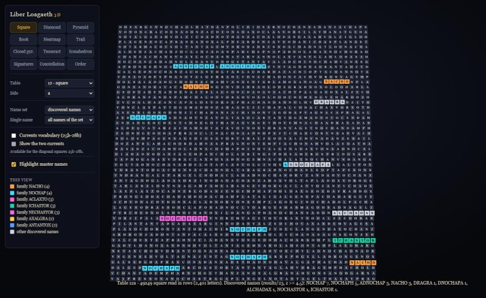 | 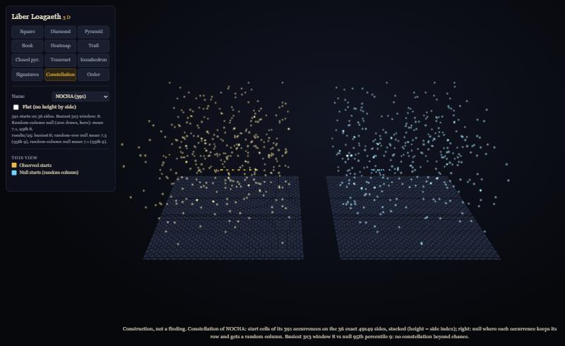 | 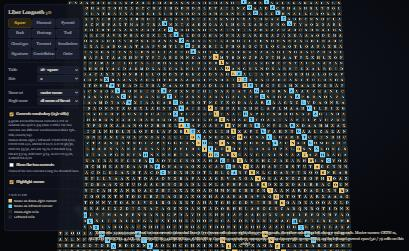 | 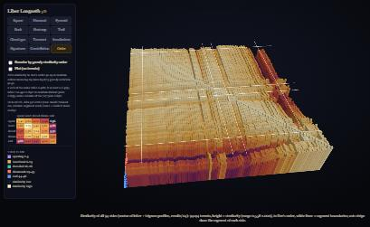 |

### Dee's letter names as a reading layer `[a26]` — construction

Every letter of the Angelic alphabet has a name in Dee's table (A Un, B Pa, C Veh, D Gal, E Graph,
F Or, G Ged, H Na, I Gon, L Ur, M Tal, N Drux, O Med, P Mals, Q Ger, R Don, S Fam, T Gisg, U Van,
X Pal, Z Ceph). The meanings used here (A "indomitable, pulsing force", H "life", O "insight"…) are a
modern attribution supplied by the practitioner — a lens for reading, not evidence about the text.

- **Readings:** CHASTOR = Veh · Na · Un · Fam · Gisg · Med · Don — *crowned conquest → life →
  pulsing force → cosmic vessel → cosmic nourishment → insight → growth*. CHUSTOR differs only in
  the third letter: Van, *true law*, instead of Un. Every master and discovered name is spelled out
  in `results/26_letter_names.json`.
- **The measured grammar in this lens:** rows open with Van (U, ×4.2), Mals (P, ×3.0), Ceph (Z),
  Ged (G), Veh (C); they close with Fam (S, ×3.6), Ger (Q), Na (H), Med (O), Pal (X). Graph, Na,
  Don and Pal (E, H, R, X) almost never open a row.
- **Each realm's signature letters** (share vs the whole book): opening Tal, Fam, Or (M, S, F ×2);
  heartland Gal, Drux, Un; 26–28 Gisg, Pal; diamonds and end Van, Don, Mals (U ×2.7 at the end).
- **Names vs random strings of the book:** the recurring names are rich in Fam, Veh, Na, Un (S, C, H,
  A — the CHASTOR letters) and poor in Van, Pa, Or, Tal, Ger (U, B, F, M, Q). This restates letter
  frequencies, read through the names.

In the 3D viewer the **Letters** view draws a 21-letter chart for every square (share or
enrichment), with a picker to follow one letter through the book, and the name panel shows each
name's reading.

| Letters, book mode (Van/U picked) | One square (12a) | Reading of CHASTOR |
|---|---|---|
| 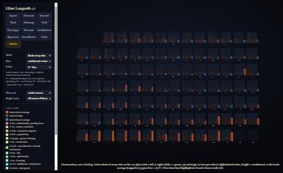 | 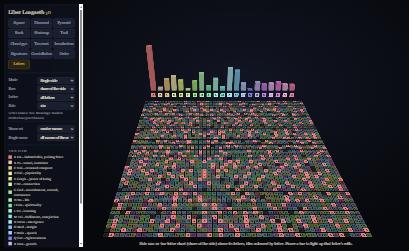 | 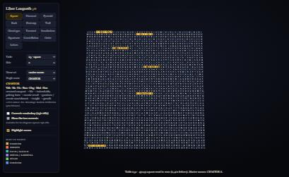 |

Followed through the book: **Van (U)** rises from 3–5% to 14.2% at the end while **Un (A)** falls from
~20% to 5.8% (the U register); **Don (R)** rises toward the end; **Gisg (T)** and **Pal (X)** peak in
26–28; **Tal (M)** and **Fam (S)** are highest in the opening and Fam fades after it; **Na (H)** and
**Med (O)** stay flat (≈ 7% and 9%) in every realm.

### The machine question: can an algorithm turn the data into code?

What the machine side has given, honestly:

- **It recognises the language** (a character model): it confirmed the diagonal decoding of 25b–28b,
  the one road through the diamonds, the U register, and that the text has a single direction.
- **It can write more of it** (an order-5 generator produces convincing pseudo-Loagaeth), and it
  can **segment** the dense lines twice as well as chance against an independent editor.
- **It finds no generating program.** No periodicity (unlike the Soyga), no 2-D rule, no copying, no
  long-range memory, and compression gains almost nothing over a 3-letter model. The text is not
  the output of a short algorithm that could be reversed.
- **It cannot translate.** Translation needs anchors — words with known meanings. The Loagaeth has
  23 shared with the Calls, and no gloss for CHASTOR or its family (Peterson's index has none). A
  model can map structure; it cannot invent meaning without such anchors.

### 3D viewer — the tables as squares, diamonds and pyramids

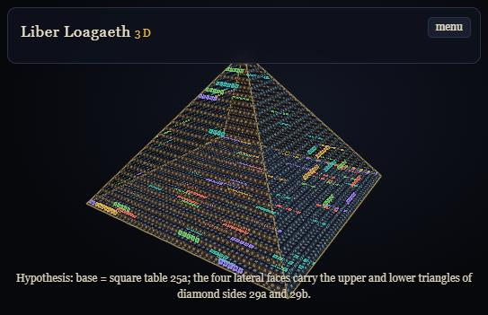

An interactive three.js viewer of every table (`viz/loagaeth_3d.html`, data from
`src/make_viz_data.py`). Open it through a local server (some browsers block scripts on
double-click):

```bash
python -m http.server 8860
```

then visit `http://localhost:8860/viz/loagaeth_3d.html`. Views:

- **Square** — any 49×49 side as tiles in the two chessboard colours; master-name cells raised and
  coloured (CHASTOR gold, ANZACH coral, GETH/ALGETH teal, NOCHA/ADNOCHA violet, ACLAX green,
  CHUSTOR blue). On 25b–28b, a toggle animates **the two currents** on the diagonals.
- **Diamond** — one diamond side as a stepped rhombus split into its two stepped pyramids, or both
  sides combined back into the 49×49 square, with a slider turning it through 45°.
- **Pyramid / Octahedron** — *the hypothesis "squares are bases, diamonds are faces", made
  visible*: a square table as base, the triangles of two diamond sides as the four faces (unfoldable
  into a flat net); or two pyramids base to base. This is a construction for exploring, not a
  finding: what is established is only that each diamond side is two stepped pyramids joined at
  its widest row.
- **Book** — the 49 tables on the 7×7 plan, coloured by territory; click a plate to open it.
- **Heatmap** — the 36 sides of 2a–25a that are exact 49×49 grids stacked into one: per cell, how
  many sides put a master name there, or observed/expected for any letter. A **Null** toggle swaps
  in the same sides with letters shuffled inside each side (seed 1583).
- **Trail** — the top letters' hotspots joined in order (A O N H L D R C X E G T, or true frequency
  order) by a gold tube, with the shuffled null's trail in cyan; on the stack or any single side.
- **Closed pyramid** — the base carries the stacked name heat; the 1,802 master-name cells of all
  diamond sides 29–48 glow on the four faces.
- **Tesseract** — a hypercube (24 square faces) turning in 4D, wearing 24 consecutive square sides.
- **Icosahedron** — 20 triangular faces carrying the upper and lower halves of ten diamond sides.

Every view links by URL hash (e.g. `#view=heat&hMode=letter&hLetter=X&hNull=1`).

| Heat map (letter X) | Trail, observed vs null | Closed pyramid |
|---|---|---|
| 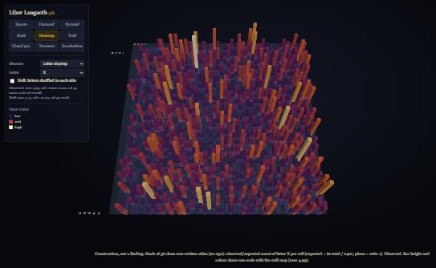 | 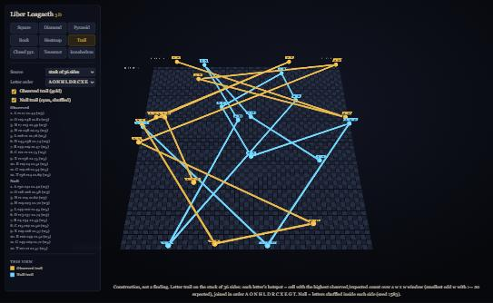 | 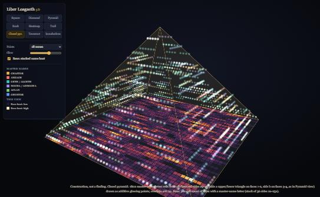 |
| **Tesseract** | **Icosahedron** | |
|  |  | |

**What the overlays show — no symbol.** Inside the grid, the hottest cells of every letter (ratio
2.2–5.5) are matched by the shuffled null (2.3–4.8): noise. The one real structure is the **row
edges** already found in `[a16]`: X sits at column 1 only 0.01× its average and at column 49 1.62×;
H 0.10× → 2.03×; G 1.89× → 0.52×; C 1.67× → 0.58× (null: 0.82–1.12× for every letter). So the trail
is pulled to the edges (O, H at the end of the row; L, C at the start) and otherwise zig-zags like
the null's. Master names hit any one cell in at most 9 of 36 sides, with no figure; on the closed
pyramid they are short horizontal streaks on all four faces, nothing at the apex or along the edges.
The tesseract and icosahedron are ways to look, not results.

**Second round of views.**
- **Inverse** (Pyramid / Closed pyramid): every face mirrored, side by side with the original, and
  reversed master names marked in magenta.
- **Elements** (Heatmap / Closed pyramid): heat split into quartiles and coloured, hottest to
  coldest, Fire (red), Air (yellow), Earth (brown), Water (blue) — the practitioner's lens, applied
  the same way to the null. Plus a **view from above**.
- **Tesseract by signature**: only the outer cube is textured; faces can be filled with sides that
  share the same top-three letters instead of consecutive sides.
- **Signatures**: the 94 sides as tiles in columns by their top-three letters.

| Inverse (ALGETH reads HTEGLA) | Elements, from above | Signature map |
|---|---|---|
|  |  |  |

What they show `[a21 F]`:
- **The text has one direction.** Read backwards, the names vanish: CHASTOR 179 forward / 0
  reversed, ANZACH 150 / 0, GETH 504 / 0, ADNOCHA 172 / 0 (only DAXO, OXAD reversed, appears — it
  is the DAX stem + O). A letter model trained forward reads reversed text at 6.1 bits vs 3.5.
  On the diamonds, reversed hits are DAXO only (19 vs 6.6 expected), forward names 426 vs 80.
- **Signatures sort the book by itself.** A dominates 83 of 94 sides; U 7 (43b–48b), R 3, N 1, all
  at the end. Top-three signatures follow the segments: AON opening, ANO heartland, AOX/AOL/AOR
  diamonds, ARO/RAO late, URN/URO/UON end — the segment difference of `[a16]` made visible.
- **Seen from above, the pyramid's four triangles are not separate realms.** Mean name heat per
  triangle: top 2.41, bottom 2.44, right 2.05, left 1.77 (null ≈ 0). Left and right are cooler only
  because they hold the row-start and row-end columns, where names rarely sit (edges 0.58 vs 2.31
  inside). With Elements, the edge columns are 87% Water; the interior splits evenly. For letters
  (where the null is usable) every triangle sits within ±4 points of the null, except X, whose
  absence from row starts makes the left side "Water".

**Majority by sub-quadrant.** A button paints each block in the element that holds most of its
cells: halves (four 24×24 quadrants plus the central cross as its own strip), 4×4, or the 7×7 blocks
of the book's plan. A "Display" select swaps the heat bars for the flat 49×49 letters in their
element colours.

| Letter H, halves, from above | Name heat, 7×7 | Side 12a as flat letters |
|---|---|---|
|  |  |  |

What it shows: the first and last block columns are Water (cold) — up to 73% for the name heat —
and for H the last column turns Fire/Earth while the first stays Water; the null shows no such
columns. That is again the row edges (H closes rows, X never opens one). The interior blocks mix
Earth, Fire and Air with no figure. Note: quartile cut-offs fall on tied values, so Water's band
often holds the most cells and wins blocks for that reason alone.

### What we tested and threw out (the discipline)
Mirror/reversal (syllable-pool artifact), decimation-by-2 (names are contiguous), Semitic
roots (ratio ~1.3, English-like), prefix-as-region (matches a frequency null), the
CHASTOR-family numeric signature (spread, not 2/3/6), the prologue acrostic (gibberish),
Call-vocabulary-as-key, Gebofal reordering, four geometric models, divine-name ciphers, and —
from the engine's broader 72-hypothesis sweep — most gematria and the 3-6-9 / sefirotic
claims (they belong to the value system or grid geometry, not a hidden code). Watchtower-style
geometric name-extraction from the 49×49 grids also fails its null (`engine/extract_names.py`):
the names live in the linear reading, not a Great-Cross geometry.

### Where this leaves us
We have the **form** of the names — network, morphology, letter-grammar, territory — and the
fact that it is one language with the Calls. We do not have the **referents** of the proper
names. The only path to meaning is an **external anchor**: the attested sense of a single
name (CHASTOR first). Per Dee's own source the highest names were "not to be pronounced," so
this layer may be sealed by design. Honest bottom line: we have not deciphered the Loagaeth —
we have mapped its skeleton, proved it is a real name-language, and ruled out a stack of
popular keys, further than any published treatment we could find.

---

## What is left — the roadmap

See [docs/ROADMAP.md](docs/ROADMAP.md): the ledger in one screen and every open question with its
test, null and stop rule (closing doubts, names, architecture, anchors for meaning, the machine
side, practitioner constructions, publication).

## Self-improving loop

The engine can keep searching on its own: an LLM reads the findings and proposes new
testable hypotheses, which you then code as probes - but the **null models stay the only
judge of truth**. Set one backend:

```bash
# cloud (Anthropic)
pip install anthropic
set ANTHROPIC_API_KEY=sk-...
cd engine && python llm_agent.py --watch --rounds 13 --every 3

# local (Ollama, no key, stdlib only)
set LLM_BACKEND=ollama
set OLLAMA_MODEL=qwen2.5:7b
cd engine && python llm_agent.py --n 5
```

Suggestions are appended to `engine/results/llm_suggestions.jsonl`. The LLM never
decides what is real; it only widens the search. See `engine/README.md`.

---

## How to simulate and test

- Change the data: drop in a second transcription of Sloane 3189 as
  `data/loagaeth_tables.json` and re-run - does CHASTOR survive the new source?
- Add a hypothesis: write a probe in `engine/sondas.py` returning a finding dict with its
  own null model (copy the shape of `s6`), add it to `SONDAS` and the loop's `plano`.
- Break a claim: every result ships its null; if you think a finding is an artifact,
  harden its surrogate in `src/a07_null_models.py` and show it falls. That is exactly how
  we killed the reversal idea (see `docs/METHODOLOGY.md`).

## Provenance & honesty

Word boundaries on the dense tables are our own segmentation, not Dee's - treat the
morphology as a strong hypothesis. The Loagaeth text is transcribed from a public-domain
facsimile of Sloane MS 3189; the Great-Table and gematria layers come from the Golden
Dawn line and Dee's diaries. Nothing here is personal data. Full provenance in
[`docs/SOURCES.md`](docs/SOURCES.md). License: MIT (code and compiled data; the historical
sources are public domain).
