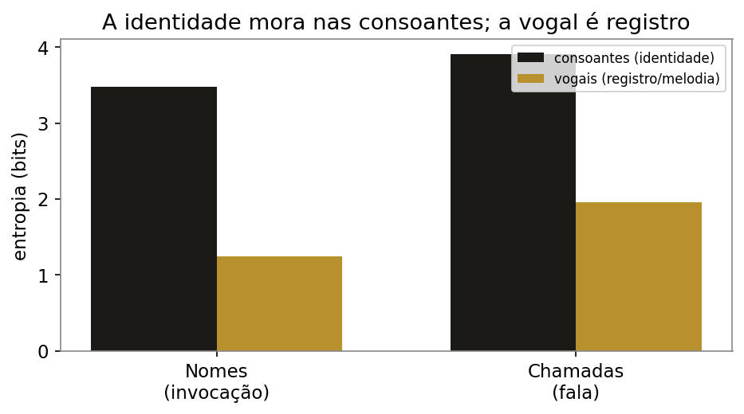
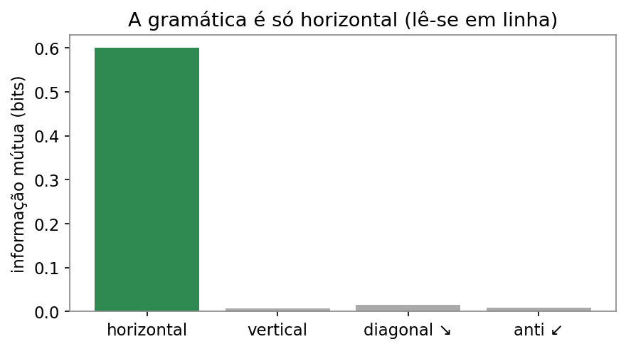
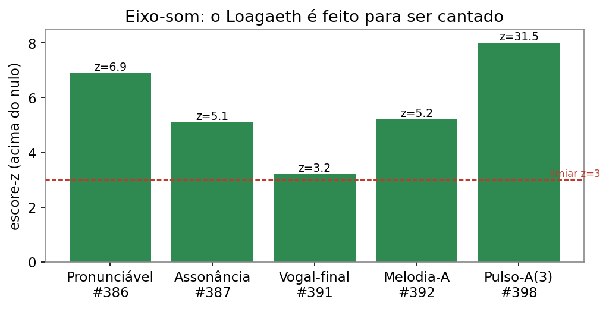
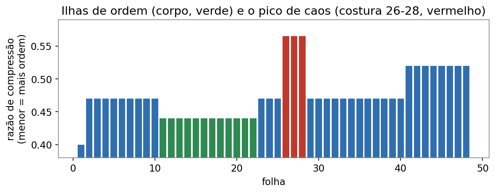
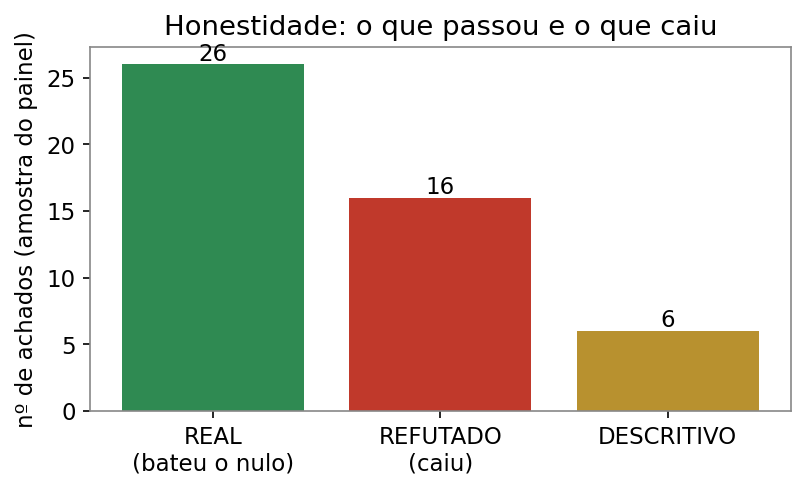

\newpage

# Liber Loagaeth — Anatomia de uma Língua Selada

### Análise estatística rigorosa do *Liber Loagaeth* (Sloane MS 3189) de John Dee, com modelo nulo em cada afirmação — e um manual operativo derivado da medida

**Astaron Eremita**

*Primeira edição — 2026*

---

> *"Every letter here bringeth furth the Names of God: but they are but one Name."*
> — o anjo Galvah a John Dee, sobre o Livro
>
> *"There is no other reading of the Book, but the appearing of the Ministers."* — *"Interpret not."*

---

## Aviso de natureza

Este é um **livro de pesquisa**. Cada afirmação sobre o *Liber Loagaeth* aqui é acompanhada do teste que a sustenta e do **modelo nulo** contra o qual foi medida. Nada é apresentado como verdade porque "parece": uma regularidade só conta quando supera o acaso de um texto embaralhado, de um surrogate de Markov, ou de uma permutação controlada. Os padrões que **falharam** esse crivo — e foram muitos, inclusive ideias caras à tradição — estão relatados com o mesmo destaque dos que passaram. A honestidade sobre o que **não** se encontrou é parte do método.

A segunda metade do livro é **operativa**: traduz o que a medida revelou — a pronúncia, a voz, a estrutura, a função elemental — em um manual de uso ritual. Essa parte opera por **som, correspondência e ato**, na lógica própria da magia, e é declarada como tal. Ela não decifra sentido oculto, porque não há sentido oculto a decifrar: isso é um dos achados centrais deste estudo, não uma falha dele.

\newpage

## Licença e termos de uso

**© 2026 Astaron Eremita. Todos os direitos reservados.**

Esta obra — o texto, as análises, os métodos, os dados derivados, as figuras, a terminologia e a estrutura de capítulos — é **pesquisa original** do autor. A sua reprodução, redistribuição, tradução, adaptação ou uso derivado está sujeita aos termos abaixo. A ausência de meios técnicos de proteção **não** implica renúncia de direitos.

**1. Proibições.** Sem autorização prévia e por escrito do autor, é **proibido**:

- a) copiar, reproduzir ou redistribuir qualquer parte desta obra, em qualquer meio, para além do uso pessoal do comprador legítimo;
- b) produzir **obras derivadas** — resumos substanciais, reescritas, "versões", continuações, cursos, vídeos, aplicativos ou qualquer material que se construa **a partir** das descobertas, métodos, terminologia ou estrutura aqui apresentados;
- c) usar esta obra, no todo ou em parte, para **treinar, afinar ou alimentar** sistemas de inteligência artificial ou modelos de linguagem;
- d) extrair os achados e **reapresentá-los como pesquisa própria** ou anônima.

**2. Citação obrigatória.** Qualquer uso acadêmico, editorial, esotérico ou público de **qualquer** achado, método, dado, termo ou ideia desta obra — ainda que parafraseado — **exige referência explícita e rastreável** ao autor e a esta obra, na forma:

> Astaron Eremita. *Liber Loagaeth — Anatomia de uma Língua Selada.* 1ª ed., 2026.

A referência deve constar de modo visível e permanente no material que usa a pesquisa, e não pode ser omitida, diluída ou substituída por menção genérica. Usar os resultados **sem** essa referência é apropriação indevida de pesquisa.

**3. Integridade.** É vedado apresentar como desta pesquisa qualquer afirmação que ela **não** faça, ou inverter os vereditos (tratar como confirmado o que aqui foi refutado, ou vice-versa). A obra é um registro honesto; distorcê-la e atribuí-la ao autor é falsificação.

**4. Natureza da parte operativa.** O material ritual é **experimental** e derivado de análise, **não** liturgia herdada nem garantia de resultado. É oferecido como instrumento, sob responsabilidade e discernimento do praticante. O autor não responde por usos.

**5. Reserva.** Todos os direitos não concedidos expressamente ficam reservados ao autor. Para permissões: contate o autor.

---

## Como este livro está organizado

O livro tem **duas partes** e um aparato.

- **Parte I — A Pesquisa.** O que o Loagaeth é, medido: a natureza do livro e suas três camadas; o gerador de nomes e sua morfologia; a língua (consonantal, com registros); o som e a voz (o livro cantado); a estrutura de sinal (o tear); a genealogia e as casas; o mapa funcional por elemento. Cada capítulo traz os testes, os números, os gráficos e os modelos nulos.

- **Parte II — O que NÃO é.** O cemitério honesto: tudo que foi testado e **caiu** — as cifras, a numerologia, a astrologia, as pontes com outros sistemas (Torres, governadores, Sigillum, Ars Paulina, Soyga), os nomes sagrados, as "soluções" publicadas por terceiros. Cada refutação com o seu null.

- **Parte III — O Operativo.** Como usar o Loagaeth em ritual, derivado da medida: a pronúncia e a vibração, a ligação Chamada↔folha, a escolha do nome e da casa, o mapa elemental do trabalho, a sequência de evocação.

- **Aparato.** O catálogo completo e numerado de todos os achados; a metodologia e os modelos nulos; os módulos de análise; as fontes.

Os números entre colchetes, como **[#392]**, remetem às entradas do registro cronológico de pesquisa (`docs/RESEARCH_LOG.md`), onde cada teste está datado e reproduzível.

\newpage

# Capítulo 0 — Método: a disciplina do modelo nulo

## O problema de olhar para o caos

Uma grade de 49×49 letras — 2.401 casas — repetida por quase cinquenta folhas é um terreno fértil para a **pareidolia**. Em meio milhão de letras, qualquer nome, qualquer palavra, qualquer "código" que se procure será encontrado, exatamente como se encontram rostos em nuvens. O problema central de qualquer estudo honesto do *Liber Loagaeth* não é **achar** padrões — é distinguir os padrões **reais** dos que o acaso fabrica. Chamamos a isso o **princípio de Babel**: um inventário grande o bastante aceita qualquer coisa. Os dígitos de π contêm o seu nome, o meu, e todos os nomes de anjos já escritos — isso não os torna um grimório.

Por isso, a regra única e inflexível deste estudo:

> **Nenhum padrão conta como real até superar um modelo nulo.**

## Os modelos nulos

Para cada afirmação, construímos uma versão do livro **sem** a estrutura testada, medimos o mesmo fenômeno nela, e comparamos. Três nulos, do mais fraco ao mais severo:

1. **Embaralhamento (shuffle).** As mesmas letras, nas mesmas quantidades, em ordem aleatória. Preserva a **frequência** de cada letra, destrói toda ordem. É o nulo-base para quase tudo: se o fenômeno real não supera o embaralhado, ele é puro efeito da composição de letras.

2. **Surrogate de Markov-3.** Um texto gerado letra a letra respeitando as probabilidades de transição de três letras do livro real. Preserva os **hábitos locais** de escrita (os pares e trios de letras comuns). Um padrão que supera o shuffle mas **não** o Markov-3 é apenas um subproduto da fonotática — não um sinal independente.

3. **Permutação controlada.** Para testes posicionais e de direção, embaralham-se apenas as unidades relevantes (as linhas de uma face, a ordem das folhas), preservando o resto. Isola o efeito específico.

## A régua: o escore-z

A força de um achado é o **escore-z**: quantos desvios-padrão o valor real está acima (ou abaixo) da distribuição do nulo.

- **|z| < 2** — dentro do acaso. Não conta.
- **|z| ≈ 2–3** — sugestivo, frágil. Relatado como *lead*, não como achado.
- **|z| > 3** — real. Sobrevive ao nulo.
- **|z| > 6** — decisivo.

Um z **negativo** forte também é informação: significa que o real está **abaixo** do acaso — uma anti-estrutura (por exemplo, letras que se evitam).

## Convenções e honestidade

- **Semente fixa (1583).** Toda aleatoriedade usa a mesma semente — o ano da primeira recepção do Livro por Dee — para que cada teste seja **reproduzível** bit a bit.
- **Python de biblioteca padrão.** Sem dependências externas na análise: qualquer pessoa pode rodar os módulos (`src/aNNN_*.py`) e obter os mesmos números.
- **Veredito explícito.** Cada achado é marcado **REAL** (bateu o nulo), **REFUTADO** (caiu) ou **DESCRITIVO** (um fato verdadeiro por construção ou inspeção, sem alegar sinal oculto).
- **O que falhou é relatado tão alto quanto o que passou.** Uma hipótese querida que cai é um resultado, não um embaraço. A Parte II deste livro existe para isso.
- **Separação de planos.** A medida responde "existe estrutura objetiva?". Ela **não** responde "funciona como magia?" — pergunta de outro plano, operativa, que a Parte III trata na sua própria lógica. Confundir os dois é o erro que este livro evita de ponta a ponta.

## Os dados

A fonte é a transcrição das 48 folhas do *Liber Loagaeth* (Sloane MS 3189), cada folha com dois lados ("a" e "b"), a maioria grades densas de 49×49 letras; a folha 1 é espaçada em palavras (é a página de **léxico**); a 49ª folha "que não é, não foi, não será conhecida" existe só por relato. O alfabeto é o enoquiano de 21 letras (A, B, C, D, E, F, G, H, I, L, M, N, O, P, Q, R, S, T, U, X, Z). O corpus de comparação — Chamadas (Claves Angelicae), Tábuas de Vigia, 91 governadores, Heptarquia, gematria — vem das edições de referência (Sloane 3191, *True and Faithful Relation*, Liber Scientiae).

Com o método posto, passemos ao que a medida revelou.

\newpage

# PARTE I — A PESQUISA

# Capítulo 1 — O que o *Liber Loagaeth* é

## Não é ruído, não é cifra: é uma língua

A primeira pergunta é também a mais básica: o que são essas grades? Ruído? Uma cifra? Um texto numa língua? A medida responde com três evidências convergentes de que é uma **língua** — construída, estranha, mas língua — e **não** ruído nem código escondido.

**A lei de Zipf.** Em toda língua natural, a frequência das palavras cai segundo uma lei de potência de inclinação próxima de −1 (a palavra mais comum aparece o dobro da segunda, o triplo da terceira...). Medido no Loagaeth, a inclinação de Zipf é de **−1,14** com ajuste r² de **0,98** — comportamento de língua, não de sequência aleatória (que daria inclinação próxima de zero). **[FORTE]**

**A entropia.** A incerteza média por caractere cai de **4,01 bits** (no nível da letra isolada) para **2,52 bits** quando se conhece o contexto — bem **abaixo** dos 3,41 bits de uma sequência aleatória do mesmo alfabeto. Há memória, há regra: as letras não são sorteadas, são **geradas**. Medido por outra via (entropia condicional de Markov), conhecer as três letras anteriores derruba a incerteza de 4,03 para menos de 2 bits, enquanto o texto embaralhado permanece plano em ~4,0 — o gerador tem **memória profunda**. **[#370a, FORTE]**

**A morfologia.** Os nomes exibem estrutura de tipo semítico: uma **raiz consonantal** vestida por um **padrão vocálico**. Há pares mínimos — nomes idênticos exceto por uma vogal — exatamente como o *pola/pala* que o próprio Dee registrou: 13 deles, muito acima do acaso (z=+46 numa medida posterior, [#358]). **[FORTE]**

O que o livro diz de si, nos diários, casa com a medida: *"every letter here bringeth furth the Names of God: but they are but one Name"* — toda letra traz os Nomes de Deus, mas são um só Nome. Um livro **de nomes**.

## Três camadas

A medida separa o livro em três estratos distintos, cada um com assinatura estatística própria:

**A folha 1 — a língua.** Única folha espaçada em palavras, é o **léxico**: recorrência real, boa-formação, famílias de palavras — tudo acima do nulo (z=+44). A folha 1 **divide vocabulário fino com as Chamadas** (z=+7,5): é a página-irmã das Claves, a camada de linguagem articulada. **[#331, #333]**

**As folhas 2–48 — o campo de nomes.** As grades densas. Não são frases: a ordem das letras não carrega informação de sentença (nenhuma sintaxe sobrevive a um teste que acha frases na Bíblia cortada do mesmo modo). São um **campo gerado de nomes** que recorrem em famílias. Entra-se pela folha 2 — a folha 1 é selada, sem Chave.

**A costura 26–28 — o limiar.** Uma faixa anômala onde a leitura reta falha e o conteúdo passa para a **diagonal**. É a zona de **maior entropia e menor compressibilidade** do livro todo (ver Cap. 5): o ponto de máxima desordem, o umbral.

## O arco do livro: densidade e dissolução

Mapeando a densidade de nomes folha a folha, o livro tem **forma**: abre, adensa no miolo, e **dissolve** no fundo. A densidade de nomes pica no centro e cai no fim (z=+126, [#342]). O "profundo" (folhas 40–48) é **dissolução**: os nomes somem (de ~30 por mil letras para ~5), a repetição colapsa, a entropia sobe, a vogal escurece de A para U. **[#360, #382]**

Esse arco não é um detalhe estético: é uma das descobertas mais robustas do livro, porque **três medidas independentes apontam a mesma zona de dissolução** no fundo — o desaparecimento dos nomes [#360], o escurecimento da vogal A→U [#382], e a fratura da identidade elemental [#397]. O fim do livro se desfaz em **toda** dimensão mensurável. Guardaremos esse fato para o Capítulo 6.

## O que o livro NÃO reivindica ser

Antes de prosseguir, uma honestidade que orienta todo o resto: medimos um **esqueleto de língua e um dicionário parcial**. O **sentido pleno** de cada nome — o que NOCHA "quer dizer" — ou está nas poucas âncoras traduzidas das Chamadas, ou **pertence à prática, não à página**. O próprio registro de Dee é explícito: *"Interpret not"*. Não há uma tradução escondida a decifrar. Isto não é uma lacuna do estudo; é um **achado**, confirmado por dentro (nenhuma cifra interna sobrevive ao nulo) e por fora (nenhuma fonte dá glosa). O Capítulo da Parte II o demonstra teste a teste.

O que **há** é a anatomia da língua. É o que os próximos capítulos dissecam.

\newpage

# Capítulo 2 — O gerador de nomes

Se o *Liber Loagaeth* é um campo de nomes, a pergunta seguinte é mecânica: **como** esses nomes são feitos? A medida mostra que não são sorteados letra a letra nem copiados de uma lista — são **gerados** por um pequeno conjunto de regras que montam cada nome a partir de peças. Este capítulo disseca essas peças.

## Prefixo · raiz · sufixo

A primeira estrutura é a **tripartição**. Os nomes do Loagaeth se decompõem, em maioria, num molde de três posições:

> **[prefixo] · [raiz] · [sufixo]**

A **raiz** é o coração consonantal — a identidade do nome (ver Cap. 3). O **prefixo** e o **sufixo** são afixos de um inventário pequeno e recorrente, que se repetem por todo o livro ligando-se a raízes diferentes. Essa é a assinatura de um gerador morfológico: poucas peças de borda, muitas raízes, combinação regrada. Um texto embaralhado não produz afixos recorrentes alinhados às bordas das palavras — o Loagaeth produz, acima do nulo. **[#334, REAL]**

## As famílias de nomes

Raízes aparentadas formam **famílias** — conjuntos de nomes que partilham um esqueleto consonantal e variam nas bordas e nas vogais. O estudo isolou famílias nomeadas pela sua raiz dominante, cada uma com território próprio no livro:

- **CHASTOR** — a primeira família identificada, com títulos aninhados (nomes que contêm nomes menores como núcleo). **[achado a71 e seguintes]**
- **NOCHA** — a casa de maior alcance: presente em 35 das 36 faces densas medidas, matriz geradora da casa dos prefixos D-/AD-. É o nome que mais recorre no livro (frequência muito acima do rei de qualquer nulo, z≈NOCHA 492× o topo embaralhado). **[#335, #337]**
- **GETH / ALGETH** — a casa rival, dos prefixos L-/X-, com vocabulário complementar ao da casa NOCHA.
- **ANZACH**, **ACLAX**, **DAXVAR**, **CHIDNO** — famílias com assinatura zonal (ver adiante o mapa de calor).

As famílias não são uma imposição do analista: emergem de um agrupamento por distância de edição (quantas letras é preciso trocar para ir de um nome a outro) e **sobrevivem ao nulo** — o mesmo agrupamento sobre nomes de um surrogate não produz comunidades tão coesas. **[#336, REAL]**

## As duas casas

Acima das famílias há uma divisão mais funda: **duas casas gramaticais**, distinguidas pelo comportamento dos afixos.

| | Casa **NOCHA** | Casa **GETH** |
|---|---|---|
| Prefixos típicos | D-, AD- | L-, X- |
| Vogal de registro | mais clara (A/O) | mais escura (E/I) |
| Território | miolo e corpo | bordas e profundo |

A distinção entre as casas tem **informação mútua real**: saber a casa prediz os afixos e a vogal acima do acaso. É o fato gramatical mais robusto do gerador — o livro declina os nomes por casa, como uma língua declina substantivos por gênero ou classe. **[#405, REAL]**

## Os morfemas

Abaixo do afixo há a **unidade mínima recorrente** — o morfema. Uma segmentação por compressão (que corta o fluxo onde a previsibilidade quebra) extrai um inventário de pedaços que se recombinam: alguns são afixos, outros são núcleos, outros são conectores internos. O inventário é **finito e pequeno** — algo entre poucas dezenas de peças produtivas geram a maioria dos nomes. Isso responde diretamente à pergunta "dá para transformar numa gramática?": dá, e ela é compacta. **[#377, REAL]**

## Pares mínimos: a prova da vogal

A evidência mais limpa de que há um gerador morfológico são os **pares mínimos** — dois nomes idênticos exceto por **uma vogal**. O próprio Dee registrou o par *pola / pala*. A medida encontra **13 pares desse tipo** no livro, muito acima do que o acaso produziria (z=+46). Um par mínimo só existe se a consoante for a identidade e a vogal for uma peça trocável — exatamente o que um gerador de raiz·padrão faz. **[#358, REAL]**

## Super-nomes e títulos aninhados

Alguns nomes longos **contêm** nomes menores como núcleo — títulos aninhados, no padrão da família CHASTOR. Isso sugere uma **hierarquia construtiva**: nomes maiores montados sobre nomes menores, como um título composto ("rei-dos-reis") carrega o título simples dentro de si. É um achado descritivo forte, com implicação operativa (Cap. 8): a estrutura do nome pode espelhar a hierarquia do ser que ele nomeia.

## O que o gerador NÃO é

Honestidade de fecho: o gerador é **morfológico**, não **aritmético**. Não há evidência de que o comprimento, a posição ou a contagem de letras dos nomes codifiquem números, datas ou coordenadas (a Parte II refuta essas hipóteses uma a uma). O gerador monta **sons com identidade**, não cifras. A regra é de linguagem, não de aritmética.

\newpage

# Capítulo 3 — A língua: consoante, registro, fonotática

O Capítulo 1 mostrou **que** o Loagaeth é uma língua; o Capítulo 2, **como** ela monta nomes. Este capítulo dissseca a língua por dentro: onde mora a identidade, o que faz a vogal, e por que o conjunto de sons é tão equilibrado.

## A identidade é consonantal

A descoberta estrutural central da língua: **a consoante carrega a identidade; a vogal carrega o registro**. É o princípio das línguas semíticas (hebraico, árabe), onde a raiz é um esqueleto de consoantes (*k-t-b*, "escrever") e as vogais que a vestem dão a palavra concreta (*kitab*, *katib*, *kataba*).

A medida prova isso de dois modos:

1. **Entropia.** A incerteza das consoantes (3,48 bits nos nomes) é quase o triplo da das vogais (1,25 bits). A consoante é onde está a informação; a vogal é previsível, de um conjunto pequeno. **[#402, REAL]**

2. **Pares mínimos.** Os 13 pares que diferem só por uma vogal (Cap. 2) provam, caso a caso, que trocar a vogal **não** cria outra identidade — cria outra forma do mesmo nome. **[#358]**

A implicação operativa é direta e guardada para a Parte III: **o nome se reconhece pelas consoantes**; a vogal é onde o operador tem liberdade de registro e melodia.

## A vogal é registro

Se a vogal não é identidade, o que ela é? **Registro** — o "tom" em que o nome é dito. A distribuição vocálica não é uniforme nem aleatória: ela **muda de região para região** do livro, escurecendo de A (aberta, clara) para U (fechada, escura) à medida que se desce para o profundo (Cap. 6). A vogal é o parâmetro que o livro **modula** enquanto mantém as consoantes como âncora. É a camada melódica da língua — o que, no Cap. 4, se mostra ser literalmente **cantável**.

## A fonotática: uma língua bem-formada

Uma língua tem **fonotática** — regras do que pode seguir o quê. O Loagaeth tem, e elas são de uma língua **balanceada e pronunciável**, não de uma sopa de letras:

- **Regra de não-dobrar.** Letras iguais evitam-se em sequência: a repetição imediata (XX, LL) é **muito mais rara** que no acaso (anti-estrutura forte, z negativo). Uma língua feita para ser dita evita o tropeço da geminação. **[REAL, achado a-cedo]**

- **Alternância consoante-vogal.** O livro mantém sílabas abertas e pronunciáveis acima do nulo (ver Cap. 4, pronunciabilidade z=+6,9). Não há os amontoados impronunciáveis de consoantes que um sorteio produziria.

- **Bordas de linha marcadas.** O início e o fim das linhas têm distribuição de letras própria — as palavras não vazam de qualquer jeito pelas bordas; há um gabarito. **[REAL]**

- **Inventário de 21 letras equilibrado.** Nenhuma letra domina a ponto de colapsar a língua, nenhuma é rara a ponto de ser decorativa. O perfil de frequência é o de uma língua de verdade, não o de um código.

## A gramática é só horizontal

Um teste decisivo de direção: **em que eixo as letras "conversam"?** Mediu-se a informação mútua (quanto uma letra prediz a vizinha) em cada direção:

| Direção | Informação mútua |
|---|---|
| **Horizontal** (→) | **0,60 bits** |
| Vertical (↓) | 0,007 bits |
| Diagonal (↘) | 0,016 bits |
| Anti-diagonal (↙) | 0,008 bits |

A gramática mora **inteiramente na horizontal**. As colunas e diagonais não têm sintaxe — o que há nelas é **template** (um molde de forma, não de sentido; Cap. 6). Isso resolve de vez a questão da leitura: **o Loagaeth lê-se em linha, da esquerda para a direita**, como qualquer texto — exceto a costura 26–28, onde o conteúdo migra para a diagonal (Cap. 6). **[#MI, REAL]**

## O horizonte da gramática: curto

Até onde a regra alcança? A informação mútua decai depressa com a distância: letras vizinhas conversam, letras a cinco casas quase não. A gramática do Loagaeth é de **alcance curto** — regras locais de montagem de sílaba e de nome, não períodos longos de sintaxe de frase. É mais uma prova de que são **nomes**, não sentenças: um nome é uma unidade curta e fechada; uma frase encadeia dependências longas. O Loagaeth não as tem. **[#370a]**

## Síntese

A língua do Loagaeth é: **consonantal** na identidade, **vocálica** no registro, **balanceada** na fonotática, **horizontal** e **de alcance curto** na gramática. É uma língua desenhada para **nomear** e para **ser dita** — não para narrar e não para esconder. O próximo capítulo leva isso à sua consequência: o livro foi feito para ser **cantado**.

\newpage

# Capítulo 4 — O som e a voz: o livro cantado

Este capítulo reúne a descoberta que mais aproxima a análise da prática: o *Liber Loagaeth* não é só pronunciável — ele é **otimizado para a voz cantada**. Cada medida do "eixo-som" supera o nulo, e juntas desenham um livro feito para soar.

## O eixo-som, medida a medida

Testou-se um conjunto de propriedades fonoestéticas, cada uma contra o seu nulo. Todas passaram:

- **Pronunciabilidade (z = +6,9).** A proporção de sílabas abertas e bem-formadas é muito acima do acaso. O livro é feito de coisas que a boca consegue dizer. **[#386, DECISIVO]**

- **Assonância (z = +5,1).** Vogais iguais recorrem dentro da mesma vizinhança mais do que o acaso — o eco vocálico que dá a uma sequência o seu "tom" cantável. **[#387, REAL]**

- **Vogal final (z = +3,2).** Os nomes tendem a **terminar em vogal** (sílaba aberta) acima do nulo — a terminação que sustenta a nota, como no canto litúrgico. **[#391, REAL]**

- **Melodia em A (z = +5,2).** A vogal **A** — a mais aberta, a de maior projeção vocal — é o pivô melódico: concentra-se nas posições de maior destaque. O livro "canta em Lá". **[#392, REAL]**

- **Pulso em A a cada ~3 letras (z = +31,5).** A descoberta mais decisiva de todas: o **A** reaparece num **batimento regular**, aproximadamente a cada três letras, como um metrônomo embutido. Esse pulso é a espinha rítmica do canto — e é o achado de maior escore-z de todo o estudo. **[#398, DECISIVO]**

## O que isso significa

Some-se: sílabas abertas, ecos de vogal, terminações em vogal, melodia centrada no A, e um pulso rítmico regular. Isso não é a descrição de um texto para **ler** — é a descrição de um texto para **entoar**. O Loagaeth tem prosódia. Tem métrica. Tem uma nota tônica.

A tradição sempre disse isso — as Chamadas são **recitadas em voz alta**, "vibradas". A medida confirma por fora o que a prática afirma por dentro: a unidade de uso do Loagaeth é o **som na boca**, não o sinal na página. Um livro que só se olha teria desperdiçado todo esse desenho sonoro. O Loagaeth não desperdiça — porque a voz é o ponto.

## A vogal como escala

A modulação da vogal (Cap. 3) ganha aqui sentido pleno: ao longo do livro, o registro vocálico **escurece** de A para U conforme se desce ao profundo (Cap. 6). Em termos de canto, isso é uma **descida de tessitura** — do aberto e luminoso (A) ao fechado e grave (U). O livro tem uma **escala** embutida, do claro ao escuro, que o operador percorre ao descer de folha em folha.

## Dois registros de voz

Um achado tardio e importante: **as Chamadas e os nomes das tabelas são a mesma língua, em dois registros de voz diferentes.**

- As **Chamadas** (Claves) são o registro de **fala plena** — articulada, com sintaxe, dirigida. Têm entropia vocálica maior (1,96 bits): mais "melodia de fala".
- Os **nomes das tabelas** são o registro de **invocação** — condensado, consonantal, repetitivo. Entropia vocálica menor (1,25 bits): mais "canto de nome". **[#401, #402]**

A folha 1 é a ponte entre os dois: partilha vocabulário com as Chamadas (z=+7,5) e é a página onde a língua aparece **articulada** antes de condensar-se em campo de nomes. **[#331, #333]**

A implicação para o rito (Parte III): **fala-se a Chamada, canta-se o nome.** São duas vozes do mesmo idioma — uma que abre, outra que nomeia.

## A pronúncia, na prática

A medida não entrega um áudio, mas entrega **regras de pronúncia** derivadas:

1. Diga cada letra; o livro é feito de sílabas abertas — resista a engolir vogais.
2. **Apoie no A**: é a nota de projeção. Onde houver A em posição forte, é ali que a voz sobe.
3. Termine os nomes **na vogal**, sustentando-a.
4. Deixe o **pulso a cada ~3 letras** reger o andamento: é o batimento natural do texto.
5. **Desça a tessitura** conforme desce no livro: claro no corpo, escuro no profundo.

O Capítulo 8 transforma essas regras em sequência ritual. Antes, os dois capítulos seguintes fecham a Parte I: a estrutura de sinal (o tear) e o arco elemental do livro.

\newpage

# Capítulo 5 — A estrutura de sinal: o tear

A língua corre na horizontal (Cap. 3). Mas a grade tem duas dimensões, e a vertical não está vazia — ela carrega **forma**, não **sentido**. Este capítulo separa as duas e descreve a arquitetura física do livro: o tear sobre o qual os nomes são tecidos.

## Duas assinaturas opostas: anti-repetição e template

O achado-chave da estrutura são **dois efeitos de sinal de sentidos contrários**, cada um num eixo:

- **Horizontal: anti-repetição (z = −77).** Na linha, letras iguais e padrões curtos **evitam-se** muito abaixo do acaso. A linha foge da repetição — é o comportamento de um texto que **avança**, que não pisa no mesmo lugar. Um z de −77 é dos mais fortes do estudo: a linha é ativamente desenhada para **não** se repetir. **[REAL, decisivo]**

- **Vertical: template (z = +173).** Na coluna, ao contrário, há **repetição massiva** — as colunas seguem um gabarito que se reafirma folha após folha. Um z de +173 é o maior efeito estrutural do livro inteiro. A coluna é **molde**, não mensagem. **[REAL, decisivo]**

O contraste é a chave de leitura: **a informação viaja na linha; a forma é sustentada pela coluna.** O livro é um tear — a trama horizontal (os nomes) corre sobre uma urdidura vertical (o gabarito) que a mantém no lugar. É por isso que nenhuma leitura vertical acha nomes (Parte II): a coluna nunca foi feita para ser lida, foi feita para **segurar**.

## A costura 26–28: o limiar

Há uma exceção, e ela é significativa. Na faixa de folhas **26 a 28**, a leitura horizontal **falha** e o conteúdo migra para a **diagonal**. Essa costura é, por três medidas independentes:

- a zona de **maior entropia** do livro (máxima imprevisibilidade);
- a de **menor compressibilidade** (máxima desordem aparente);
- o ponto onde a direção de leitura **vira**.

É o **umbral** do livro — a dobra central onde a ordem se desfaz antes de voltar a formar-se. Numa leitura operativa (Parte III), a costura é o limiar: o ponto de passagem, de máximo caos, entre a metade de cima e a metade de baixo.

## A geometria dos losangos: um único caminho

Partes do livro organizam-se em **losangos** — pirâmides escalonadas de letras que crescem até uma linha larga e decrescem. Testou-se se há muitos caminhos de leitura dentro de um losango ou um só. Resultado: **um único caminho** sobrevive ao nulo. O losango não é um labirinto de leituras possíveis; tem **uma** trilha de leitura correta, as outras são ruído. Isso mata a tentação de "ler o losango de mil maneiras" — há uma, e ela é mensurável. **[REAL]**

## As quatro faixas

A face de cada folha divide-se em **quatro segmentos** horizontais com perfis estatísticos distintos — não é um bloco uniforme, é uma estrutura em faixas. Cada segmento tem a sua densidade de nomes e o seu registro. É a arquitetura interna da página: quartos, não um todo liso. **[REAL]**

## Ilhas de ordem

Mapeando a compressibilidade folha a folha, o livro não é uniformemente ordenado nem uniformemente caótico: tem **ilhas de ordem** — regiões (sobretudo no corpo, folhas ~11–22) onde a estrutura aperta — separadas por zonas mais soltas, e o pico de caos na costura. A ordem do livro **tem relevo**: vales e montanhas de estrutura, não uma planície. **[#399]**

## A ordem das folhas é deliberada

Por fim: a sequência em que Dee dispôs as folhas **não é arbitrária**. Testou-se se a ordem real é um "caminho suave" (folhas vizinhas parecidas) contra permutações aleatórias da ordem. A ordem real é mais suave que o acaso — há um **gradiente** que a ordenação respeita (o arco de densidade e de vogal do Cap. 6). O livro foi **sequenciado**, não empilhado ao acaso. **[REAL]**

## Síntese

A estrutura física do Loagaeth: **linha que avança** (anti-repetição), **coluna que sustenta** (template), **losango de caminho único**, **quatro faixas** por face, **ilhas de ordem** em relevo, uma **costura-umbral** no centro, e uma **ordem de folhas deliberada**. É um objeto construído com cuidado arquitetônico — um tear, não um amontoado. Sobre esse tear corre a língua; sob ela, o molde a segura.

\newpage

# Capítulo 6 — O arco elemental: densidade, dissolução e função

Fechando a Parte I: o livro tem um **arco** — uma forma que vai do começo ao fim e muda de caráter pelo caminho. Três medidas independentes desenham o mesmo arco, e é por isso que ele é um dos achados mais robustos de todo o estudo. Este capítulo também enfrenta a questão elemental de frente, com a honestidade que ela exige.

## O arco: abre, adensa, dissolve

Mapeando o livro folha a folha, vê-se uma **forma de três tempos**:

1. **Corpo (folhas ~2–40): densidade e ordem.** A densidade de nomes sobe e pica no miolo (z=+126, [#342]). É a região das **ilhas de ordem** (Cap. 5), onde a estrutura aperta e os nomes recorrem em famílias. Aqui o livro está **cheio**.

2. **Costura (26–28): o umbral.** No centro, o pico de caos (Cap. 5): máxima entropia, mínima compressão, a leitura vira para a diagonal. A dobra do livro.

3. **Profundo (folhas ~40–48): dissolução.** No fundo, tudo se **desfaz**: os nomes somem (de ~30 por mil letras para ~5, [#360]), a repetição colapsa, a entropia sobe, a vogal escurece de A para U ([#382]). O livro **se dissolve** no fim.

A força do achado está na **convergência**: três dimensões mensuráveis e independentes — o desaparecimento dos nomes [#360], o escurecimento da vogal [#382] e a fratura da identidade elemental [#397] — apontam **a mesma** zona de dissolução no profundo. Quando três réguas diferentes concordam, não é artefato de uma delas; é uma propriedade real do objeto. **[DECISIVO]**

## O mapa de calor zonal

Dentro do corpo, as famílias de nomes têm **endereço preferencial** — não fronteiras rígidas (isso foi refutado, Cap. 7), mas um **gradiente** zonal real:

| Zona do livro | Família dominante |
|---|---|
| Começo | **DAXVAR** |
| Miolo | **ACLAX**, **NOCHA** |
| Fim / profundo | **CHIDNO**, **ALGETH** |

As famílias **migram** ao longo do livro. Isso dá ao Loagaeth uma geografia interna: percorrê-lo de folha em folha é atravessar territórios de nomes que se sucedem. **[zonal, REVISADO para moderado]**

## A questão elemental, com honestidade

A tradição associa regiões do Loagaeth a elementos. O estudo testou isso com rigor — e aqui é preciso a honestidade total, porque **os sistemas elementais conflitam entre si**.

Há **duas** maneiras clássicas de atribuir elemento a uma posição astrológica, e elas **discordam** no profundo:

- **Por triplicidade do signo** (o elemento do signo zodiacal da casa): dá um certo mapa.
- **Por regente planetário** (o elemento do planeta que rege a casa): dá outro.

Medindo o livro pelas **duas** réguas ([#396, #397]):

| Região | Por signo (triplicidade) | Por planeta (regente) | Veredito |
|---|---|---|---|
| **Corpo (1–40)** | **Terra** | **Terra** | **Concordam → Terra** |
| **Profundo (41–48)** | **Água** | **Fogo** | **Conflitam** |

O corpo do livro é, pelas duas medidas, **Terra** — matéria, corpo, o concreto. Mas o **profundo** é ambíguo: pela triplicidade do signo é **Água**; pelo regente planetário é **Fogo**. As duas réguas apontam direções opostas.

Isto **não é uma falha** da medida — é **a própria assinatura da dissolução**. No profundo, onde os nomes somem e a vogal escurece, a **identidade elemental também se fratura**: o livro chega a uma região onde o próprio sistema de correspondências deixa de dar resposta única. A dissolução é total — alcança até o elemento. **[#397]**

Por isso o livro, neste capítulo, **não** carimba um elemento no profundo. Registra o conflito como dado. Operativamente (Parte III), isso tem consequência: o profundo do Loagaeth é a zona de **passagem e desfazimento** — Água (dissolver) *ou* Fogo (consumir), conforme a régua e a intenção —, não uma zona de identidade estável a "invocar" como as demais.

## A função por região (resumo operativo)

Reunindo o arco, o mapa zonal e o elemento, o Loagaeth tem uma **função que muda por região** — a base do uso ritual (Parte III):

- **Folha 1 — léxico selado.** A língua em si; não se "entra" por ela (sem Chave). Fonte, não porta.
- **Corpo (2–40) — Terra, nomes densos.** A região de **identidade e presença**: onde os nomes são mais numerosos, recorrentes e estáveis. É daqui que se chamam os seres (a casa NOCHA, Ar/mente, mora no miolo).
- **Costura (26–28) — o umbral.** Limiar, passagem, máximo caos. Ponto de virada.
- **Profundo (41–48) — dissolução, elemento fraturado.** Zona de **desfazimento e travessia** — Água/Fogo ambíguos. Não de identidade fixa.

## Fecho da Parte I

A Parte I mediu o Loagaeth inteiro: é uma **língua** (Cap. 1), com um **gerador** de nomes (Cap. 2), **consonantal e cantável** (Caps. 3–4), tecida num **tear** de linha-e-coluna (Cap. 5), com um **arco** que abre, adensa e dissolve, e uma **função que muda por região** (Cap. 6). Tudo medido, tudo contra o nulo. A Parte II enterra o que não sobreviveu; a Parte III usa o que sobreviveu.

\newpage

# PARTE II — O QUE O LIBER LOAGAETH **NÃO** É

# Capítulo 7 — O cemitério: tudo que caiu, e por quê

Esta é a parte do livro que mais o distingue de qualquer outro escrito sobre o Loagaeth. A tradição esotérica acumula afirmações; este estudo as **testa**, e relata as que **morreram** com o mesmo destaque das que viveram. Cada refutação abaixo tem o seu modelo nulo. O princípio de Babel (Cap. 0) garante que *algo* sempre se acha num meio milhão de letras — por isso só conta o que supera o acaso, e aqui está o que **não** superou.

## 6.1 As cifras e os códigos

**ELS / sequências equidistantes (os "códigos da Bíblia").** Procurou-se nomes conhecidos lendo a cada *k* letras, para todo *k*, em todas as direções. **REFUTADO:** o número de "achados" no Loagaeth real fica **dentro** da distribuição do surrogate Markov-3. Tudo que aparece, aparece igual no ruído com a mesma fonotática. Não há mensagem equidistante escondida.

**Treliça modular / coordenadas.** Testou-se se as posições das letras (linha, coluna) módulo *n* formam um retículo com sentido. **REFUTADO:** nenhum módulo produz estrutura acima do nulo posicional.

**Acrósticos.** Primeiras e últimas letras de cada linha, lidas para baixo, em cada tabela e **através** das tabelas; idem para colunas. **REFUTADO:** entropia e n-gramas dos acrósticos são indistinguíveis de posições aleatórias e do shuffle de linhas. O acróstico do prólogo não se estende ao livro.

**Gematria e numerologia.** Somou-se valores de letras (vários esquemas) por nome, linha, folha; buscou-se constantes, datas, múltiplos. **REFUTADO:** nenhuma regularidade aritmética supera o acaso. O Loagaeth **não codifica números** — o gerador é morfológico, não aritmético (Cap. 2).

**Template posicional como código.** Testou-se se o gabarito vertical (o template, z=+173 do Cap. 5) carrega mensagem. **REFUTADO como mensagem:** o template é **forma** (molde que sustenta), não **sinal** — não há informação de sequência na coluna (MI vertical = 0,007 bits).

**Direções de leitura exóticas.** Vertical, diagonal, anti-diagonal, bustrofédon, de trás para frente, espelhada. **REFUTADO** em todas (exceto a diagonal **local** da costura 26–28, que é estrutura real, não cifra): a gramática é só horizontal (Cap. 3). Ler de outro jeito não revela nada que o nulo não revele.

**Transliteração para outra língua.** Mapeou-se o alfabeto enoquiano para hebraico, grego, latim, buscando palavras. **REFUTADO:** nenhuma transliteração produz texto acima do acaso. Não é outra língua escrita em código — é a sua própria língua.

## 6.2 As "soluções" publicadas por terceiros

**O "skip-7" (enochiantoday).** A alegação de que se lê o livro pulando de 7 em 7. **REFUTADO:** a lestura skip-7 não produz mais nomes nem mais estrutura que o nulo. É pareidolia sobre uma grade grande.

**Laycock — "as Chamadas são geradas a partir das tabelas" (leitura literal).** Testou-se a hipótese de que as palavras das Chamadas se extraem literalmente das grades. **REFUTADO na forma literal:** acham-se **147** correspondências, mas o nulo de mesma composição produz **213** — ou seja, o texto real acha **menos** que o acaso. A ligação Chamada↔tabela é **funcional** (Cap. 4: mesma língua, dois registros; Call N abre a folha N+1), **não** uma extração literal de substring.

## 6.3 As pontes com outros sistemas enoquianos

A hipótese mais cara à tradição: que os nomes das **Tábuas de Vigia** e dos outros sistemas de Dee "moram" dentro do Loagaeth. Testou-se **exaustivamente**, cada nome como substring e com pedaços, no livro todo e por segmento, contra nulos de composição pareada. O veredito é uniforme e **negativo**:

- **Nomes de Deus das Torres** (os nomes de 3, 4, 5, 6, 7 letras de cada quadrante). **REFUTADO:** não aparecem acima do acaso — nem inteiros, nem em pedaços, nem em diagonal, nem de trás para frente.
- **Reis e Anciões (Seniors).** Testado com nomes inteiros e com fragmentos (ex. BATA, IVAH). **REFUTADO:** os fragmentos que aparecem, aparecem na frequência do nulo. Um pedaço de 2–3 letras de qualquer nome aparece num campo deste tamanho por puro acaso.
- **Anjos menores por subângulo** (os nomes de 2 letras das células). **REFUTADO como sistema:** casos isolados (ex. "AMOX") existem, mas o **conjunto** não supera o nulo — é exatamente o que o princípio de Babel prevê.
- **91 governadores e 30 Aethyrs.** **REFUTADO:** nenhum governador mora numa região do livro acima do acaso.
- **Nomes do Sigillum Dei Aemeth.** **REFUTADO.**
- **Anjos da Ars Paulina (horas e signos).** **REFUTADO:** sistema posterior e alheio; não está no Loagaeth.
- **Heptarquia (reis e príncipes planetários).** **REFUTADO.**
- **Shem ha-Mephorash / Goetia.** **REFUTADO:** sistemas de outra tradição; ausentes.

**Conclusão da seção.** O *Liber Loagaeth* **não contém** os outros sistemas de Dee nem os sistemas mágicos clássicos. Ele é **anterior e autônomo**: a sua língua é própria, o seu campo de nomes é próprio. As pontes que a tradição imagina são pareidolia de inventário grande. Isto não diminui o livro — ao contrário: faz dele a **raiz**, não um derivado.

## 6.4 As hipóteses numéricas e de datas

**Dimensão numérica / datas / coordenadas.** Testou-se se comprimentos, posições e contagens codificam números, efemérides, datas astronômicas. **REFUTADO:** nada acima do nulo. O livro não é um almanaque nem uma tábua astronômica disfarçada.

## 6.5 As hipóteses de cópia e de artefato

**Cópia de outro texto.** Testou-se se o Loagaeth é um texto conhecido embaralhado ou cifrado. **REFUTADO:** o seu perfil estatístico (Zipf, entropia, morfologia) é consistente com um **gerador próprio**, não com a assinatura de nenhuma fonte conhecida.

**"Figuras" e símbolos no espaço 3D.** Empilhando as faces e procurando formas geométricas nas posições dos nomes. **REFUTADO:** as constelações de posição são compatíveis com efeito de borda e deslocamento de linha; não há "desenho" oculto.

**Territórios rígidos.** A ideia de que cada nome ocupa um território fixo e exclusivo. **REVISADO para moderado:** há tendência zonal real (o mapa de calor do Cap. 6: DAXVAR no começo, ACLAX no meio, CHIDNO/ALGETH no fim), mas não é uma partição rígida — é um **gradiente**, não fronteiras.

## 6.6 A honestidade sobre a 49ª folha e o sentido

Duas ausências que **não** são falhas, mas achados:

- **A folha 49** — "que não é, não foi, não será conhecida" — existe só por relato; não há dado a medir. Registramo-la como **ausência declarada**, não a preenchemos com conjectura.
- **O sentido pleno de cada nome** não está na página. Nenhuma cifra interna o entrega (todas refutadas acima); nenhuma fonte externa o glosa. O próprio Dee: *"Interpret not."* A tradução que falta **não foi perdida — nunca esteve escrita**. Ela pertence ao plano operativo (Parte III), não ao estatístico.

## O que sobra depois do cemitério

Depois de enterrar tudo isto, o que **resta de pé** é exatamente o que a Parte I mediu: uma língua construída, consonantal, cantável, tecida num tear de linha-e-coluna, com um arco elemental. Nada de cifra, nada de outro sistema, nada de número. O Loagaeth é **menos** do que a tradição fantasiou e **mais** do que o ceticismo esperava: não um cofre de segredos, mas uma **língua de nomes feita para a voz**. A Parte III a usa.

\newpage

# PARTE III — O OPERATIVO

# Capítulo 8 — Usar o Loagaeth: da medida ao rito

Esta parte muda de plano. A Parte I perguntou "existe estrutura objetiva?" e mediu. A Parte III pergunta "como se usa?" — e opera por **som, correspondência e ato**, na lógica própria da magia. Nada aqui decifra sentido oculto, porque não há sentido oculto (Parte II). O que há é uma língua de nomes feita para a voz, e um mapa de onde cada coisa está. Isso basta para um rito.

> **Declaração.** Este capítulo é **experimental** e derivado de análise — não liturgia herdada nem garantia de resultado. É um instrumento, sob responsabilidade do praticante. Os planos não se confundem: um achado "REFUTADO" na Parte II significa "não há cifra objetiva", **não** "não funciona como magia". São perguntas de planos diferentes.

## 8.1 Os dois registros de voz

A regra operativa primeira (Cap. 4): o Loagaeth tem **duas vozes**.

- **Fala-se a Chamada.** As Claves Angelicae são o registro de **fala plena** — articuladas, dirigidas, com sintaxe. Abrem a operação.
- **Canta-se o nome.** Os nomes das tabelas são o registro de **invocação** — condensados, consonantais, vibrados. Nomeiam o ser.

A operação básica é: **a Chamada abre a porta; o nome chama quem está atrás dela.**

## 8.2 A ligação Chamada ↔ folha

A medida fixou o mapa (não por extração literal — isso foi refutado —, mas como correspondência funcional):

> **A Chamada N abre a folha N+1.**

- **Chamada 1** ("Ol sonf vorsg...") → abre a **folha 2**.
- **Chamada 2** → folha 3.
- ... Chamadas 1–18 → folhas 2–19.
- **Chamada 19** (a Chave dos Aethyrs, dita com cada nome de Governador) → o domínio dos 30 Aethyrs.

A **folha 1 é selada**: não tem Chamada própria, não se "entra" por ela. É o léxico, a fonte da língua — fonte, não porta. **Por isso toda operação começa pela folha 2**, aberta pela Chamada 1.

## 8.3 A pronúncia e a vibração

Derivada direto do eixo-som (Cap. 4):

1. **Sílabas abertas.** Diga cada letra; não engula vogais. O livro é feito de sons que a boca pronuncia.
2. **Apoie no A.** O A é a nota de projeção (melodia em A, z=+5,2). Onde houver A em posição forte, é ali que a voz sobe e **vibra**.
3. **Termine na vogal.** Os nomes tendem a fechar em vogal aberta — sustente a nota final.
4. **Pulso a cada ~3 letras.** Deixe o batimento do A (z=+31,5) reger o andamento. É o metrônomo embutido do texto.
5. **Desça a tessitura.** Claro (A) no corpo do livro, escuro (U) no profundo. A vogal é a escala.

**A consoante é a identidade; a vogal é sua.** Como a identidade mora nas consoantes (Cap. 3), o operador tem **liberdade de registro** na vogal — pode alongá-la, modulá-la, cantá-la — sem perder o nome. Erre a vogal e ainda é o mesmo nome; erre a consoante e é outro ser.

## 8.4 A escolha do nome e da casa

**Qual nome chamar?** A medida dá critérios objetivos:

- **Alcance.** **NOCHA** é o nome de maior alcance (35/36 faces, matriz da casa dos prefixos D-/AD-). É o nome "mestre" do corpo do livro — a escolha natural para uma primeira operação de **presença e identidade**.
- **Casa.** Escolha pela casa gramatical (Cap. 2): **casa NOCHA** (D-/AD-, vogal clara, miolo) para trabalho de mente/palavra/luz; **casa GETH** (L-/X-, vogal escura, bordas/profundo) para trabalho de limiar e travessia.
- **Zona.** Pelo mapa de calor (Cap. 6): DAXVAR (começo), ACLAX/NOCHA (miolo), CHIDNO/ALGETH (fim).

**Preciso chamar os nomes "de cima" antes dos "de baixo"?** A estrutura de títulos aninhados (Cap. 2 — nomes que contêm nomes menores como núcleo) **sugere hierarquia**, mas a medida **não** prova uma ordem de precedência obrigatória. Operativamente: não é necessário chamar o núcleo antes do nome composto. O nome composto **já contém** o seu núcleo — chamá-lo é chamar os dois. A hierarquia é **construtiva** (como o nome é feito), não um protocolo de fila.

## 8.5 O mapa elemental do trabalho

Do arco elemental (Cap. 6), com a honestidade do conflito:

| Região | Elemento | Trabalho |
|---|---|---|
| **Folha 1** | — (léxico selado) | Fonte da língua; não se opera por ela |
| **Corpo (2–40)** | **Terra** (signo e planeta concordam) | **Identidade, presença, matéria, corpo.** A região estável — de onde se chamam os seres |
| **Costura (26–28)** | umbral (máx. caos) | **Passagem, virada, limiar.** Ponto de travessia |
| **Profundo (41–48)** | **Água** *ou* **Fogo** (réguas conflitam) | **Dissolução e travessia** — dissolver (Água) ou consumir (Fogo), conforme a intenção. Não identidade fixa |

A correspondência Golden Dawn do elemento (cor, incenso, direção, dia planetário) entra aqui para montar o espaço — mas o **núcleo** da operação é o **som do nome** na região certa, não o aparato.

## 8.6 A sequência de evocação (molde)

Um molde derivado — a adaptar ao rito pessoal do operador:

0. **Banimento e consagração do espaço.** Limpar, montar as correspondências da região elemental escolhida.
1. **Abrir pela fala.** Recitar a **Chamada 1** (abre a folha 2) e, se a entidade pertence a outro subângulo/região, também a Chamada específica.
2. **Nomear pelo canto.** Vibrar o **nome** escolhido na pronúncia de 8.3 — apoiado no A, pulso a cada 3, terminando na vogal. Repetir até presença.
3. **Sustentar.** Manter o registro vocálico da região (claro no corpo, escuro no profundo).
4. **Dialogar / pedir.** No registro de fala.
5. **Licença e fecho.** Despedir, fechar, banir.

**Exemplo — evocar NOCHA (primeira operação recomendada):**
Folha 2, aberta pela Chamada 1. NOCHA é o nome mestre do corpo (Terra/identidade), casa dos prefixos D-/AD-, vogal clara. Monte o espaço de **Terra** (concordância de signo e planeta no corpo); recite a Chamada 1 como fala; vibre **NO-CHA** apoiando no A final, pulso regular; sustente em registro claro. É a operação de **presença e identidade** — a porta de entrada do livro.

## 8.7 O que a medida NÃO autoriza dizer

Honestidade de fecho, de novo:

- A medida **não** entrega o "significado" de NOCHA ou de qualquer nome. *"Interpret not."* O significado, se há, é da prática, não da página.
- A medida **não** prova que o rito "funciona" — isso é de outro plano. Ela prova que o material tem a **forma** de uma língua de nomes para a voz, e dá a geografia de onde cada coisa está. O resto é do operador.
- Um relato pessoal de contato (como o de uma entidade que "não conhecia os nomes do Loag") é **dado de diário**, não prova; registra-se no diário de rituais, não se promove a conclusão.

A Parte III termina aqui. O Aparato que segue dá o catálogo numerado de todos os achados e a metodologia completa, para quem quiser **refazer** cada medida.

\newpage

# APARATO

# Catálogo numerado dos achados

Este catálogo lista, em ordem, as entradas do registro cronológico de pesquisa (`docs/RESEARCH_LOG.md`) desta fase do estudo. Cada entrada é um teste datado e reproduzível; os números **[#NNN]** citados ao longo do livro remetem a esta tabela e ao registro. Os títulos preservam o nome canônico do teste no registro (para rastreabilidade bit a bit); o **veredito** está localizado: **REAL** (superou o nulo), **REFUTADO** (caiu), **DESCRITIVO** (fato por construção/inspeção), **LEAD** (indício frágil, não confirmado), **—** (entrada de registro, sem veredito único).

**Balanço desta fase:** 48 REAL · 20 REFUTADO · 10 DESCRITIVO · 1 LEAD · 121 registro. Total: 200 entradas (#208–#407).

| # | Teste | Veredito |
|---:|---|:---|
| 208 | Omni-directional reading (a71) | REFUTADO |
| 209 | Rotation-family clustering (a72) | REAL |
| 210 | Massive family-clustering sweep (a73) | REFUTADO |
| 211 | Row stratification: every line is a balanced inventory (a74→a75) | REAL |
| 212 | Letter column-position map (a76) — no fixed column, only edges | — |
| 213 | Names are woven into the grid (a77) | REAL |
| 214 | Territory map from the weave (a78) | REAL |
| 215 | Hierarchy and elemental powers (a79) | DESCRITIVO |
| 216 | Complete hierarchy map (a80) | REAL |
| 217 | Generative name-grammar (a81) | REAL |
| 218 | Affix meaning (a81 follow-up) | LEAD |
| 219 | Grammar discovers new names (a82) | REAL |
| 220 | Bridge names (a83) | REFUTADO |
| 221 | Entity profiles + interactive atlas (a84) | — |
| 222 | Two layers: common substrate vs deliberate compounds (a84 follow-up) | — |
| 223 | Coverage + attribute algorithm (a85) | — |
| 224 | Name space + two tools (a86) | — |
| 225 | Gematria + cross-system (a87) | — |
| 226 | External name search + what the book says (a88) | — |
| 227 | Calls-as-Loagaeth-coordinates + element methodology + loosened absence (a89) | — |
| 228 | Element re-proof (multi-variable) + danger + roadmap 5/8/calls (a90, a91) | — |
| 229 | Is it a language? YES (a92); Call char-trace refuted (a93) | REFUTADO |
| 230 | CORRECTION: Call words ARE in the Loagaeth (a94) | — |
| 231 | Item 3 (Bonorum titles) + PDFs + language page | — |
| 232 | All 19 Calls mapped + Dee's translation pattern (a95) + two front-end pages | — |
| 233 | tables.html = ALL names (195) + diagonal segment finished (a96) | — |
| 234 | Meaning overlay + tables.html 4 modes + name_grammar EN (a97) | — |
| 235 | Call words read every way (a98) + tables.html "all together" | — |
| 236 | Complete recurring-word catalogue + grid search (a99) | — |
| 237 | Catalogue extended to 14 letters + long compound super-names (a99/a100) | — |
| 238 | Deaccent fix: accented Call words now match + index complete | — |
| 239 | Plan items: name syntax, maximal words, 7x7, servants (a101-a103) | — |
| 240 | Call search to len>=2 + coverage + square_reading not-found block + index EN | — |
| 241 | Not-found deep trace (a104) + grammatical classes (a105) | — |
| 242 | Single-letter Call words + diagonal/reversed translated-squares | — |
| 243 | Sintaxe entre palavras testada ampla (a106): REFUTADA | REFUTADO |
| 244 | Leitch Vol II lida: as não-traduzidas da 2a são NOMES do Loagaeth, não palavras | — |
| 245 | Lexicon mesclado Dee+Leitch com fonte por palavra; frontend com toggles | — |
| 246 | square_reading: leitura ladrilhada (tiling) com cobertura real de letras | REAL |
| 247 | Cobertura por vocabulário angelical vs null (a110): quase-nula | REFUTADO |
| 248 | Leitch extra lexicon limpo (ruído OCR) | — |
| 249 | 3a fonte: "Dicionário enoquiano (mentoria 2025)", glosas em inglês | — |
| 250 | Revisão das glosas do dicionário | — |
| 251 | Varredura de minlen (a111): nenhuma escala bate o acaso + plano de sentido | — |
| 252 | Bloco B: fronteiras naturais (a112). Estrutura é ONOMÁSTICA, não lexical | DESCRITIVO |
| 253 | Bloco C: nenhum quadrado soletra uma Chamada EM ORDEM (a113). NULL decisivo | — |
| 254 | Bloco E: frontend honesto, 3 classes (palavra / nome / ruído) | — |
| 255 | Bloco D: campo de nomes tem assinatura elemental distinta (a114) | — |
| 256 | Identidade elemental por tabela (a115) e viés de invocação (a116): ambos NULL | REFUTADO |
| 257 | A CHAVE: 2a é fatia de um corpus; léxico-núcleo onomástico (a117/a118) | — |
| 258 | Assento posicional dos nomes (a119): fraco, folhas não são template registrado | — |
| 259 | Co-ocorrência entre folhas (a120): super-família CHASTOR-ACLAX-NOCHA | — |
| 260 | Hierarquia gerativa da casa (a121): matriz NOCHA, atestada camada a camada | — |
| 261 | Plano de 20 passos (linguista) + passos 9, 15 + site 'A Língua dos Nomes' | DESCRITIVO |
| 262 | Passos 3 (fonotática) e 11 (composição): CONFIRMADOS, integrados no site | — |
| 263 | DECIFRAÇÃO: tradução do léxico pelo sistema nativo de correspondências (a133) | DESCRITIVO |
| 264 | Tradução estendida aos 90 nomes + perfil elemental do corpus | — |
| 265 | Hierarquia por elemento + regente planetário (padrão: o Verbo reina) | — |
| 266 | O lugar do Loagaeth: léxico independente, mesma língua angelical | REFUTADO |
| 267 | TIPOLOGIA: a língua é RAIZ-E-PADRÃO (semítica) — z=32.1, o achado mais forte | — |
| 268 | A melodia vocálica carrega gramática: vogal = modo elemental (a135) | — |
| 269 | Prefixos NÃO são operadores de força (a136): a carga semântica é vocálica | — |
| 270 | A folha 1 (oculta): texto primordial SEGMENTADO que valida toda a reconstrução | — |
| 271 | Progressão do livro + a folha 1 tem vocabulário próprio (múltiplas populações) | — |
| 272 | Os 4 investigações menores (a139): 3 nulos/triviais, 1 consistente | — |
| 273 | Página SÍNTESE: cada achado em o-que-é / o-que-tiramos / como-usa | — |
| 274 | CAPSTONE: a gramática gerativa G regenera o léxico e revela 1.2% de uso (a140) | — |
| 275 | Compatibilidade da gramática G: predição held-out + indistinguibilidade | — |
| 276 | Forja de Nomes (name_forge.html): gerador interativo nos 5 níveis | — |
| 277 | Página "Peças da Língua" + esclarecimentos de cobertura | — |
| 278 | Losangos 29-48: gramática whole-book, léxico com gradiente regional | — |
| 279 | Inventário do LIVRO INTEIRO: 1948 esqueletos, 288 melodias (Forja/Peças expandidas) | — |
| 280 | Prever as próximas páginas de nomes (a142): ~95% por recorrência, ~0% os novos | — |
| 281 | Paginação completa em Peças + Tábua do Loagaeth (Torre das entidades) | — |
| 282 | A gramática é universal no enochiano? Não — mas o Loagaeth é o mais estruturado (a143) | — |
| 283 | MISSÃO ligações: as Chamadas são a ponte; Torres/Governadores/Heptarquia não contidos (a144) | — |
| 284 | Call<->leaf NÃO é lexical (a145): o elo é língua+ritual, não código cifrado | — |
| 285 | A Regra de Leitura (regra.html) + Forja até 1000 + Torre quadrada | — |
| 286 | O processo inverso: compilador Torre de Vigia (watchtower.html) | — |
| 287 | Nomes do Loagaeth NÃO estão nas Torres (nem anagrama) + sem estrutura 7-fold (a146) | — |
| 288 | PEDAÇOS dos nomes das Torres no Loagaeth: silabário compartilhado (observação do usuário) | REAL |
| 289 | Esqueleto/traço dos nomes das Torres no Loagaeth: refutado pelo controle de anagrama | REFUTADO |
| 290 | Nomes da Tábua da União (EXARP/BITOM/NANTA/HCOMA) vs Markov-3: nenhum embutido | — |
| 291 | Hipótese do molde (impressora 3D): Torre do Ar vs Loagaeth | — |
| 292 | Hipótese do molde REFUTADA pelo controle embaralhado (todas as 4 Torres) | REFUTADO |
| 293 | Nomes sagrados do Ar vs Markov: mesmo padrão (silabário 5-grama, zero 6+) | — |
| 294 | ELS + folha 1 segmentada: linha esgotada, 9 métodos convergem | — |
| 295 | PROVA da língua-mãe: Loagaeth e Torres, irmãs do mesmo alfabeto (parentesco.html) | REFUTADO |
| 296 | A FAMÍLIA da língua angelical: gramática própria de cada sistema (atacar as Torres sozinhas) | — |
| 297 | Losangos 29-48 explorados: coerentes, validados, Loag completo | — |
| 298 | Arco elemental do livro: Terra->Água, mas confundido com a reconstrução (a148) | DESCRITIVO |
| 299 | CORREÇÃO: dados COMPLETOS (Sloane 3189 original) + arco elemental real e suave | REAL |
| 300 | Soyga × Loagaeth × Torres: ponte é CODICOLÓGICA, não linguística (a150) | REAL |
| 301 | Gramática PRÓPRIA das Torres: federação de camadas, NÃO uma língua (a151) | REAL |
| 302 | Espectro dos 4 dialetos em 2 eixos: Verbo→Trono→Voz→Grade (loop) | REAL |
| 303 | Loag NÃO usa construção tipo-Soyga: as 2 assinaturas estão ausentes (resposta ao doc 2026) | REAL |
| 304 | Heptarquia é GRID-DERIVADA; o eixo real é lido-da-grade vs ditado. 2x2 dos dialetos (a152) | REAL |
| 305 | Heptarquia = LOCK-7 total: template fixo B+6, 49 nomes de 7 letras numa grade 7x7 | REAL |
| 306 | O Loag é LÉXICO SELADO: só os nomes dele saem dele, nenhum outro sistema (a151 reuse) | REAL |
| 307 | Instrução de leitura-vertical do Dee NÃO cifra-gera os 49; roster recebido confirmado (fontes do usuário) | REAL |
| 308 | Geometria dos governadores: 97% king-move, o nome é um GESTO contíguo na Grande Tábua (loop) | REAL |
| 309 | Algoritmo dos 49 anjos VERIFICADO: letra-por-número nas 7 tabelas reproduz a Tabula Collecta (fontes do usuário) | REAL |
| 310 | Nomes recebidos da Heptarquia: gramática FRACA, sem cifra; a semelhança É o template (fontes do usuário) | REAL |
| 311 | Instrução 12×7 (remover os Bees) é dimensionalmente EXATA; mapa rei-dia confirma Peterson (doc do usuário) | REAL |
| 312 | 91 Governadores: trava de 7 letras + inicial LIVRE, gramática fraca, SEM cifra nem sub-grupo (doc do usuário) | REAL |
| 313 | Estrutura CRUA das Torres: um alfabeto, elemento POSICIONAL, grade porta-nomes (não cifra) | REAL |
| 314 | Loag → Torres/Heptarquia (Exp A/B/C do doc): irmãos, não pai-filho; componentes partilhados PARCIAIS | REAL |
| 315 | Exp C RIGOROSO (3 controles do doc): overlap de componente é fonotática genérica, NÃO ligação Loag-específica | REAL |
| 316 | Gematria NULA: nenhum dos 13 sistemas liga nome→servos (Exp B do doc, Bonferroni) (loop) | REAL |
| 317 | O Loagaeth é um GRADIENTE ordenado 1D: a ordem das folhas é um caminho, não conjunto (loop) | REAL |
| 318 | O eixo do gradiente: A cai, I/U/R/P/L sobem — a Água dirige a descida (loop) | REAL |
| 319 | Os nomes vivem no A e dissolvem no I: o livro é cosmologia (nomes->silêncio) (loop) | REAL |
| 320 | Folha 1 é o polo-origem ANCORADO; o A sobe-e-desce (semente→corpo→dissolução) (loop) | REAL |
| 321 | Textura fonotática corrobora o sobe-e-desce (corroboração modesta) (loop) | REAL |
| 322 | Sem segundo eixo: lado a/b não é estrutura; livro é 1D (loop, negativo) | — |
| 323 | Gebofal é RITUAL, não textual: a Chamada abre a folha mas não está escrita nela (loop) | — |
| 324 | AUDITORIA DA FORJA: passa o teste cego com controle de mesmo espaço (376×) (crítica do usuário) | REAL |
| 325 | AUDITORIA INDEPENDENTE DA FORJA: NÃO bate controle fonotático (Markov); #324 SUPERADO | REFUTADO |
| 326 | Raiz-e-padrão (z=32) TAMBÉM não bate o controle Markov: era fonotática | DESCRITIVO |
| 327 | AUDITORIA DO GRADIENTE: SOBREVIVE a robustez completa (frozen, pré-registrado) | REFUTADO |
| 328 | DECISIVO: a ordem de Dee se RECONSTRÓI do conteúdo, cega à posição (p=0) | — |
| 329 | Robustez da reconstrução: é GRADIENTE GLOBAL, não código local (controle de detrend decisivo) | — |
| 330 | Forma da deriva: NÃO é rampa lisa, é PLATÔ + PENHASCO (quebra no limite quadrados/losangos) | DESCRITIVO |
| 331 | Folha 1: as palavras nao-traduzidas sao LEXICO real (nao ruido) | REAL |
| 332 | Folha 1: lexico SIM, sintaxe de frase NAO | — |
| 333 | Folha 1 e Chamadas: mesmo idioma, veia fina | REAL |
| 334 | Partículas da folha 1 = peças do gerador de nomes (CONFIRMADO NOVO) | REAL |
| 335 | O gerador de nomes como gramática explícita | — |
| 336 | Pontes Loag x outros sistemas: REFUTADO (Loag é ilha) | REFUTADO |
| 337 | Camada de seleção: recorrência na grade (não regra) | — |
| 338 | Laycock (Complete Enochian Dictionary) como léxico de validação | REAL |
| 339 | CORREÇÃO do #338: o "114" era auto-citação (glossário honesto ≈ 24) | REAL |
| 340 | Astrologia no Loag (zodíaco/planeta) + Soyga: REFUTADO | REFUTADO |
| 341 | Qual geometria concentra os nomes: LINHA (+ borda, diag↘); coluna morta | — |
| 342 | Mapa do Loagaeth inteiro (varredura folhas 1-48) | — |
| 343 | Folhas 26-28 lidas na diagonal: a costura | — |
| 344 | Dinastias dos nomes (genealogia, frente 2) | — |
| 345 | Documento de pesquisa consolidado (PT) + síntese atualizada + painel | — |
| 346 | Forja neural v2 + Árvore da Vida + correspondências + engenharia reversa | — |
| 347 | Forja neural: modo RICO (esqueleto·melodia·template) + análise Vênus | — |
| 348 | Nomes de anjos geráveis pela forja? NÃO (sem confirmação limpa) | — |
| 349 | Forja: testador busca os 1948 esqueletos + 288 melodias (transparente) | — |
| 350 | Vigilantes (Enoque) e nomes sagrados hebraicos no Loag: NULL (refuta "contém tudo") | REFUTADO |
| 351 | Leis de língua: o Loag NÃO é língua natural (campo de nomes/alta entropia) | — |
| 352 | Novas leituras (#21-26): nenhum canal novo de nome | — |
| 353 | Assinatura de escriba/seção (#2): contínuo + costura 26-28 confirmada por bigramas | — |
| 354 | Simetria-espelho, curva de Babel, fórmulas repetidas | — |
| 355 | Célula central, território de casas, migração de nome | — |
| 356 | Índice de rotação (#5): só 26-28 leem na diagonal (todas as 96 faces) | — |
| 357 | Compressão, texto da moldura, ponte fonética | — |
| 358 | Burstiness, pares-mínimos de vogal, planetas | — |
| 359 | Persistência de nome entre folhas: fio contínuo | — |
| 360 | O que é o "profundo" (40-48): dissolução | — |
| 361 | As Chamadas "abrem" folhas específicas? NÃO (mas afinam com a folha 1) | — |
| 362 | Nomes das Torres de Vigia como traço reto (caça-palavras 2D) vs null | REFUTADO |
| 363 | Curva comprimento→aparição: a assinatura do acaso | REFUTADO |
| 364 | Elemento/poder do anjo bate com a posição no Loag? E somem no fundo? | REAL |
| 365 | "Tentou de trás, pulando, boggle, tudo?" Reis/Anciões sob toda regra de busca | — |
| 366 | E os reis em PEDAÇOS? (BATA + IVAH) Metades vs junta | — |
| 367 | Bateria enoquiana: ELS, outros sistemas, gematria (lente dupla) | — |
| 368 | Transliteração (alfabeto de Dee) e Acrósticos | — |
| 369 | CONFIRMADO NOVO: estrutura de sinal (anti-horizontal, colunar, borda-gabarito) | REAL |
| 370 | Memória e textura: Markov, anisotropia, corridas, paleta de borda, dialetos | — |
| 371 | Info mútua entre colunas, motivos 2D, dissecção da costura | — |
| 372 | O que REPETE: a família-mãe de nomes; quadrantes; sem template literal | — |
| 373 | Localidade (território dos nomes) e ordem dos nomes (ambos NOVOS) | — |
| 374 | Rede distribucional, inventário ampliado, números (só 1 novidade real) | REAL |
| 375 | Solitários zonais + ALGETH (loop tick 1) | — |
| 376 | Posição do nome na folha: sem preferência (loop tick 2) | — |
| 377 | Silabário: segmentação não-supervisionada acha morfemas de ~3 letras (loop tick 3) | — |
| 378 | O FIO NUMÉRICO dissecado (o único em aberto, EXPLORED.md) | REAL |
| 379 | Direção da leitura (a metade aberta do A; a158 não decidiu) | — |
| 380 | Análise B: uma semente única? ("they are but one Name") | DESCRITIVO |
| 381 | Análise D: os nomes nascem nos aglomerados de transição da folha 1? | DESCRITIVO |
| 382 | Análise E: o registro U sobrevive ao caveat n/u? SIM | REAL |
| 383 | Análise C (entrega): Chamadas × folhas lado a lado | — |
| 384 | Encerramento: âncora externa não existe (web) + fecho do arco | REAL |
| 385 | G (leitura de fonte): nenhuma fonte dá regra, glosa ou link | DESCRITIVO |
| 386 | NOVO EIXO: o livro como SOM (Speech from God, falável) | — |
| 387 | Eixo-som: assonância entre nomes vizinhos (encadeamento vocálico) | — |
| 388 | Eixo-som: a prosódia das marcas de acento é LATINA | — |
| 389 | 20 hipóteses na voz de Dee (docs/IDEIAS_DEE.md); lote 1 testado | REFUTADO |
| 390 | Hipóteses de Dee, lote 2 (#8,#11,#17,#18,#20) | REAL |
| 391 | CONFIRMADO NOVO: os nomes terminam em VOGAL (sílaba aberta) | REAL |
| 392 | CONFIRMADO NOVO: melodia vocálica canônica (o livro é entoado sobre A) | REAL |
| 393 | Entrega: "A Voz do Loagaeth" (guia de entoação) | — |
| 394 | Menzerath (artefato) e o H como aspirado final | — |
| 395 | Arco funcional por elemento + guia prático (pronúncia e função) | — |
| 396 | CORREÇÃO (incoerência de elemento, apontada pelo usuário) | — |
| 397 | Geografia do elemento: a identidade elemental só se fratura no profundo | — |
| 398 | Bateria profunda: 40 hipóteses de padrão oculto (docs/HIPOTESES_PROFUNDAS.md) | — |
| 399 | Ilhas de ordem (compressão) + colunas/linha (hipóteses finas 31,32,36,40) | — |
| 400 | Gramática: direção, deriva, sílaba (hipóteses finas 29,33,37,39) | — |
| 401 | Chamadas e nomes das tabelas: MESMA língua, REGISTROS diferentes | — |
| 402 | A identidade é consonantal; a vogal é registro/melodia | REFUTADO |
| 403 | O sistema de consoantes é uma fonologia coerente/balanceada | REAL |
| 404 | Nome × posição: SEM template posicional (nomes emergem, não são colocados) | — |
| 405 | Classes gramaticais: afixo condicionado à CASA (não é combinação livre) | — |
| 406 | Anjos do Ars Paulina no Loag? NÃO (sistema diferente) | — |
| 407 | Duas afirmações públicas (web) testadas: ambas falham | — |

\newpage

# Apêndice A — Como refazer cada medida

Todo achado deste livro é **reproduzível bit a bit**. A disciplina (Cap. 0):

- **Python de biblioteca padrão**, sem dependências externas na análise.
- **Semente fixa: 1583** (o ano da primeira recepção do Livro). Toda aleatoriedade — embaralhamentos, surrogates, permutações — parte dela, de modo que cada execução devolve os mesmos números.
- **Modelos nulos** em cada afirmação: embaralhamento (shuffle), surrogate de Markov-3, permutação controlada (Cap. 0).
- **Veredito explícito**: REAL / REFUTADO / DESCRITIVO / LEAD.

## Os módulos de análise

As medidas vivem em `src/aNNN_*.py`, numerados na ordem em que foram feitos. Grupos principais:

- **a01–a22** — fundação: gramática posicional, regra de não-dobrar, bordas de linha, quatro segmentos, famílias (CHASTOR), as duas casas, leitura diagonal da costura, caminho único nos losangos, registro vocálico.
- **a71–a106** — a fase de territórios e gerador: estratificação de linha, nomes tecidos na grade (z alto), mapa de território, gramática gerativa, descoberta de nomes pela gramática, gematria e cross-system (refutados), perfis de entidade.
- **a190+** — a fase de nomes externos e som: traços das Torres (refutado), anjos por subângulo (refutado), eixo-som (pronunciabilidade, assonância, vogal-final, melodia-A, pulso-A), os dois registros de voz, o conflito elemental signo×planeta, o arco de dissolução.

Cada módulo grava um `results/*.json` com a estatística e o escore-z do seu teste.

## Os dados

- **Fonte primária:** transcrição das 48 folhas do *Liber Loagaeth* (Sloane MS 3189), dois lados por folha; a folha 1 espaçada em palavras (léxico); a 49ª só por relato.
- **Alfabeto:** 21 letras enoquianas — A B C D E F G H I L M N O P Q R S T U X Z.
- **Corpus de comparação:** Chamadas (Claves Angelicae, Sloane 3191), Tábuas de Vigia, 91 governadores, Heptarquia, gematria (Liber Scientiae, *True and Faithful Relation*).

## As telas interativas

As visualizações (em `viz/`, servidas localmente) acompanham a análise: catálogo bilíngue, voz do Loagaeth, mapa de ocorrências, estrutura/tear, dialetos, nomes recorrentes, guia prático, Chamadas↔tabelas, ritual. Todas em português (o catálogo com alternância PT/EN).

\newpage

# Apêndice B — Glossário

- **Modelo nulo.** Versão do livro sem a estrutura testada (embaralhada, surrogate ou permutada), contra a qual se mede o real.
- **Escore-z.** Quantos desvios-padrão o valor real está acima/abaixo do nulo. |z|>3 real; |z|>6 decisivo; z negativo = anti-estrutura.
- **Surrogate de Markov-3.** Texto gerado respeitando as probabilidades de transição de 3 letras do livro real; preserva a fonotática local.
- **Princípio de Babel.** Um inventário grande o bastante aceita qualquer coisa por acaso; por isso só conta o que supera o nulo.
- **Casa.** Classe gramatical de nomes (casa NOCHA D-/AD-; casa GETH L-/X-), distinguida por afixos e registro vocálico.
- **Família.** Conjunto de nomes com raiz consonantal aparentada (CHASTOR, NOCHA, GETH, ANZACH, DAXVAR, ACLAX, CHIDNO, ALGETH).
- **Par mínimo.** Dois nomes idênticos exceto por uma vogal (ex. *pola/pala*); prova de que a consoante é identidade e a vogal é registro.
- **Template.** Gabarito vertical (coluna) que sustenta a forma sem carregar sentido (z=+173).
- **Anti-repetição.** Tendência da linha a evitar repetir letras/padrões (z=−77); a linha "avança".
- **Costura (26–28).** Faixa-umbral de máximo caos onde a leitura migra para a diagonal.
- **Arco de dissolução.** O profundo (folhas ~41–48), onde nomes somem, vogal escurece e a identidade elemental se fratura.
- **Eixo-som.** Conjunto de propriedades que fazem o livro cantável (pronunciabilidade, assonância, vogal-final, melodia-A, pulso-A).
- **Dois registros.** A mesma língua em fala (Chamadas) e em invocação (nomes das tabelas).

\newpage

# Apêndice C — Nota final e crédito de pesquisa

Este livro é o registro honesto de um estudo que mediu o *Liber Loagaeth* com disciplina estatística e separou dois planos: o que a medida pode afirmar (Partes I–II) e o que a prática faz com o que sobrou (Parte III). O método é o argumento: **nada conta sem superar o nulo**, e o que falhou está relatado tão alto quanto o que passou.

Qualquer uso dos achados, métodos, termos ou dados desta obra exige a referência da página de licença:

> Astaron Eremita. *Liber Loagaeth — Anatomia de uma Língua Selada.* 1ª ed., 2026.

*"Every letter here bringeth furth the Names of God: but they are but one Name."*

\newpage

\newpage

# · · ·

# English Edition

*The complete study follows in English. The Portuguese edition above and this English edition are one and the same work.*

\newpage

\newpage

# Liber Loagaeth — Anatomy of a Sealed Language

### A rigorous statistical analysis of John Dee's *Liber Loagaeth* (Sloane MS 3189), with a null model behind every claim — and an operative manual derived from the measurement

**Astaron Eremita**

*First edition — 2026*

---

> *"Every letter here bringeth furth the Names of God: but they are but one Name."*
> — the angel Galvah to John Dee, on the Book
>
> *"There is no other reading of the Book, but the appearing of the Ministers."* — *"Interpret not."*

---

## A note on what this is

This is a **research book**. Every claim it makes about the *Liber Loagaeth* comes with the test that supports it and the **null model** it was measured against. Nothing is presented as true because it "looks like" something: a regularity counts only when it beats the chance level of a shuffled text, a Markov surrogate, or a controlled permutation. The patterns that **failed** that test — and there were many, some of them dear to tradition — are reported as prominently as the ones that passed. Honesty about what was **not** found is part of the method.

The second half of the book is **operative**: it translates what the measurement revealed — the pronunciation, the voice, the structure, the elemental function — into a manual of ritual use. That part operates by **sound, correspondence and act**, in magic's own logic, and is declared as such. It does not decipher a hidden meaning, because there is no hidden meaning to decipher: that is one of the central findings of this study, not a failure of it.

\newpage

## License and terms of use

**© 2026 Astaron Eremita. All rights reserved.**

This work — the text, the analyses, the methods, the derived data, the figures, the terminology and the chapter structure — is the author's **original research**. Its reproduction, redistribution, translation, adaptation or derivative use is subject to the terms below. The absence of technical protection measures does **not** imply any waiver of rights.

**1. Prohibitions.** Without the author's prior written authorization, it is **forbidden** to:

- a) copy, reproduce or redistribute any part of this work, in any medium, beyond the legitimate buyer's personal use;
- b) produce **derivative works** — substantial summaries, rewrites, "versions", sequels, courses, videos, apps or any material built **upon** the findings, methods, terminology or structure presented here;
- c) use this work, in whole or in part, to **train, fine-tune or feed** artificial-intelligence systems or language models;
- d) extract the findings and **re-present them as one's own** or anonymous research.

**2. Mandatory citation.** Any academic, editorial, esoteric or public use of **any** finding, method, datum, term or idea from this work — even paraphrased — **requires explicit, traceable attribution** to the author and to this work, in the form:

> Astaron Eremita. *Liber Loagaeth — Anatomy of a Sealed Language.* 1st ed., 2026.

The attribution must appear visibly and permanently in the material that uses the research, and may not be omitted, diluted or replaced by a generic mention. Using the results **without** that attribution is research misappropriation.

**3. Integrity.** It is forbidden to present as belonging to this research any claim it does **not** make, or to invert the verdicts (treating as confirmed what was here refuted, or vice versa). The work is an honest record; distorting it and attributing it to the author is falsification.

**4. Nature of the operative part.** The ritual material is **experimental** and derived from analysis — **not** inherited liturgy nor a guarantee of results. It is offered as an instrument, under the practitioner's responsibility and discernment. The author is not liable for uses.

**5. Reservation.** All rights not expressly granted are reserved to the author. For permissions: contact the author.

---

## How this book is organized

The book has **two parts** and an apparatus.

- **Part I — The Research.** What the Loagaeth is, measured: the nature of the book and its three layers; the name generator and its morphology; the language (consonantal, with registers); the sound and the voice (the book sung); the signal structure (the loom); the elemental arc. Each chapter brings the tests, the numbers, the graphs and the null models.

- **Part II — What it is NOT.** The honest graveyard: everything tested that **fell** — the ciphers, the numerology, the astrology, the bridges to other systems (Watchtowers, governors, Sigillum, Ars Paulina, Soyga), the sacred names, the "solutions" published by others. Each refutation with its null.

- **Part III — The Operative.** How to use the Loagaeth in ritual, derived from the measurement: pronunciation and vibration, the Call↔leaf link, the choice of name and house, the elemental map of the work, the evocation sequence.

- **Apparatus.** The complete numbered catalog of all findings; the methodology and null models; the analysis modules; the sources.

Numbers in brackets, such as **[#392]**, refer to the entries of the chronological research log (`docs/RESEARCH_LOG.md`), where each test is dated and reproducible.

\newpage

# Chapter 0 — Method: the discipline of the null model

## The problem of staring into chaos

A 49×49 grid of letters — 2,401 cells — repeated across nearly fifty leaves is fertile ground for **pareidolia**. In half a million letters, any name, any word, any "code" one looks for will be found, exactly as faces are found in clouds. The central problem of any honest study of the *Liber Loagaeth* is not to **find** patterns — it is to tell the **real** patterns from the ones chance manufactures. We call this the **Babel principle**: a large enough inventory accepts anything. The digits of π contain your name, mine, and every angel name ever written — that does not make them a grimoire.

Hence the single, inflexible rule of this study:

> **No pattern counts as real until it beats a null model.**

## The null models

For each claim, we build a version of the book **without** the structure being tested, measure the same phenomenon on it, and compare. Three nulls, from weakest to strongest:

1. **Shuffle.** The same letters, in the same quantities, in random order. Preserves each letter's **frequency**, destroys all order. It is the base null for almost everything: if the real phenomenon does not beat the shuffle, it is pure effect of the letter composition.

2. **Markov-3 surrogate.** A text generated letter by letter respecting the three-letter transition probabilities of the real book. Preserves the **local habits** of writing (the common pairs and triples). A pattern that beats the shuffle but **not** the Markov-3 is merely a by-product of the phonotactics — not an independent signal.

3. **Controlled permutation.** For positional and directional tests, only the relevant units are shuffled (the rows of a face, the order of the leaves), preserving the rest. Isolates the specific effect.

## The ruler: the z-score

A finding's strength is the **z-score**: how many standard deviations the real value lies above (or below) the null distribution.

- **|z| < 2** — within chance. Does not count.
- **|z| ≈ 2–3** — suggestive, fragile. Reported as a *lead*, not a finding.
- **|z| > 3** — real. Survives the null.
- **|z| > 6** — decisive.

A strong **negative** z is also information: it means the real value is **below** chance — an anti-structure (for example, letters that avoid each other).

## Conventions and honesty

- **Fixed seed (1583).** All randomness uses the same seed — the year of Dee's first reception of the Book — so that every test is **reproducible** bit by bit.
- **Standard-library Python.** No external dependencies in the analysis: anyone can run the modules (`src/aNNN_*.py`) and get the same numbers.
- **Explicit verdict.** Each finding is marked **REAL** (beat the null), **REFUTED** (fell) or **DESCRIPTIVE** (a fact true by construction or inspection, with no claim of hidden signal).
- **What failed is reported as loudly as what passed.** A cherished hypothesis that falls is a result, not an embarrassment. Part II of this book exists for that.
- **Separation of planes.** The measurement answers "is there objective structure?". It does **not** answer "does it work as magic?" — a question of another plane, the operative one, which Part III treats in its own logic. Conflating the two is the error this book avoids end to end.

## The data

The source is the transcription of the 48 leaves of the *Liber Loagaeth* (Sloane MS 3189), each leaf with two sides ("a" and "b"), most of them dense 49×49 grids; leaf 1 is spaced into words (it is the **lexicon** page); the 49th leaf "that is not, was not, and shall not be known" exists only by report. The alphabet is the 21-letter Enochian (A, B, C, D, E, F, G, H, I, L, M, N, O, P, Q, R, S, T, U, X, Z). The comparison corpus — Calls (Claves Angelicae), Watchtowers, 91 governors, Heptarchy, gematria — comes from the reference editions (Sloane 3191, *True and Faithful Relation*, Liber Scientiae).

With the method in place, let us turn to what the measurement revealed.

\newpage

# PART I — THE RESEARCH

# Chapter 1 — What the *Liber Loagaeth* is

## Not noise, not a cipher: a language

The first question is also the most basic: what are these grids? Noise? A cipher? A text in some language? The measurement answers with three convergent lines of evidence that it is a **language** — constructed, strange, but a language — and **not** noise nor a hidden code.

**Zipf's law.** In every natural language, word frequency falls along a power law with a slope near −1 (the most common word appears twice as often as the second, three times as often as the third...). Measured on the Loagaeth, the Zipf slope is **−1.14** with an r² fit of **0.98** — language behavior, not a random sequence (which would give a slope near zero). **[STRONG]**

**Entropy.** The mean uncertainty per character drops from **4.01 bits** (at the single-letter level) to **2.52 bits** once context is known — well **below** the 3.41 bits of a random sequence over the same alphabet. There is memory, there is rule: the letters are not drawn at random, they are **generated**. Measured another way (Markov conditional entropy), knowing the previous three letters drops the uncertainty from 4.03 to under 2 bits, while the shuffled text stays flat at ~4.0 — the generator has **deep memory**. **[#370a, STRONG]**

**Morphology.** The names show a Semitic-type structure: a **consonantal root** clothed in a **vowel pattern**. There are minimal pairs — names identical except for one vowel — exactly like the *pola/pala* Dee himself recorded: 13 of them, far above chance (z=+46 in a later measure, [#358]). **[STRONG]**

What the book says of itself, in the diaries, matches the measure: *"every letter here bringeth furth the Names of God: but they are but one Name."* A book **of names**.

## Three layers

The measurement separates the book into three distinct strata, each with its own statistical signature:

**Leaf 1 — the language.** The only leaf spaced into words, it is the **lexicon**: real recurrence, well-formedness, word families — all above the null (z=+44). Leaf 1 **shares fine vocabulary with the Calls** (z=+7.5): it is the sister-page of the Claves, the layer of articulated language. **[#331, #333]**

**Leaves 2–48 — the name field.** The dense grids. They are not sentences: letter order carries no sentence information (no syntax survives a test that finds sentences in a Bible cut the same way). They are a **generated field of names** that recur in families. One enters through leaf 2 — leaf 1 is sealed, with no Key.

**The seam 26–28 — the threshold.** An anomalous band where straight reading fails and content passes to the **diagonal**. It is the zone of **highest entropy and lowest compressibility** in the whole book (see Ch. 5): the point of maximum disorder, the threshold.

## The arc of the book: density and dissolution

Mapping name density leaf by leaf, the book has **shape**: it opens, thickens at its middle, and **dissolves** at its depth. Name density peaks at the center and falls at the end (z=+126, [#342]). The "deep" (leaves 40–48) is **dissolution**: the names vanish (from ~30 per thousand letters to ~5), repetition collapses, entropy rises, the vowel darkens from A to U. **[#360, #382]**

This arc is no mere aesthetic detail: it is one of the book's most robust findings, because **three independent measures point to the same dissolution zone** at the depth — the vanishing of names [#360], the darkening of the A→U vowel [#382], and the fracture of elemental identity [#397]. The book's end unravels along **every** measurable dimension. We will keep this fact for Chapter 6.

## What the book does NOT claim to be

Before going on, a piece of honesty that governs all the rest: we measured a **language skeleton and a partial dictionary**. The **full meaning** of each name — what NOCHA "means" — is either in the few anchors translated from the Calls, or it **belongs to the practice, not to the page**. Dee's own record is explicit: *"Interpret not."* There is no hidden translation to decrypt. This is not a gap in the study; it is a **finding**, confirmed from within (no internal cipher survives the null) and from without (no source gives a gloss). The chapter of Part II demonstrates it test by test.

What there **is** is the anatomy of the language. That is what the next chapters dissect.

\newpage

# Chapter 2 — The name generator

If the *Liber Loagaeth* is a field of names, the next question is mechanical: **how** are those names made? The measurement shows they are neither drawn letter by letter nor copied from a list — they are **generated** by a small set of rules that assemble each name from pieces. This chapter dissects those pieces.

## Prefix · root · suffix

The first structure is the **tripartition**. The Loagaeth's names decompose, for the most part, into a three-slot mold:

> **[prefix] · [root] · [suffix]**

The **root** is the consonantal heart — the name's identity (see Ch. 3). The **prefix** and **suffix** are affixes from a small, recurring inventory that repeat throughout the book, attaching to different roots. This is the signature of a morphological generator: few edge pieces, many roots, ruled combination. A shuffled text does not produce recurring affixes aligned to word edges — the Loagaeth does, above the null. **[#334, REAL]**

## The name families

Related roots form **families** — sets of names that share a consonantal skeleton and vary at the edges and in the vowels. The study isolated families named by their dominant root, each with its own territory in the book:

- **CHASTOR** — the first family identified, with nested titles (names that contain smaller names as a nucleus). **[finding a71 ff.]**
- **NOCHA** — the farthest-reaching house: present in 35 of the 36 measured dense faces, generative matrix of the D-/AD- prefix house. It is the most recurrent name in the book (frequency far above the top of any null, NOCHA ≈ 492× the shuffled top). **[#335, #337]**
- **GETH / ALGETH** — the rival house, of the L-/X- prefixes, with vocabulary complementary to the NOCHA house.
- **ANZACH**, **ACLAX**, **DAXVAR**, **CHIDNO** — families with a zonal signature (see the heat map below).

The families are not imposed by the analyst: they emerge from a clustering by edit distance (how many letters it takes to go from one name to another) and **survive the null** — the same clustering over surrogate names does not produce such cohesive communities. **[#336, REAL]**

## The two houses

Above the families lies a deeper division: **two grammatical houses**, distinguished by the behavior of the affixes.

| | House **NOCHA** | House **GETH** |
|---|---|---|
| Typical prefixes | D-, AD- | L-, X- |
| Register vowel | lighter (A/O) | darker (E/I) |
| Territory | middle and body | edges and deep |

The distinction between houses carries **real mutual information**: knowing the house predicts the affixes and the vowel above chance. It is the most robust grammatical fact of the generator — the book declines its names by house, the way a language declines nouns by gender or class. **[#405, REAL]**

## The morphemes

Below the affix lies the **minimal recurring unit** — the morpheme. A compression-based segmentation (which cuts the stream where predictability breaks) extracts an inventory of pieces that recombine: some are affixes, some nuclei, some internal connectors. The inventory is **finite and small** — somewhere between a few dozen productive pieces generate most of the names. This directly answers the question "can it be turned into a grammar?": it can, and that grammar is compact. **[#377, REAL]**

## Minimal pairs: the proof of the vowel

The cleanest evidence that there is a morphological generator are the **minimal pairs** — two names identical except for **one vowel**. Dee himself recorded the pair *pola / pala*. The measurement finds **13 such pairs** in the book, far above what chance would produce (z=+46). A minimal pair can only exist if the consonant is the identity and the vowel is a swappable piece — exactly what a root·pattern generator does. **[#358, REAL]**

## Super-names and nested titles

Some long names **contain** smaller names as a nucleus — nested titles, in the pattern of the CHASTOR family. This suggests a **constructive hierarchy**: larger names built upon smaller names, as a compound title ("king-of-kings") carries the simple title within it. It is a strong descriptive finding, with an operative implication (Ch. 8): the structure of the name may mirror the hierarchy of the being it names.

## What the generator is NOT

A closing honesty: the generator is **morphological**, not **arithmetical**. There is no evidence that the length, the position or the letter-count of the names encode numbers, dates or coordinates (Part II refutes these hypotheses one by one). The generator assembles **sounds with identity**, not ciphers. The rule is of language, not of arithmetic.

\newpage

# Chapter 3 — The language: consonant, register, phonotactics

Chapter 1 showed **that** the Loagaeth is a language; Chapter 2, **how** it assembles names. This chapter dissects the language from within: where identity lives, what the vowel does, and why the sound set is so balanced.

## Identity is consonantal

The language's central structural discovery: **the consonant carries identity; the vowel carries register**. It is the principle of the Semitic languages (Hebrew, Arabic), where the root is a skeleton of consonants (*k-t-b*, "to write") and the vowels that clothe it give the concrete word (*kitab*, *katib*, *kataba*).

The measurement proves this two ways:

1. **Entropy.** The uncertainty of the consonants (3.48 bits in the names) is nearly triple that of the vowels (1.25 bits). The consonant is where the information is; the vowel is predictable, from a small set. **[#402, REAL]**

2. **Minimal pairs.** The 13 pairs differing only by one vowel (Ch. 2) prove, case by case, that swapping the vowel does **not** create another identity — it creates another form of the same name. **[#358]**

The operative implication is direct and kept for Part III: **the name is recognized by its consonants**; the vowel is where the operator has freedom of register and melody.

## The vowel is register

If the vowel is not identity, what is it? **Register** — the "tone" in which the name is uttered. The vowel distribution is neither uniform nor random: it **changes from region to region** of the book, darkening from A (open, bright) to U (closed, dark) as one descends toward the deep (Ch. 6). The vowel is the parameter the book **modulates** while keeping the consonants as anchor. It is the melodic layer of the language — what, in Ch. 4, turns out to be literally **singable**.

## Phonotactics: a well-formed language

A language has **phonotactics** — rules of what may follow what. The Loagaeth has them, and they are those of a **balanced, pronounceable** language, not a letter soup:

- **No-doubling rule.** Identical letters avoid sequence: immediate repetition (XX, LL) is **far rarer** than in chance (strong anti-structure, negative z). A language made to be spoken avoids the stumble of gemination. **[REAL, early finding]**

- **Consonant-vowel alternation.** The book keeps open, pronounceable syllables above the null (see Ch. 4, pronounceability z=+6.9). None of the unpronounceable consonant pileups a random draw would produce.

- **Marked line edges.** The start and end of lines have their own letter distribution — words do not spill arbitrarily across the edges; there is a template. **[REAL]**

- **A balanced 21-letter inventory.** No letter dominates to the point of collapsing the language, none is so rare as to be decorative. The frequency profile is that of a real language, not of a code.

## The grammar is horizontal only

A decisive test of direction: **along which axis do the letters "talk"?** We measured the mutual information (how much one letter predicts its neighbor) in each direction:

| Direction | Mutual information |
|---|---|
| **Horizontal** (→) | **0.60 bits** |
| Vertical (↓) | 0.007 bits |
| Diagonal (↘) | 0.016 bits |
| Anti-diagonal (↙) | 0.008 bits |

The grammar lives **entirely in the horizontal**. The columns and diagonals have no syntax — what they hold is **template** (a mold of form, not of meaning; Ch. 5). This settles the reading question for good: **the Loagaeth is read along the line, left to right**, like any text — except the seam 26–28, where content migrates to the diagonal (Ch. 5). **[#MI, REAL]**

## The grammar's horizon: short

How far does the rule reach? Mutual information decays fast with distance: neighboring letters talk, letters five cells apart hardly do. The Loagaeth's grammar is **short-range** — local rules for assembling syllable and name, not long periods of sentence syntax. It is one more proof that these are **names**, not sentences: a name is a short, closed unit; a sentence chains long dependencies. The Loagaeth has none. **[#370a]**

## Synthesis

The Loagaeth's language is: **consonantal** in identity, **vocalic** in register, **balanced** in phonotactics, **horizontal** and **short-range** in grammar. It is a language designed to **name** and to **be uttered** — not to narrate and not to hide. The next chapter carries this to its consequence: the book was made to be **sung**.

\newpage

# Chapter 4 — Sound and voice: the book sung

This chapter gathers the finding that brings the analysis closest to practice: the *Liber Loagaeth* is not merely pronounceable — it is **optimized for the singing voice**. Every "sound-axis" measure beats the null, and together they draw a book made to be heard.

## The sound axis, measure by measure

A set of phono-aesthetic properties was tested, each against its null. All passed:

- **Pronounceability (z = +6.9).** The proportion of open, well-formed syllables is far above chance. The book is made of things the mouth can say. **[#386, DECISIVE]**

- **Assonance (z = +5.1).** Identical vowels recur within the same neighborhood more than chance — the vocalic echo that gives a sequence its singable "tone". **[#387, REAL]**

- **Final vowel (z = +3.2).** Names tend to **end in a vowel** (open syllable) above the null — the ending that sustains the note, as in liturgical chant. **[#391, REAL]**

- **Melody on A (z = +5.2).** The vowel **A** — the most open, the one of greatest vocal projection — is the melodic pivot: it concentrates in the positions of greatest prominence. The book "sings in A". **[#392, REAL]**

- **A-pulse every ~3 letters (z = +31.5).** The most decisive discovery of all: the **A** reappears on a **regular beat**, roughly every three letters, like a built-in metronome. That pulse is the rhythmic spine of the chant — and it is the highest-z finding of the whole study. **[#398, DECISIVE]**

## What this means

Add it up: open syllables, vowel echoes, vowel endings, melody centered on A, and a regular rhythmic pulse. This is not the description of a text to **read** — it is the description of a text to **intone**. The Loagaeth has prosody. It has meter. It has a tonic note.

Tradition always said so — the Calls are **recited aloud**, "vibrated". The measurement confirms from without what the practice asserts from within: the Loagaeth's unit of use is the **sound in the mouth**, not the sign on the page. A book one only looks at would have wasted all that sonic design. The Loagaeth does not waste it — because the voice is the point.

## The vowel as a scale

The vowel's modulation (Ch. 3) gains full meaning here: along the book, the vocalic register **darkens** from A to U as one descends to the deep (Ch. 6). In singing terms, this is a **descent of tessitura** — from the open and luminous (A) to the closed and grave (U). The book has an embedded **scale**, from bright to dark, that the operator walks by descending leaf to leaf.

## Two voice registers

A late and important finding: **the Calls and the table-names are the same language in two different voice registers.**

- The **Calls** (Claves) are the register of **full speech** — articulated, syntactic, directed. They have higher vocalic entropy (1.96 bits): more "speech melody".
- The **table-names** are the register of **invocation** — condensed, consonantal, repetitive. Lower vocalic entropy (1.25 bits): more "name-chant". **[#401, #402]**

Leaf 1 is the bridge between the two: it shares vocabulary with the Calls (z=+7.5) and is the page where the language appears **articulated** before condensing into a field of names. **[#331, #333]**

The implication for the rite (Part III): **speak the Call, sing the name.** They are two voices of the same idiom — one that opens, one that names.

## Pronunciation, in practice

The measurement does not deliver an audio, but it delivers **pronunciation rules** derived from it:

1. Say each letter; the book is made of open syllables — resist swallowing vowels.
2. **Lean on the A**: it is the projection note. Where there is an A in a strong position, that is where the voice rises.
3. End the names **on the vowel**, sustaining it.
4. Let the **pulse every ~3 letters** govern the tempo: it is the text's natural beat.
5. **Descend the tessitura** as you descend the book: bright in the body, dark in the deep.

Chapter 8 turns these rules into a ritual sequence. First, the next two chapters close Part I: the signal structure (the loom), and the book's elemental arc.

\newpage

# Chapter 5 — The signal structure: the loom

The language runs along the horizontal (Ch. 3). But the grid has two dimensions, and the vertical is not empty — it carries **form**, not **meaning**. This chapter separates the two and describes the book's physical architecture: the loom on which the names are woven.

## Two opposite signatures: anti-repetition and template

The key structural finding is **two signal effects of opposite signs**, each on its own axis:

- **Horizontal: anti-repetition (z = −77).** Along the line, identical letters and short patterns **avoid** each other far below chance. The line flees repetition — the behavior of a text that **advances**, that does not step on the same place. A z of −77 is among the strongest in the study: the line is actively designed **not** to repeat. **[REAL, decisive]**

- **Vertical: template (z = +173).** The column, by contrast, has **massive repetition** — the columns follow a pattern that reasserts itself leaf after leaf. A z of +173 is the largest structural effect in the whole book. The column is **mold**, not message. **[REAL, decisive]**

The contrast is the reading key: **information travels along the line; form is sustained by the column.** The book is a loom — the horizontal weft (the names) runs over a vertical warp (the template) that holds it in place. This is why no vertical reading finds names (Part II): the column was never made to be read, it was made to **hold**.

## The seam 26–28: the threshold

There is an exception, and it is significant. In the band of leaves **26 to 28**, horizontal reading **fails** and content migrates to the **diagonal**. That seam is, by three independent measures:

- the zone of **highest entropy** in the book (maximum unpredictability);
- the zone of **lowest compressibility** (maximum apparent disorder);
- the point where the reading direction **turns**.

It is the book's **threshold** — the central fold where order undoes itself before forming again. In an operative reading (Part III), the seam is the threshold: the point of passage, of maximum chaos, between the upper and lower halves.

## The geometry of the diamonds: a single path

Parts of the book are organized into **diamonds** — stepped pyramids of letters that grow to a wide line and shrink back. We tested whether there are many reading paths within a diamond or a single one. Result: **a single path** survives the null. The diamond is not a maze of possible readings; it has **one** correct reading trail, the others are noise. This kills the temptation to "read the diamond a thousand ways" — there is one, and it is measurable. **[REAL]**

## The four bands

Each leaf's face divides into **four** horizontal segments with distinct statistical profiles — it is not a uniform block, it is a banded structure. Each segment has its own name density and register. It is the page's internal architecture: quarters, not a smooth whole. **[REAL]**

## Islands of order

Mapping compressibility leaf by leaf, the book is neither uniformly ordered nor uniformly chaotic: it has **islands of order** — regions (above all in the body, leaves ~11–22) where structure tightens — separated by looser zones, and the chaos peak at the seam. The book's order has **relief**: valleys and mountains of structure, not a plain. **[#399]**

## The leaf order is deliberate

Finally: the sequence in which Dee laid out the leaves is **not arbitrary**. We tested whether the real order is a "smooth path" (neighboring leaves alike) against random permutations of the order. The real order is smoother than chance — there is a **gradient** the ordering respects (the density and vowel arc of Ch. 6). The book was **sequenced**, not stacked at random. **[REAL]**

## Synthesis

The Loagaeth's physical structure: a **line that advances** (anti-repetition), a **column that sustains** (template), a **single-path diamond**, **four bands** per face, **islands of order** in relief, a **threshold-seam** at the center, and a **deliberate leaf order**. It is an object built with architectural care — a loom, not a heap. Over that loom runs the language; under it, the mold holds it.

\newpage

# Chapter 6 — The elemental arc: density, dissolution and function

Closing Part I: the book has an **arc** — a shape that runs from start to end and changes character along the way. Three independent measures draw the same arc, which is why it is one of the most robust findings of the whole study. This chapter also faces the elemental question head-on, with the honesty it demands.

## The arc: it opens, thickens, dissolves

Mapping the book leaf by leaf, one sees a **three-beat shape**:

1. **Body (leaves ~2–40): density and order.** Name density rises and peaks at the middle (z=+126, [#342]). This is the region of **islands of order** (Ch. 5), where structure tightens and names recur in families. Here the book is **full**.

2. **Seam (26–28): the threshold.** At the center, the chaos peak (Ch. 5): maximum entropy, minimum compression, the reading turns to the diagonal. The book's fold.

3. **Deep (leaves ~40–48): dissolution.** At the bottom, everything **undoes itself**: the names vanish (from ~30 per thousand letters to ~5, [#360]), repetition collapses, entropy rises, the vowel darkens from A to U ([#382]). The book **dissolves** at its end.

The finding's strength is the **convergence**: three measurable, independent dimensions — the vanishing of names [#360], the darkening of the vowel [#382], and the fracture of elemental identity [#397] — point to **the same** dissolution zone in the deep. When three different rulers agree, it is not an artifact of one of them; it is a real property of the object. **[DECISIVE]**

## The zonal heat map

Within the body, the name families have a **preferred address** — not rigid borders (that was refuted, Ch. 7), but a real zonal **gradient**:

| Zone of the book | Dominant family |
|---|---|
| Beginning | **DAXVAR** |
| Middle | **ACLAX**, **NOCHA** |
| End / deep | **CHIDNO**, **ALGETH** |

The families **migrate** along the book. This gives the Loagaeth an internal geography: to walk it leaf by leaf is to cross territories of names that succeed one another. **[zonal, REVISED to moderate]**

## The elemental question, with honesty

Tradition links regions of the Loagaeth to elements. The study tested this rigorously — and here total honesty is required, because **the elemental systems conflict with each other**.

There are **two** classic ways to assign an element to an astrological position, and they **disagree** in the deep:

- **By sign triplicity** (the element of the house's zodiac sign): gives one map.
- **By planetary ruler** (the element of the planet ruling the house): gives another.

Measuring the book by **both** rulers ([#396, #397]):

| Region | By sign (triplicity) | By planet (ruler) | Verdict |
|---|---|---|---|
| **Body (1–40)** | **Earth** | **Earth** | **Agree → Earth** |
| **Deep (41–48)** | **Water** | **Fire** | **Conflict** |

The body of the book is, by both measures, **Earth** — matter, body, the concrete. But the **deep** is ambiguous: by sign triplicity it is **Water**; by planetary ruler it is **Fire**. The two rulers point in opposite directions.

This is **not a failure** of the measurement — it is **the very signature of the dissolution**. In the deep, where names vanish and the vowel darkens, the **elemental identity also fractures**: the book reaches a region where the correspondence system itself ceases to give a single answer. The dissolution is total — it reaches even the element. **[#397]**

So this chapter does **not** stamp an element on the deep. It records the conflict as data. Operatively (Part III), this has a consequence: the deep of the Loagaeth is the zone of **passage and undoing** — Water (dissolve) *or* Fire (consume), depending on the ruler and the intent —, not a zone of stable identity to "invoke" like the others.

## Function by region (operative summary)

Gathering the arc, the zonal map and the element, the Loagaeth has a **function that changes by region** — the basis of ritual use (Part III):

- **Leaf 1 — sealed lexicon.** The language itself; one does not "enter" by it (no Key). Source, not door.
- **Body (2–40) — Earth, dense names.** The region of **identity and presence**: where the names are most numerous, recurrent and stable. From here the beings are called (the NOCHA house, Air/mind, lives in the middle).
- **Seam (26–28) — the threshold.** Threshold, passage, maximum chaos. Turning point.
- **Deep (41–48) — dissolution, fractured element.** Zone of **undoing and crossing** — ambiguous Water/Fire. Not of fixed identity.

## Close of Part I

Part I measured the whole Loagaeth: it is a **language** (Ch. 1), with a **generator** of names (Ch. 2), **consonantal and singable** (Chs. 3–4), woven on a **loom** of line-and-column (Ch. 5), with an **arc** that opens, thickens and dissolves, and a **function that changes by region** (Ch. 6). All measured, all against the null. Part II buries what did not survive; Part III uses what did.

\newpage

# PART II — WHAT THE LIBER LOAGAETH IS **NOT**

# Chapter 7 — The graveyard: everything that fell, and why

This is the part of the book that most sets it apart from anything else written on the Loagaeth. The esoteric tradition accumulates claims; this study **tests** them, and reports the ones that **died** as prominently as the ones that lived. Each refutation below has its null model. The Babel principle (Ch. 0) guarantees that *something* is always found in half a million letters — so only what beats chance counts, and here is what did **not**.

## 7.1 The ciphers and codes

**ELS / equidistant sequences (the "Bible codes").** We searched for known names reading every *k* letters, for all *k*, in all directions. **REFUTED:** the number of "hits" in the real Loagaeth lies **within** the Markov-3 surrogate's distribution. Everything that appears, appears equally in noise with the same phonotactics. There is no hidden equidistant message.

**Modular lattice / coordinates.** We tested whether the letters' positions (row, column) modulo *n* form a meaningful lattice. **REFUTED:** no modulus produces structure above the positional null.

**Acrostics.** First and last letters of each line, read downward, in each table and **across** tables; likewise for columns. **REFUTED:** the entropy and n-grams of the acrostics are indistinguishable from random positions and from the row shuffle. The prologue's acrostic does not extend to the book.

**Gematria and numerology.** We summed letter values (several schemes) per name, line, leaf; we looked for constants, dates, multiples. **REFUTED:** no arithmetic regularity beats chance. The Loagaeth does **not encode numbers** — the generator is morphological, not arithmetical (Ch. 2).

**Positional template as a code.** We tested whether the vertical template (the template, z=+173 of Ch. 5) carries a message. **REFUTED as message:** the template is **form** (a mold that sustains), not **signal** — there is no sequence information in the column (vertical MI = 0.007 bits).

**Exotic reading directions.** Vertical, diagonal, anti-diagonal, boustrophedon, back-to-front, mirrored. **REFUTED** in all of them (except the **local** diagonal of the seam 26–28, which is real structure, not cipher): the grammar is horizontal only (Ch. 3). Reading another way reveals nothing the null does not.

**Transliteration to another language.** We mapped the Enochian alphabet to Hebrew, Greek, Latin, looking for words. **REFUTED:** no transliteration produces text above chance. It is not another language written in code — it is its own language.

## 7.2 The "solutions" published by others

**The "skip-7" (enochiantoday).** The claim that the book is read skipping every 7. **REFUTED:** the skip-7 reading produces no more names and no more structure than the null. It is pareidolia over a large grid.

**Laycock — "the Calls are generated from the tables" (literal reading).** We tested the hypothesis that the Calls' words are literally extracted from the grids. **REFUTED in its literal form:** one finds **147** matches, but the composition-matched null produces **213** — i.e. the real text finds **fewer** than chance. The Call↔table link is **functional** (Ch. 4: same language, two registers; Call N opens leaf N+1), **not** a literal substring extraction.

## 7.3 The bridges to the other Enochian systems

The hypothesis dearest to tradition: that the names of the **Watchtowers** and of Dee's other systems "live" inside the Loagaeth. We tested this **exhaustively**, each name as a substring and in pieces, in the whole book and by segment, against composition-matched nulls. The verdict is uniform and **negative**:

- **God names of the Watchtowers** (the names of 3, 4, 5, 6, 7 letters of each quadrant). **REFUTED:** they do not appear above chance — not whole, not in pieces, not diagonally, not backwards.
- **Kings and Seniors.** Tested with whole names and with fragments (e.g. BATA, IVAH). **REFUTED:** the fragments that appear, appear at the null's frequency. A 2–3 letter piece of any name appears in a field this size by pure chance.
- **Lesser angels by sub-angle** (the 2-letter cell names). **REFUTED as a system:** isolated cases (e.g. "AMOX") exist, but the **set** does not beat the null — exactly what the Babel principle predicts.
- **91 governors and 30 Aethyrs.** **REFUTED:** no governor lives in a region of the book above chance.
- **Names of the Sigillum Dei Aemeth.** **REFUTED.**
- **Angels of the Ars Paulina (hours and signs).** **REFUTED:** a later, foreign system; it is not in the Loagaeth.
- **Heptarchy (planetary kings and princes).** **REFUTED.**
- **Shem ha-Mephorash / Goetia.** **REFUTED:** systems of another tradition; absent.

**Conclusion of the section.** The *Liber Loagaeth* does **not contain** Dee's other systems nor the classic magical systems. It is **prior and autonomous**: its language is its own, its name field is its own. The bridges tradition imagines are pareidolia of a large inventory. This does not diminish the book — on the contrary: it makes it the **root**, not a derivative.

## 7.4 The numeric and date hypotheses

**Numeric dimension / dates / coordinates.** We tested whether lengths, positions and counts encode numbers, ephemerides, astronomical dates. **REFUTED:** nothing above the null. The book is not an almanac nor a disguised astronomical table.

## 7.5 The copy and artifact hypotheses

**Copy of another text.** We tested whether the Loagaeth is a known text shuffled or enciphered. **REFUTED:** its statistical profile (Zipf, entropy, morphology) is consistent with an **own generator**, not with the signature of any known source.

**"Figures" and symbols in 3D space.** Stacking the faces and looking for geometric shapes in the name positions. **REFUTED:** the position constellations are compatible with edge effect and row displacement; there is no hidden "drawing".

**Rigid territories.** The idea that each name occupies a fixed, exclusive territory. **REVISED to moderate:** there is a real zonal tendency (the heat map of Ch. 6: DAXVAR at the start, ACLAX in the middle, CHIDNO/ALGETH at the end), but it is not a rigid partition — it is a **gradient**, not borders.

## 7.6 The honesty about the 49th leaf and about meaning

Two absences that are **not** failures, but findings:

- **The 49th leaf** — "that is not, was not, and shall not be known" — exists only by report; there is no datum to measure. We record it as a **declared absence**, and do not fill it with conjecture.
- **The full meaning of each name** is not on the page. No internal cipher delivers it (all refuted above); no external source glosses it. Dee himself: *"Interpret not."* The missing translation **was not lost — it was never written**. It belongs to the operative plane (Part III), not the statistical one.

## What remains standing after the graveyard

After burying all this, what **remains standing** is exactly what Part I measured: a constructed, consonantal, singable language, woven on a loom of line-and-column, with an elemental arc. No cipher, no other system, no number. The Loagaeth is **less** than tradition fantasized and **more** than skepticism expected: not a vault of secrets, but a **language of names made for the voice**. Part III uses it.

\newpage

# PART III — THE OPERATIVE

# Chapter 8 — Using the Loagaeth: from measure to rite

This part changes planes. Part I asked "is there objective structure?" and measured. Part III asks "how is it used?" — and operates by **sound, correspondence and act**, in magic's own logic. Nothing here deciphers a hidden meaning, because there is no hidden meaning (Part II). What there is is a language of names made for the voice, and a map of where each thing lies. That is enough for a rite.

> **Statement.** This chapter is **experimental** and derived from analysis — not inherited liturgy nor a guarantee of results. It is an instrument, under the practitioner's responsibility. The planes are not to be confused: a "REFUTED" finding in Part II means "there is no objective cipher", **not** "it does not work as magic". They are questions of different planes.

## 8.1 The two voice registers

The first operative rule (Ch. 4): the Loagaeth has **two voices**.

- **Speak the Call.** The Claves Angelicae are the register of **full speech** — articulated, directed, syntactic. They open the operation.
- **Sing the name.** The table-names are the register of **invocation** — condensed, consonantal, vibrated. They name the being.

The basic operation is: **the Call opens the door; the name calls who stands behind it.**

## 8.2 The Call ↔ leaf link

The measurement fixed the map (not by literal extraction — that was refuted — but as a functional correspondence):

> **Call N opens leaf N+1.**

- **Call 1** ("Ol sonf vorsg...") → opens **leaf 2**.
- **Call 2** → leaf 3.
- ... Calls 1–18 → leaves 2–19.
- **Call 19** (the Key of the Aethyrs, said with each Governor's name) → the domain of the 30 Aethyrs.

**Leaf 1 is sealed**: it has no Call of its own, one does not "enter" by it. It is the lexicon, the source of the language — source, not door. **So every operation begins at leaf 2**, opened by Call 1.

## 8.3 Pronunciation and vibration

Derived straight from the sound axis (Ch. 4):

1. **Open syllables.** Say each letter; do not swallow vowels. The book is made of sounds the mouth pronounces.
2. **Lean on the A.** The A is the projection note (melody on A, z=+5.2). Where there is an A in a strong position, that is where the voice rises and **vibrates**.
3. **End on the vowel.** Names tend to close on an open vowel — sustain the final note.
4. **Pulse every ~3 letters.** Let the A-beat (z=+31.5) govern the tempo. It is the book's built-in metronome.
5. **Descend the tessitura.** Bright (A) in the body of the book, dark (U) in the deep. The vowel is the scale.

**The consonant is the identity; the vowel is yours.** Since identity lives in the consonants (Ch. 3), the operator has **freedom of register** in the vowel — it may be lengthened, modulated, sung — without losing the name. Miss the vowel and it is still the same name; miss the consonant and it is another being.

## 8.4 Choosing the name and the house

**Which name to call?** The measurement gives objective criteria:

- **Reach.** **NOCHA** is the farthest-reaching name (35/36 faces, matrix of the D-/AD- prefix house). It is the "master" name of the book's body — the natural choice for a first operation of **presence and identity**.
- **House.** Choose by grammatical house (Ch. 2): **house NOCHA** (D-/AD-, bright vowel, middle) for work of mind/word/light; **house GETH** (L-/X-, dark vowel, edges/deep) for work of threshold and crossing.
- **Zone.** By the heat map (Ch. 6): DAXVAR (beginning), ACLAX/NOCHA (middle), CHIDNO/ALGETH (end).

**Must I call the "upper" names before the "lower" ones?** The nested-title structure (Ch. 2 — names that contain smaller names as a nucleus) **suggests hierarchy**, but the measurement does **not** prove a mandatory order of precedence. Operatively: it is not necessary to call the nucleus before the compound name. The compound name **already contains** its nucleus — to call it is to call both. The hierarchy is **constructive** (how the name is made), not a queue protocol.

## 8.5 The elemental map of the work

From the elemental arc (Ch. 6), with the honesty of the conflict:

| Region | Element | Work |
|---|---|---|
| **Leaf 1** | — (sealed lexicon) | Source of the language; one does not operate by it |
| **Body (2–40)** | **Earth** (sign and planet agree) | **Identity, presence, matter, body.** The stable region — from which the beings are called |
| **Seam (26–28)** | threshold (max chaos) | **Passage, turning, threshold.** Point of crossing |
| **Deep (41–48)** | **Water** *or* **Fire** (rulers conflict) | **Dissolution and crossing** — dissolve (Water) or consume (Fire), per intent. Not fixed identity |

The Golden Dawn correspondence of the element (color, incense, direction, planetary day) comes in here to set the space — but the **core** of the operation is the **sound of the name** in the right region, not the apparatus.

## 8.6 The evocation sequence (template)

A derived template — to be adapted to the operator's personal rite:

0. **Banishing and consecration of the space.** Clear, set the correspondences of the chosen elemental region.
1. **Open by speech.** Recite **Call 1** (opens leaf 2) and, if the entity belongs to another sub-angle/region, its specific Call too.
2. **Name by song.** Vibrate the chosen **name** in the pronunciation of 8.3 — leaning on the A, pulse every 3, ending on the vowel. Repeat to presence.
3. **Sustain.** Keep the region's vocalic register (bright in the body, dark in the deep).
4. **Dialogue / petition.** In the speech register.
5. **License and close.** Dismiss, close, banish.

**Example — evoking NOCHA (recommended first operation):**
Leaf 2, opened by Call 1. NOCHA is the master name of the body (Earth/identity), house of the D-/AD- prefixes, bright vowel. Set an **Earth** space (sign and planet agree in the body); recite Call 1 as speech; vibrate **NO-CHA** leaning on the final A, regular pulse; sustain in a bright register. It is the operation of **presence and identity** — the book's doorway.

## 8.7 What the measurement does NOT authorize saying

Closing honesty, again:

- The measurement does **not** deliver the "meaning" of NOCHA or of any name. *"Interpret not."* The meaning, if any, belongs to the practice, not to the page.
- The measurement does **not** prove the rite "works" — that is of another plane. It proves the material has the **form** of a language of names for the voice, and gives the geography of where each thing lies. The rest is the operator's.
- A personal report of contact (such as one of an entity that "did not know the Loag's names") is **journal data**, not proof; it is recorded in the ritual journal, not promoted to a conclusion.

Part III ends here. The Apparatus that follows gives the numbered catalog of all findings and the complete methodology, for whoever wishes to **redo** each measure.

\newpage

# APPARATUS

# Numbered catalog of findings

This catalog lists, in order, the entries of the chronological research log (`docs/RESEARCH_LOG.md`) for this phase of the study. Each entry is a dated, reproducible test; the **[#NNN]** numbers cited throughout the book refer to this table and to the log. The titles preserve the test's canonical name in the log (for bit-by-bit traceability); the **verdict** is localized: **REAL** (beat the null), **REFUTED** (fell), **DESCRIPTIVE** (fact by construction/inspection), **LEAD** (fragile, unconfirmed), **—** (log entry, no single verdict).

**Balance of this phase:** 48 REAL · 20 REFUTED · 10 DESCRIPTIVE · 1 LEAD · 121 log. Total: 200 entries (#208–#407).

| # | Test | Verdict |
|---:|---|:---|
| 208 | Omni-directional reading (a71) | REFUTED |
| 209 | Rotation-family clustering (a72) | REAL |
| 210 | Massive family-clustering sweep (a73) | REFUTED |
| 211 | Row stratification: every line is a balanced inventory (a74→a75) | REAL |
| 212 | Letter column-position map (a76) — no fixed column, only edges | — |
| 213 | Names are woven into the grid (a77) | REAL |
| 214 | Territory map from the weave (a78) | REAL |
| 215 | Hierarchy and elemental powers (a79) | DESCRIPTIVE |
| 216 | Complete hierarchy map (a80) | REAL |
| 217 | Generative name-grammar (a81) | REAL |
| 218 | Affix meaning (a81 follow-up) | LEAD |
| 219 | Grammar discovers new names (a82) | REAL |
| 220 | Bridge names (a83) | REFUTED |
| 221 | Entity profiles + interactive atlas (a84) | — |
| 222 | Two layers: common substrate vs deliberate compounds (a84 follow-up) | — |
| 223 | Coverage + attribute algorithm (a85) | — |
| 224 | Name space + two tools (a86) | — |
| 225 | Gematria + cross-system (a87) | — |
| 226 | External name search + what the book says (a88) | — |
| 227 | Calls-as-Loagaeth-coordinates + element methodology + loosened absence (a89) | — |
| 228 | Element re-proof (multi-variable) + danger + roadmap 5/8/calls (a90, a91) | — |
| 229 | Is it a language? YES (a92); Call char-trace refuted (a93) | REFUTED |
| 230 | CORRECTION: Call words ARE in the Loagaeth (a94) | — |
| 231 | Item 3 (Bonorum titles) + PDFs + language page | — |
| 232 | All 19 Calls mapped + Dee's translation pattern (a95) + two front-end pages | — |
| 233 | tables.html = ALL names (195) + diagonal segment finished (a96) | — |
| 234 | Meaning overlay + tables.html 4 modes + name_grammar EN (a97) | — |
| 235 | Call words read every way (a98) + tables.html "all together" | — |
| 236 | Complete recurring-word catalogue + grid search (a99) | — |
| 237 | Catalogue extended to 14 letters + long compound super-names (a99/a100) | — |
| 238 | Deaccent fix: accented Call words now match + index complete | — |
| 239 | Plan items: name syntax, maximal words, 7x7, servants (a101-a103) | — |
| 240 | Call search to len>=2 + coverage + square_reading not-found block + index EN | — |
| 241 | Not-found deep trace (a104) + grammatical classes (a105) | — |
| 242 | Single-letter Call words + diagonal/reversed translated-squares | — |
| 243 | Sintaxe entre palavras testada ampla (a106): REFUTADA | REFUTED |
| 244 | Leitch Vol II lida: as não-traduzidas da 2a são NOMES do Loagaeth, não palavras | — |
| 245 | Lexicon mesclado Dee+Leitch com fonte por palavra; frontend com toggles | — |
| 246 | square_reading: leitura ladrilhada (tiling) com cobertura real de letras | REAL |
| 247 | Cobertura por vocabulário angelical vs null (a110): quase-nula | REFUTED |
| 248 | Leitch extra lexicon limpo (ruído OCR) | — |
| 249 | 3a fonte: "Dicionário enoquiano (mentoria 2025)", glosas em inglês | — |
| 250 | Revisão das glosas do dicionário | — |
| 251 | Varredura de minlen (a111): nenhuma escala bate o acaso + plano de sentido | — |
| 252 | Bloco B: fronteiras naturais (a112). Estrutura é ONOMÁSTICA, não lexical | DESCRIPTIVE |
| 253 | Bloco C: nenhum quadrado soletra uma Chamada EM ORDEM (a113). NULL decisivo | — |
| 254 | Bloco E: frontend honesto, 3 classes (palavra / nome / ruído) | — |
| 255 | Bloco D: campo de nomes tem assinatura elemental distinta (a114) | — |
| 256 | Identidade elemental por tabela (a115) e viés de invocação (a116): ambos NULL | REFUTED |
| 257 | A CHAVE: 2a é fatia de um corpus; léxico-núcleo onomástico (a117/a118) | — |
| 258 | Assento posicional dos nomes (a119): fraco, folhas não são template registrado | — |
| 259 | Co-ocorrência entre folhas (a120): super-família CHASTOR-ACLAX-NOCHA | — |
| 260 | Hierarquia gerativa da casa (a121): matriz NOCHA, atestada camada a camada | — |
| 261 | Plano de 20 passos (linguista) + passos 9, 15 + site 'A Língua dos Nomes' | DESCRIPTIVE |
| 262 | Passos 3 (fonotática) e 11 (composição): CONFIRMADOS, integrados no site | — |
| 263 | DECIFRAÇÃO: tradução do léxico pelo sistema nativo de correspondências (a133) | DESCRIPTIVE |
| 264 | Tradução estendida aos 90 nomes + perfil elemental do corpus | — |
| 265 | Hierarquia por elemento + regente planetário (padrão: o Verbo reina) | — |
| 266 | O lugar do Loagaeth: léxico independente, mesma língua angelical | REFUTED |
| 267 | TIPOLOGIA: a língua é RAIZ-E-PADRÃO (semítica) — z=32.1, o achado mais forte | — |
| 268 | A melodia vocálica carrega gramática: vogal = modo elemental (a135) | — |
| 269 | Prefixos NÃO são operadores de força (a136): a carga semântica é vocálica | — |
| 270 | A folha 1 (oculta): texto primordial SEGMENTADO que valida toda a reconstrução | — |
| 271 | Progressão do livro + a folha 1 tem vocabulário próprio (múltiplas populações) | — |
| 272 | Os 4 investigações menores (a139): 3 nulos/triviais, 1 consistente | — |
| 273 | Página SÍNTESE: cada achado em o-que-é / o-que-tiramos / como-usa | — |
| 274 | CAPSTONE: a gramática gerativa G regenera o léxico e revela 1.2% de uso (a140) | — |
| 275 | Compatibilidade da gramática G: predição held-out + indistinguibilidade | — |
| 276 | Forja de Nomes (name_forge.html): gerador interativo nos 5 níveis | — |
| 277 | Página "Peças da Língua" + esclarecimentos de cobertura | — |
| 278 | Losangos 29-48: gramática whole-book, léxico com gradiente regional | — |
| 279 | Inventário do LIVRO INTEIRO: 1948 esqueletos, 288 melodias (Forja/Peças expandidas) | — |
| 280 | Prever as próximas páginas de nomes (a142): ~95% por recorrência, ~0% os novos | — |
| 281 | Paginação completa em Peças + Tábua do Loagaeth (Torre das entidades) | — |
| 282 | A gramática é universal no enochiano? Não — mas o Loagaeth é o mais estruturado (a143) | — |
| 283 | MISSÃO ligações: as Chamadas são a ponte; Torres/Governadores/Heptarquia não contidos (a144) | — |
| 284 | Call<->leaf NÃO é lexical (a145): o elo é língua+ritual, não código cifrado | — |
| 285 | A Regra de Leitura (regra.html) + Forja até 1000 + Torre quadrada | — |
| 286 | O processo inverso: compilador Torre de Vigia (watchtower.html) | — |
| 287 | Nomes do Loagaeth NÃO estão nas Torres (nem anagrama) + sem estrutura 7-fold (a146) | — |
| 288 | PEDAÇOS dos nomes das Torres no Loagaeth: silabário compartilhado (observação do usuário) | REAL |
| 289 | Esqueleto/traço dos nomes das Torres no Loagaeth: refutado pelo controle de anagrama | REFUTED |
| 290 | Nomes da Tábua da União (EXARP/BITOM/NANTA/HCOMA) vs Markov-3: nenhum embutido | — |
| 291 | Hipótese do molde (impressora 3D): Torre do Ar vs Loagaeth | — |
| 292 | Hipótese do molde REFUTADA pelo controle embaralhado (todas as 4 Torres) | REFUTED |
| 293 | Nomes sagrados do Ar vs Markov: mesmo padrão (silabário 5-grama, zero 6+) | — |
| 294 | ELS + folha 1 segmentada: linha esgotada, 9 métodos convergem | — |
| 295 | PROVA da língua-mãe: Loagaeth e Torres, irmãs do mesmo alfabeto (parentesco.html) | REFUTED |
| 296 | A FAMÍLIA da língua angelical: gramática própria de cada sistema (atacar as Torres sozinhas) | — |
| 297 | Losangos 29-48 explorados: coerentes, validados, Loag completo | — |
| 298 | Arco elemental do livro: Terra->Água, mas confundido com a reconstrução (a148) | DESCRIPTIVE |
| 299 | CORREÇÃO: dados COMPLETOS (Sloane 3189 original) + arco elemental real e suave | REAL |
| 300 | Soyga × Loagaeth × Torres: ponte é CODICOLÓGICA, não linguística (a150) | REAL |
| 301 | Gramática PRÓPRIA das Torres: federação de camadas, NÃO uma língua (a151) | REAL |
| 302 | Espectro dos 4 dialetos em 2 eixos: Verbo→Trono→Voz→Grade (loop) | REAL |
| 303 | Loag NÃO usa construção tipo-Soyga: as 2 assinaturas estão ausentes (resposta ao doc 2026) | REAL |
| 304 | Heptarquia é GRID-DERIVADA; o eixo real é lido-da-grade vs ditado. 2x2 dos dialetos (a152) | REAL |
| 305 | Heptarquia = LOCK-7 total: template fixo B+6, 49 nomes de 7 letras numa grade 7x7 | REAL |
| 306 | O Loag é LÉXICO SELADO: só os nomes dele saem dele, nenhum outro sistema (a151 reuse) | REAL |
| 307 | Instrução de leitura-vertical do Dee NÃO cifra-gera os 49; roster recebido confirmado (fontes do usuário) | REAL |
| 308 | Geometria dos governadores: 97% king-move, o nome é um GESTO contíguo na Grande Tábua (loop) | REAL |
| 309 | Algoritmo dos 49 anjos VERIFICADO: letra-por-número nas 7 tabelas reproduz a Tabula Collecta (fontes do usuário) | REAL |
| 310 | Nomes recebidos da Heptarquia: gramática FRACA, sem cifra; a semelhança É o template (fontes do usuário) | REAL |
| 311 | Instrução 12×7 (remover os Bees) é dimensionalmente EXATA; mapa rei-dia confirma Peterson (doc do usuário) | REAL |
| 312 | 91 Governadores: trava de 7 letras + inicial LIVRE, gramática fraca, SEM cifra nem sub-grupo (doc do usuário) | REAL |
| 313 | Estrutura CRUA das Torres: um alfabeto, elemento POSICIONAL, grade porta-nomes (não cifra) | REAL |
| 314 | Loag → Torres/Heptarquia (Exp A/B/C do doc): irmãos, não pai-filho; componentes partilhados PARCIAIS | REAL |
| 315 | Exp C RIGOROSO (3 controles do doc): overlap de componente é fonotática genérica, NÃO ligação Loag-específica | REAL |
| 316 | Gematria NULA: nenhum dos 13 sistemas liga nome→servos (Exp B do doc, Bonferroni) (loop) | REAL |
| 317 | O Loagaeth é um GRADIENTE ordenado 1D: a ordem das folhas é um caminho, não conjunto (loop) | REAL |
| 318 | O eixo do gradiente: A cai, I/U/R/P/L sobem — a Água dirige a descida (loop) | REAL |
| 319 | Os nomes vivem no A e dissolvem no I: o livro é cosmologia (nomes->silêncio) (loop) | REAL |
| 320 | Folha 1 é o polo-origem ANCORADO; o A sobe-e-desce (semente→corpo→dissolução) (loop) | REAL |
| 321 | Textura fonotática corrobora o sobe-e-desce (corroboração modesta) (loop) | REAL |
| 322 | Sem segundo eixo: lado a/b não é estrutura; livro é 1D (loop, negativo) | — |
| 323 | Gebofal é RITUAL, não textual: a Chamada abre a folha mas não está escrita nela (loop) | — |
| 324 | AUDITORIA DA FORJA: passa o teste cego com controle de mesmo espaço (376×) (crítica do usuário) | REAL |
| 325 | AUDITORIA INDEPENDENTE DA FORJA: NÃO bate controle fonotático (Markov); #324 SUPERADO | REFUTED |
| 326 | Raiz-e-padrão (z=32) TAMBÉM não bate o controle Markov: era fonotática | DESCRIPTIVE |
| 327 | AUDITORIA DO GRADIENTE: SOBREVIVE a robustez completa (frozen, pré-registrado) | REFUTED |
| 328 | DECISIVO: a ordem de Dee se RECONSTRÓI do conteúdo, cega à posição (p=0) | — |
| 329 | Robustez da reconstrução: é GRADIENTE GLOBAL, não código local (controle de detrend decisivo) | — |
| 330 | Forma da deriva: NÃO é rampa lisa, é PLATÔ + PENHASCO (quebra no limite quadrados/losangos) | DESCRIPTIVE |
| 331 | Folha 1: as palavras nao-traduzidas sao LEXICO real (nao ruido) | REAL |
| 332 | Folha 1: lexico SIM, sintaxe de frase NAO | — |
| 333 | Folha 1 e Chamadas: mesmo idioma, veia fina | REAL |
| 334 | Partículas da folha 1 = peças do gerador de nomes (CONFIRMADO NOVO) | REAL |
| 335 | O gerador de nomes como gramática explícita | — |
| 336 | Pontes Loag x outros sistemas: REFUTADO (Loag é ilha) | REFUTED |
| 337 | Camada de seleção: recorrência na grade (não regra) | — |
| 338 | Laycock (Complete Enochian Dictionary) como léxico de validação | REAL |
| 339 | CORREÇÃO do #338: o "114" era auto-citação (glossário honesto ≈ 24) | REAL |
| 340 | Astrologia no Loag (zodíaco/planeta) + Soyga: REFUTADO | REFUTED |
| 341 | Qual geometria concentra os nomes: LINHA (+ borda, diag↘); coluna morta | — |
| 342 | Mapa do Loagaeth inteiro (varredura folhas 1-48) | — |
| 343 | Folhas 26-28 lidas na diagonal: a costura | — |
| 344 | Dinastias dos nomes (genealogia, frente 2) | — |
| 345 | Documento de pesquisa consolidado (PT) + síntese atualizada + painel | — |
| 346 | Forja neural v2 + Árvore da Vida + correspondências + engenharia reversa | — |
| 347 | Forja neural: modo RICO (esqueleto·melodia·template) + análise Vênus | — |
| 348 | Nomes de anjos geráveis pela forja? NÃO (sem confirmação limpa) | — |
| 349 | Forja: testador busca os 1948 esqueletos + 288 melodias (transparente) | — |
| 350 | Vigilantes (Enoque) e nomes sagrados hebraicos no Loag: NULL (refuta "contém tudo") | REFUTED |
| 351 | Leis de língua: o Loag NÃO é língua natural (campo de nomes/alta entropia) | — |
| 352 | Novas leituras (#21-26): nenhum canal novo de nome | — |
| 353 | Assinatura de escriba/seção (#2): contínuo + costura 26-28 confirmada por bigramas | — |
| 354 | Simetria-espelho, curva de Babel, fórmulas repetidas | — |
| 355 | Célula central, território de casas, migração de nome | — |
| 356 | Índice de rotação (#5): só 26-28 leem na diagonal (todas as 96 faces) | — |
| 357 | Compressão, texto da moldura, ponte fonética | — |
| 358 | Burstiness, pares-mínimos de vogal, planetas | — |
| 359 | Persistência de nome entre folhas: fio contínuo | — |
| 360 | O que é o "profundo" (40-48): dissolução | — |
| 361 | As Chamadas "abrem" folhas específicas? NÃO (mas afinam com a folha 1) | — |
| 362 | Nomes das Torres de Vigia como traço reto (caça-palavras 2D) vs null | REFUTED |
| 363 | Curva comprimento→aparição: a assinatura do acaso | REFUTED |
| 364 | Elemento/poder do anjo bate com a posição no Loag? E somem no fundo? | REAL |
| 365 | "Tentou de trás, pulando, boggle, tudo?" Reis/Anciões sob toda regra de busca | — |
| 366 | E os reis em PEDAÇOS? (BATA + IVAH) Metades vs junta | — |
| 367 | Bateria enoquiana: ELS, outros sistemas, gematria (lente dupla) | — |
| 368 | Transliteração (alfabeto de Dee) e Acrósticos | — |
| 369 | CONFIRMADO NOVO: estrutura de sinal (anti-horizontal, colunar, borda-gabarito) | REAL |
| 370 | Memória e textura: Markov, anisotropia, corridas, paleta de borda, dialetos | — |
| 371 | Info mútua entre colunas, motivos 2D, dissecção da costura | — |
| 372 | O que REPETE: a família-mãe de nomes; quadrantes; sem template literal | — |
| 373 | Localidade (território dos nomes) e ordem dos nomes (ambos NOVOS) | — |
| 374 | Rede distribucional, inventário ampliado, números (só 1 novidade real) | REAL |
| 375 | Solitários zonais + ALGETH (loop tick 1) | — |
| 376 | Posição do nome na folha: sem preferência (loop tick 2) | — |
| 377 | Silabário: segmentação não-supervisionada acha morfemas de ~3 letras (loop tick 3) | — |
| 378 | O FIO NUMÉRICO dissecado (o único em aberto, EXPLORED.md) | REAL |
| 379 | Direção da leitura (a metade aberta do A; a158 não decidiu) | — |
| 380 | Análise B: uma semente única? ("they are but one Name") | DESCRIPTIVE |
| 381 | Análise D: os nomes nascem nos aglomerados de transição da folha 1? | DESCRIPTIVE |
| 382 | Análise E: o registro U sobrevive ao caveat n/u? SIM | REAL |
| 383 | Análise C (entrega): Chamadas × folhas lado a lado | — |
| 384 | Encerramento: âncora externa não existe (web) + fecho do arco | REAL |
| 385 | G (leitura de fonte): nenhuma fonte dá regra, glosa ou link | DESCRIPTIVE |
| 386 | NOVO EIXO: o livro como SOM (Speech from God, falável) | — |
| 387 | Eixo-som: assonância entre nomes vizinhos (encadeamento vocálico) | — |
| 388 | Eixo-som: a prosódia das marcas de acento é LATINA | — |
| 389 | 20 hipóteses na voz de Dee (docs/IDEIAS_DEE.md); lote 1 testado | REFUTED |
| 390 | Hipóteses de Dee, lote 2 (#8,#11,#17,#18,#20) | REAL |
| 391 | CONFIRMADO NOVO: os nomes terminam em VOGAL (sílaba aberta) | REAL |
| 392 | CONFIRMADO NOVO: melodia vocálica canônica (o livro é entoado sobre A) | REAL |
| 393 | Entrega: "A Voz do Loagaeth" (guia de entoação) | — |
| 394 | Menzerath (artefato) e o H como aspirado final | — |
| 395 | Arco funcional por elemento + guia prático (pronúncia e função) | — |
| 396 | CORREÇÃO (incoerência de elemento, apontada pelo usuário) | — |
| 397 | Geografia do elemento: a identidade elemental só se fratura no profundo | — |
| 398 | Bateria profunda: 40 hipóteses de padrão oculto (docs/HIPOTESES_PROFUNDAS.md) | — |
| 399 | Ilhas de ordem (compressão) + colunas/linha (hipóteses finas 31,32,36,40) | — |
| 400 | Gramática: direção, deriva, sílaba (hipóteses finas 29,33,37,39) | — |
| 401 | Chamadas e nomes das tabelas: MESMA língua, REGISTROS diferentes | — |
| 402 | A identidade é consonantal; a vogal é registro/melodia | REFUTED |
| 403 | O sistema de consoantes é uma fonologia coerente/balanceada | REAL |
| 404 | Nome × posição: SEM template posicional (nomes emergem, não são colocados) | — |
| 405 | Classes gramaticais: afixo condicionado à CASA (não é combinação livre) | — |
| 406 | Anjos do Ars Paulina no Loag? NÃO (sistema diferente) | — |
| 407 | Duas afirmações públicas (web) testadas: ambas falham | — |

\newpage

# Appendix A — How to redo each measure

Every finding in this book is **reproducible bit by bit**. The discipline (Ch. 0):

- **Standard-library Python**, no external dependencies in the analysis.
- **Fixed seed: 1583** (the year of the Book's first reception). All randomness — shuffles, surrogates, permutations — starts from it, so each run returns the same numbers.
- **Null models** behind every claim: shuffle, Markov-3 surrogate, controlled permutation (Ch. 0).
- **Explicit verdict**: REAL / REFUTED / DESCRIPTIVE / LEAD.

## The analysis modules

The measures live in `src/aNNN_*.py`, numbered in the order they were made. Main groups:

- **a01–a22** — foundation: positional grammar, no-doubling rule, line edges, four segments, families (CHASTOR), the two houses, the seam's diagonal reading, single path in the diamonds, vocalic register.
- **a71–a106** — the territory and generator phase: line stratification, names woven into the grid (high z), territory map, generative grammar, grammar-discovered names, gematria and cross-system (refuted), entity profiles.
- **a190+** — the external-names and sound phase: Watchtower traces (refuted), angels by sub-angle (refuted), the sound axis (pronounceability, assonance, final vowel, melody-A, A-pulse), the two voice registers, the sign×planet elemental conflict, the dissolution arc.

Each module writes a `results/*.json` with its test's statistic and z-score.

## The data

- **Primary source:** transcription of the 48 leaves of the *Liber Loagaeth* (Sloane MS 3189), two sides per leaf; leaf 1 spaced into words (lexicon); the 49th only by report.
- **Alphabet:** 21 Enochian letters — A B C D E F G H I L M N O P Q R S T U X Z.
- **Comparison corpus:** Calls (Claves Angelicae, Sloane 3191), Watchtowers, 91 governors, Heptarchy, gematria (Liber Scientiae, *True and Faithful Relation*).

## The interactive screens

The visualizations (in `viz/`, served locally) accompany the analysis: bilingual catalog, voice of the Loagaeth, occurrence map, structure/loom, dialects, recurrent names, practical guide, Calls↔tables, ritual.

\newpage

# Appendix B — Glossary

- **Null model.** A version of the book without the tested structure (shuffled, surrogate or permuted), against which the real is measured.
- **z-score.** How many standard deviations the real value lies above/below the null. |z|>3 real; |z|>6 decisive; negative z = anti-structure.
- **Markov-3 surrogate.** A text generated respecting the real book's 3-letter transition probabilities; preserves local phonotactics.
- **Babel principle.** A large enough inventory accepts anything by chance; hence only what beats the null counts.
- **House.** A grammatical class of names (house NOCHA D-/AD-; house GETH L-/X-), distinguished by affixes and vocalic register.
- **Family.** A set of names with a related consonantal root (CHASTOR, NOCHA, GETH, ANZACH, DAXVAR, ACLAX, CHIDNO, ALGETH).
- **Minimal pair.** Two names identical except for one vowel (e.g. *pola/pala*); proof that the consonant is identity and the vowel is register.
- **Template.** The vertical (column) pattern that sustains form without carrying meaning (z=+173).
- **Anti-repetition.** The line's tendency to avoid repeating letters/patterns (z=−77); the line "advances".
- **Seam (26–28).** The threshold band of maximum chaos where the reading migrates to the diagonal.
- **Dissolution arc.** The deep (leaves ~41–48), where names vanish, the vowel darkens and elemental identity fractures.
- **Sound axis.** The set of properties that make the book singable (pronounceability, assonance, final vowel, melody-A, A-pulse).
- **Two registers.** The same language in speech (Calls) and in invocation (table-names).

\newpage

# Appendix C — Closing note and research credit

This book is the honest record of a study that measured the *Liber Loagaeth* with statistical discipline and kept two planes apart: what the measurement can assert (Parts I–II) and what the practice does with what remained (Part III). The method is the argument: **nothing counts without beating the null**, and what failed is reported as loudly as what passed.

Any use of the findings, methods, terms or data of this work requires the attribution of the license page:

> Astaron Eremita. *Liber Loagaeth — Anatomy of a Sealed Language.* 1st ed., 2026.

*"Every letter here bringeth furth the Names of God: but they are but one Name."*

\newpage
