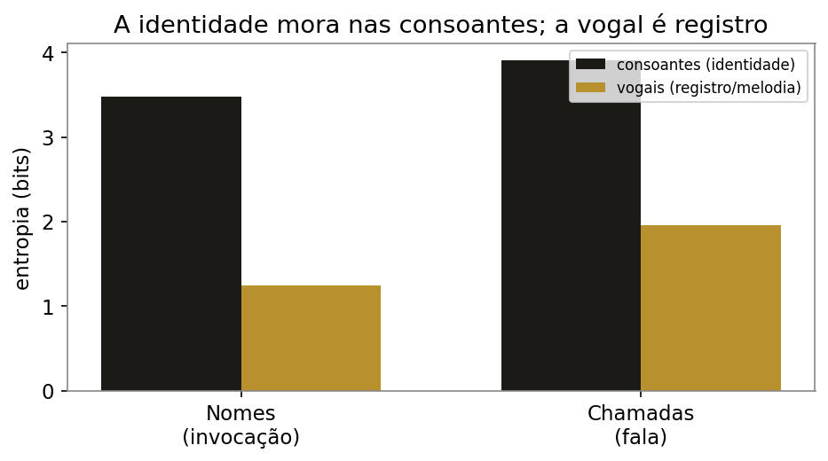

# Chapter 2 — The name generator

If the *Liber Loagaeth* is a field of names, the next question is mechanical: **how** are those names made? The measurement shows they are neither drawn letter by letter nor copied from a list — they are **generated** by a small set of rules that assemble each name from pieces. This chapter dissects those pieces.

## Prefix · root · suffix

The first structure is the **tripartition**. The Loagaeth's names decompose, for the most part, into a three-slot mold:

> **[prefix] · [root] · [suffix]**

The **root** is the consonantal heart — the name's identity (see Ch. 3). The **prefix** and **suffix** are affixes from a small, recurring inventory that repeat throughout the book, attaching to different roots. This is the signature of a morphological generator: few edge pieces, many roots, ruled combination. A shuffled text does not produce recurring affixes aligned to word edges — the Loagaeth does, above the null. **[#334, REAL]**

## The name families

Related roots form **families** — sets of names that share a consonantal skeleton and vary at the edges and in the vowels. The study isolated families named by their dominant root, each with its own territory in the book:

- **CHASTOR** — the first family identified, with nested titles (names that contain smaller names as a nucleus). **[finding a71 ff.]**
- **NOCHA** — the farthest-reaching house: present in 35 of the 36 measured dense faces, generative matrix of the D-/AD- prefix house. It is the most recurrent name in the book (frequency far above the top of any null, NOCHA ≈ 492× the shuffled top). **[#335, #337]**
- **GETH / ALGETH** — the rival house, of the L-/X- prefixes, with vocabulary complementary to the NOCHA house.
- **ANZACH**, **ACLAX**, **DAXVAR**, **CHIDNO** — families with a zonal signature (see the heat map below).

The families are not imposed by the analyst: they emerge from a clustering by edit distance (how many letters it takes to go from one name to another) and **survive the null** — the same clustering over surrogate names does not produce such cohesive communities. **[#336, REAL]**

## The two houses

Above the families lies a deeper division: **two grammatical houses**, distinguished by the behavior of the affixes.

| | House **NOCHA** | House **GETH** |
|---|---|---|
| Typical prefixes | D-, AD- | L-, X- |
| Register vowel | lighter (A/O) | darker (E/I) |
| Territory | middle and body | edges and deep |

The distinction between houses carries **real mutual information**: knowing the house predicts the affixes and the vowel above chance. It is the most robust grammatical fact of the generator — the book declines its names by house, the way a language declines nouns by gender or class. **[#405, REAL]**

## The morphemes

Below the affix lies the **minimal recurring unit** — the morpheme. A compression-based segmentation (which cuts the stream where predictability breaks) extracts an inventory of pieces that recombine: some are affixes, some nuclei, some internal connectors. The inventory is **finite and small** — somewhere between a few dozen productive pieces generate most of the names. This directly answers the question "can it be turned into a grammar?": it can, and that grammar is compact. **[#377, REAL]**

## Minimal pairs: the proof of the vowel

The cleanest evidence that there is a morphological generator are the **minimal pairs** — two names identical except for **one vowel**. Dee himself recorded the pair *pola / pala*. The measurement finds **13 such pairs** in the book, far above what chance would produce (z=+46). A minimal pair can only exist if the consonant is the identity and the vowel is a swappable piece — exactly what a root·pattern generator does. **[#358, REAL]**

## Super-names and nested titles

Some long names **contain** smaller names as a nucleus — nested titles, in the pattern of the CHASTOR family. This suggests a **constructive hierarchy**: larger names built upon smaller names, as a compound title ("king-of-kings") carries the simple title within it. It is a strong descriptive finding, with an operative implication (Ch. 8): the structure of the name may mirror the hierarchy of the being it names.

## What the generator is NOT

A closing honesty: the generator is **morphological**, not **arithmetical**. There is no evidence that the length, the position or the letter-count of the names encode numbers, dates or coordinates (Part II refutes these hypotheses one by one). The generator assembles **sounds with identity**, not ciphers. The rule is of language, not of arithmetic.

\newpage
