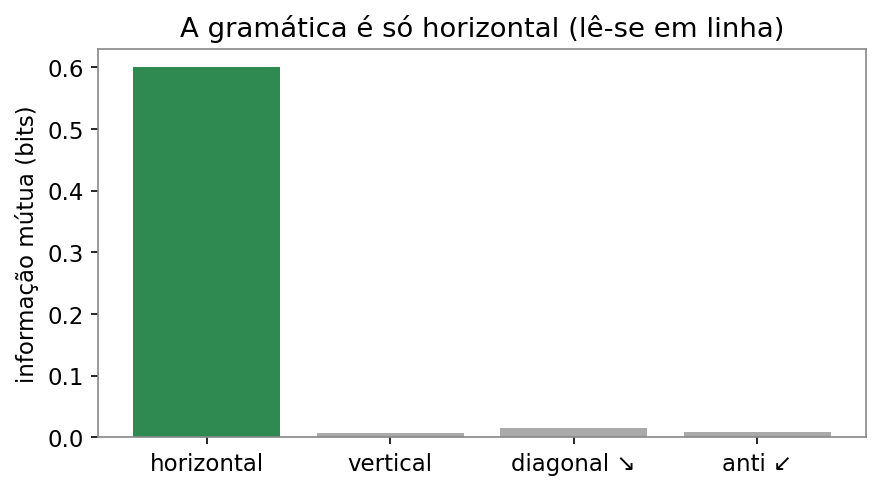

# Chapter 3 — The language: consonant, register, phonotactics

Chapter 1 showed **that** the Loagaeth is a language; Chapter 2, **how** it assembles names. This chapter dissects the language from within: where identity lives, what the vowel does, and why the sound set is so balanced.

## Identity is consonantal

The language's central structural discovery: **the consonant carries identity; the vowel carries register**. It is the principle of the Semitic languages (Hebrew, Arabic), where the root is a skeleton of consonants (*k-t-b*, "to write") and the vowels that clothe it give the concrete word (*kitab*, *katib*, *kataba*).

The measurement proves this two ways:

1. **Entropy.** The uncertainty of the consonants (3.48 bits in the names) is nearly triple that of the vowels (1.25 bits). The consonant is where the information is; the vowel is predictable, from a small set. **[#402, REAL]**

2. **Minimal pairs.** The 13 pairs differing only by one vowel (Ch. 2) prove, case by case, that swapping the vowel does **not** create another identity — it creates another form of the same name. **[#358]**

The operative implication is direct and kept for Part III: **the name is recognized by its consonants**; the vowel is where the operator has freedom of register and melody.

## The vowel is register

If the vowel is not identity, what is it? **Register** — the "tone" in which the name is uttered. The vowel distribution is neither uniform nor random: it **changes from region to region** of the book, darkening from A (open, bright) to U (closed, dark) as one descends toward the deep (Ch. 6). The vowel is the parameter the book **modulates** while keeping the consonants as anchor. It is the melodic layer of the language — what, in Ch. 4, turns out to be literally **singable**.

## Phonotactics: a well-formed language

A language has **phonotactics** — rules of what may follow what. The Loagaeth has them, and they are those of a **balanced, pronounceable** language, not a letter soup:

- **No-doubling rule.** Identical letters avoid sequence: immediate repetition (XX, LL) is **far rarer** than in chance (strong anti-structure, negative z). A language made to be spoken avoids the stumble of gemination. **[REAL, early finding]**

- **Consonant-vowel alternation.** The book keeps open, pronounceable syllables above the null (see Ch. 4, pronounceability z=+6.9). None of the unpronounceable consonant pileups a random draw would produce.

- **Marked line edges.** The start and end of lines have their own letter distribution — words do not spill arbitrarily across the edges; there is a template. **[REAL]**

- **A balanced 21-letter inventory.** No letter dominates to the point of collapsing the language, none is so rare as to be decorative. The frequency profile is that of a real language, not of a code.

## The grammar is horizontal only

A decisive test of direction: **along which axis do the letters "talk"?** We measured the mutual information (how much one letter predicts its neighbor) in each direction:

| Direction | Mutual information |
|---|---|
| **Horizontal** (→) | **0.60 bits** |
| Vertical (↓) | 0.007 bits |
| Diagonal (↘) | 0.016 bits |
| Anti-diagonal (↙) | 0.008 bits |

The grammar lives **entirely in the horizontal**. The columns and diagonals have no syntax — what they hold is **template** (a mold of form, not of meaning; Ch. 5). This settles the reading question for good: **the Loagaeth is read along the line, left to right**, like any text — except the seam 26–28, where content migrates to the diagonal (Ch. 5). **[#MI, REAL]**

## The grammar's horizon: short

How far does the rule reach? Mutual information decays fast with distance: neighboring letters talk, letters five cells apart hardly do. The Loagaeth's grammar is **short-range** — local rules for assembling syllable and name, not long periods of sentence syntax. It is one more proof that these are **names**, not sentences: a name is a short, closed unit; a sentence chains long dependencies. The Loagaeth has none. **[#370a]**

## Synthesis

The Loagaeth's language is: **consonantal** in identity, **vocalic** in register, **balanced** in phonotactics, **horizontal** and **short-range** in grammar. It is a language designed to **name** and to **be uttered** — not to narrate and not to hide. The next chapter carries this to its consequence: the book was made to be **sung**.

\newpage
