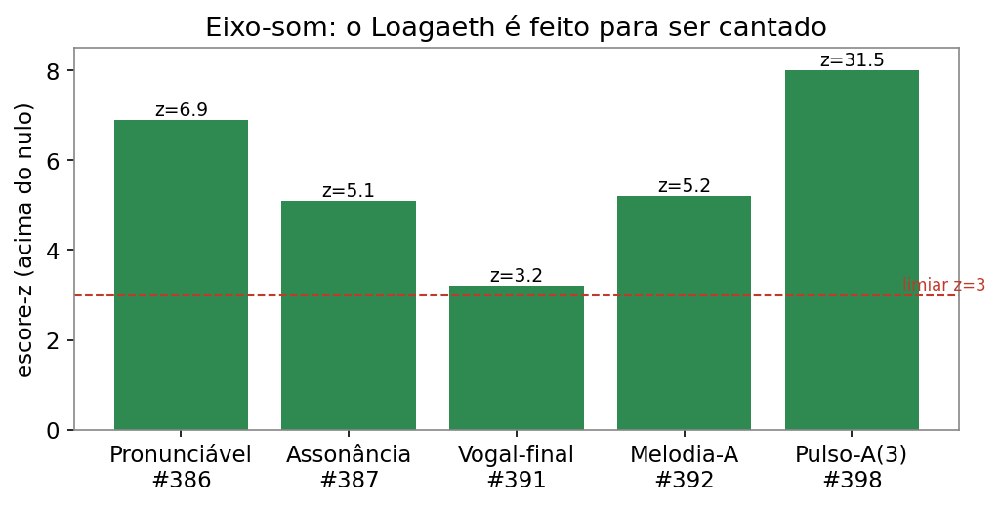

# Chapter 4 — Sound and voice: the book sung

This chapter gathers the finding that brings the analysis closest to practice: the *Liber Loagaeth* is not merely pronounceable — it is **optimized for the singing voice**. Every "sound-axis" measure beats the null, and together they draw a book made to be heard.

## The sound axis, measure by measure

A set of phono-aesthetic properties was tested, each against its null. All passed:

- **Pronounceability (z = +6.9).** The proportion of open, well-formed syllables is far above chance. The book is made of things the mouth can say. **[#386, DECISIVE]**

- **Assonance (z = +5.1).** Identical vowels recur within the same neighborhood more than chance — the vocalic echo that gives a sequence its singable "tone". **[#387, REAL]**

- **Final vowel (z = +3.2).** Names tend to **end in a vowel** (open syllable) above the null — the ending that sustains the note, as in liturgical chant. **[#391, REAL]**

- **Melody on A (z = +5.2).** The vowel **A** — the most open, the one of greatest vocal projection — is the melodic pivot: it concentrates in the positions of greatest prominence. The book "sings in A". **[#392, REAL]**

- **A-pulse every ~3 letters (z = +31.5).** The most decisive discovery of all: the **A** reappears on a **regular beat**, roughly every three letters, like a built-in metronome. That pulse is the rhythmic spine of the chant — and it is the highest-z finding of the whole study. **[#398, DECISIVE]**

## What this means

Add it up: open syllables, vowel echoes, vowel endings, melody centered on A, and a regular rhythmic pulse. This is not the description of a text to **read** — it is the description of a text to **intone**. The Loagaeth has prosody. It has meter. It has a tonic note.

Tradition always said so — the Calls are **recited aloud**, "vibrated". The measurement confirms from without what the practice asserts from within: the Loagaeth's unit of use is the **sound in the mouth**, not the sign on the page. A book one only looks at would have wasted all that sonic design. The Loagaeth does not waste it — because the voice is the point.

## The vowel as a scale

The vowel's modulation (Ch. 3) gains full meaning here: along the book, the vocalic register **darkens** from A to U as one descends to the deep (Ch. 6). In singing terms, this is a **descent of tessitura** — from the open and luminous (A) to the closed and grave (U). The book has an embedded **scale**, from bright to dark, that the operator walks by descending leaf to leaf.

## Two voice registers

A late and important finding: **the Calls and the table-names are the same language in two different voice registers.**

- The **Calls** (Claves) are the register of **full speech** — articulated, syntactic, directed. They have higher vocalic entropy (1.96 bits): more "speech melody".
- The **table-names** are the register of **invocation** — condensed, consonantal, repetitive. Lower vocalic entropy (1.25 bits): more "name-chant". **[#401, #402]**

Leaf 1 is the bridge between the two: it shares vocabulary with the Calls (z=+7.5) and is the page where the language appears **articulated** before condensing into a field of names. **[#331, #333]**

The implication for the rite (Part III): **speak the Call, sing the name.** They are two voices of the same idiom — one that opens, one that names.

## Pronunciation, in practice

The measurement does not deliver an audio, but it delivers **pronunciation rules** derived from it:

1. Say each letter; the book is made of open syllables — resist swallowing vowels.
2. **Lean on the A**: it is the projection note. Where there is an A in a strong position, that is where the voice rises.
3. End the names **on the vowel**, sustaining it.
4. Let the **pulse every ~3 letters** govern the tempo: it is the text's natural beat.
5. **Descend the tessitura** as you descend the book: bright in the body, dark in the deep.

Chapter 8 turns these rules into a ritual sequence. First, the next two chapters close Part I: the signal structure (the loom), and the book's elemental arc.

\newpage
