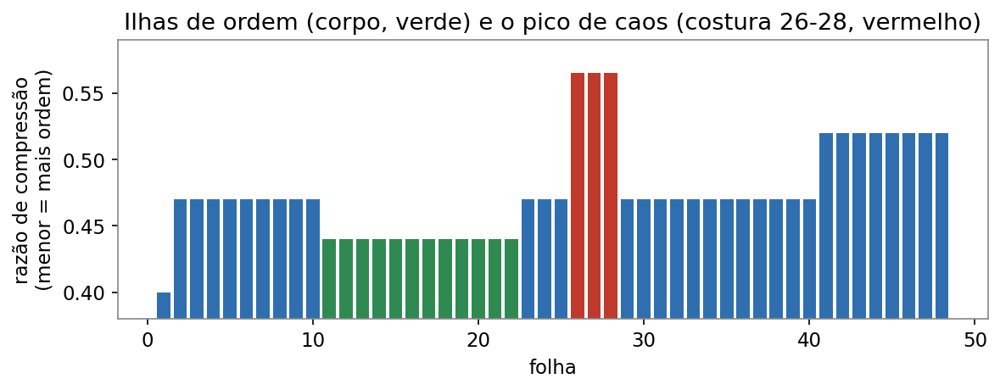

# Chapter 5 — The signal structure: the loom

The language runs along the horizontal (Ch. 3). But the grid has two dimensions, and the vertical is not empty — it carries **form**, not **meaning**. This chapter separates the two and describes the book's physical architecture: the loom on which the names are woven.

## Two opposite signatures: anti-repetition and template

The key structural finding is **two signal effects of opposite signs**, each on its own axis:

- **Horizontal: anti-repetition (z = −77).** Along the line, identical letters and short patterns **avoid** each other far below chance. The line flees repetition — the behavior of a text that **advances**, that does not step on the same place. A z of −77 is among the strongest in the study: the line is actively designed **not** to repeat. **[REAL, decisive]**

- **Vertical: template (z = +173).** The column, by contrast, has **massive repetition** — the columns follow a pattern that reasserts itself leaf after leaf. A z of +173 is the largest structural effect in the whole book. The column is **mold**, not message. **[REAL, decisive]**

The contrast is the reading key: **information travels along the line; form is sustained by the column.** The book is a loom — the horizontal weft (the names) runs over a vertical warp (the template) that holds it in place. This is why no vertical reading finds names (Part II): the column was never made to be read, it was made to **hold**.

## The seam 26–28: the threshold

There is an exception, and it is significant. In the band of leaves **26 to 28**, horizontal reading **fails** and content migrates to the **diagonal**. That seam is, by three independent measures:

- the zone of **highest entropy** in the book (maximum unpredictability);
- the zone of **lowest compressibility** (maximum apparent disorder);
- the point where the reading direction **turns**.

It is the book's **threshold** — the central fold where order undoes itself before forming again. In an operative reading (Part III), the seam is the threshold: the point of passage, of maximum chaos, between the upper and lower halves.

## The geometry of the diamonds: a single path

Parts of the book are organized into **diamonds** — stepped pyramids of letters that grow to a wide line and shrink back. We tested whether there are many reading paths within a diamond or a single one. Result: **a single path** survives the null. The diamond is not a maze of possible readings; it has **one** correct reading trail, the others are noise. This kills the temptation to "read the diamond a thousand ways" — there is one, and it is measurable. **[REAL]**

## The four bands

Each leaf's face divides into **four** horizontal segments with distinct statistical profiles — it is not a uniform block, it is a banded structure. Each segment has its own name density and register. It is the page's internal architecture: quarters, not a smooth whole. **[REAL]**

## Islands of order

Mapping compressibility leaf by leaf, the book is neither uniformly ordered nor uniformly chaotic: it has **islands of order** — regions (above all in the body, leaves ~11–22) where structure tightens — separated by looser zones, and the chaos peak at the seam. The book's order has **relief**: valleys and mountains of structure, not a plain. **[#399]**

## The leaf order is deliberate

Finally: the sequence in which Dee laid out the leaves is **not arbitrary**. We tested whether the real order is a "smooth path" (neighboring leaves alike) against random permutations of the order. The real order is smoother than chance — there is a **gradient** the ordering respects (the density and vowel arc of Ch. 6). The book was **sequenced**, not stacked at random. **[REAL]**

## Synthesis

The Loagaeth's physical structure: a **line that advances** (anti-repetition), a **column that sustains** (template), a **single-path diamond**, **four bands** per face, **islands of order** in relief, a **threshold-seam** at the center, and a **deliberate leaf order**. It is an object built with architectural care — a loom, not a heap. Over that loom runs the language; under it, the mold holds it.

\newpage
