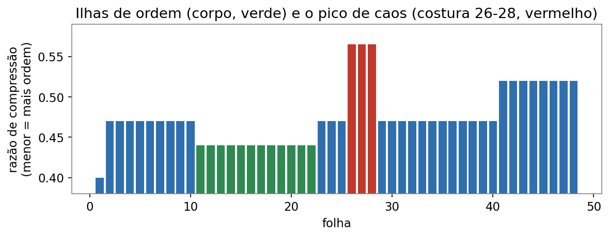

# Chapter 6 — The elemental arc: density, dissolution and function

Closing Part I: the book has an **arc** — a shape that runs from start to end and changes character along the way. Three independent measures draw the same arc, which is why it is one of the most robust findings of the whole study. This chapter also faces the elemental question head-on, with the honesty it demands.

## The arc: it opens, thickens, dissolves

Mapping the book leaf by leaf, one sees a **three-beat shape**:

1. **Body (leaves ~2–40): density and order.** Name density rises and peaks at the middle (z=+126, [#342]). This is the region of **islands of order** (Ch. 5), where structure tightens and names recur in families. Here the book is **full**.

2. **Seam (26–28): the threshold.** At the center, the chaos peak (Ch. 5): maximum entropy, minimum compression, the reading turns to the diagonal. The book's fold.

3. **Deep (leaves ~40–48): dissolution.** At the bottom, everything **undoes itself**: the names vanish (from ~30 per thousand letters to ~5, [#360]), repetition collapses, entropy rises, the vowel darkens from A to U ([#382]). The book **dissolves** at its end.

The finding's strength is the **convergence**: three measurable, independent dimensions — the vanishing of names [#360], the darkening of the vowel [#382], and the fracture of elemental identity [#397] — point to **the same** dissolution zone in the deep. When three different rulers agree, it is not an artifact of one of them; it is a real property of the object. **[DECISIVE]**

## The zonal heat map

Within the body, the name families have a **preferred address** — not rigid borders (that was refuted, Ch. 7), but a real zonal **gradient**:

| Zone of the book | Dominant family |
|---|---|
| Beginning | **DAXVAR** |
| Middle | **ACLAX**, **NOCHA** |
| End / deep | **CHIDNO**, **ALGETH** |

The families **migrate** along the book. This gives the Loagaeth an internal geography: to walk it leaf by leaf is to cross territories of names that succeed one another. **[zonal, REVISED to moderate]**

## The elemental question, with honesty

Tradition links regions of the Loagaeth to elements. The study tested this rigorously — and here total honesty is required, because **the elemental systems conflict with each other**.

There are **two** classic ways to assign an element to an astrological position, and they **disagree** in the deep:

- **By sign triplicity** (the element of the house's zodiac sign): gives one map.
- **By planetary ruler** (the element of the planet ruling the house): gives another.

Measuring the book by **both** rulers ([#396, #397]):

| Region | By sign (triplicity) | By planet (ruler) | Verdict |
|---|---|---|---|
| **Body (1–40)** | **Earth** | **Earth** | **Agree → Earth** |
| **Deep (41–48)** | **Water** | **Fire** | **Conflict** |

The body of the book is, by both measures, **Earth** — matter, body, the concrete. But the **deep** is ambiguous: by sign triplicity it is **Water**; by planetary ruler it is **Fire**. The two rulers point in opposite directions.

This is **not a failure** of the measurement — it is **the very signature of the dissolution**. In the deep, where names vanish and the vowel darkens, the **elemental identity also fractures**: the book reaches a region where the correspondence system itself ceases to give a single answer. The dissolution is total — it reaches even the element. **[#397]**

So this chapter does **not** stamp an element on the deep. It records the conflict as data. Operatively (Part III), this has a consequence: the deep of the Loagaeth is the zone of **passage and undoing** — Water (dissolve) *or* Fire (consume), depending on the ruler and the intent —, not a zone of stable identity to "invoke" like the others.

## Function by region (operative summary)

Gathering the arc, the zonal map and the element, the Loagaeth has a **function that changes by region** — the basis of ritual use (Part III):

- **Leaf 1 — sealed lexicon.** The language itself; one does not "enter" by it (no Key). Source, not door.
- **Body (2–40) — Earth, dense names.** The region of **identity and presence**: where the names are most numerous, recurrent and stable. From here the beings are called (the NOCHA house, Air/mind, lives in the middle).
- **Seam (26–28) — the threshold.** Threshold, passage, maximum chaos. Turning point.
- **Deep (41–48) — dissolution, fractured element.** Zone of **undoing and crossing** — ambiguous Water/Fire. Not of fixed identity.

## Close of Part I

Part I measured the whole Loagaeth: it is a **language** (Ch. 1), with a **generator** of names (Ch. 2), **consonantal and singable** (Chs. 3–4), woven on a **loom** of line-and-column (Ch. 5), with an **arc** that opens, thickens and dissolves, and a **function that changes by region** (Ch. 6). All measured, all against the null. Part II buries what did not survive; Part III uses what did.

\newpage
