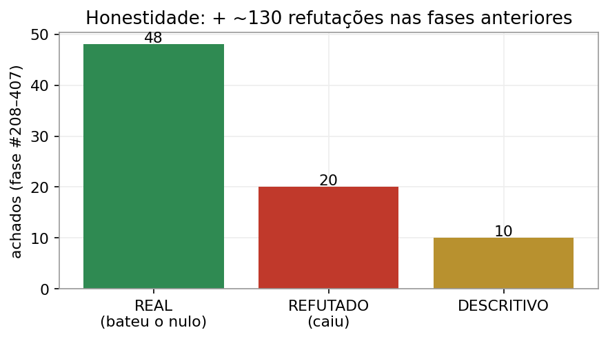

# PART II — WHAT THE LIBER LOAGAETH IS **NOT**

# Chapter 7 — The graveyard: everything that fell, and why

This is the part of the book that most sets it apart from anything else written on the Loagaeth. The esoteric tradition accumulates claims; this study **tests** them, and reports the ones that **died** as prominently as the ones that lived. Each refutation below has its number and its null model. The Babel principle (Ch. 0) guarantees that *something* is always found in half a million letters — so only what beats chance counts, and here is what did **not**.

## 7.1 The ciphers and codes

| # | Hypothesis | Measure | Verdict |
|---|---|---|---|
| 7 | Mirrored/reversed names | 102 pairs vs 93 in Markov-3 | REFUTED |
| 8 | Semitic triliteral root (morphological) | words/skeleton ≈ 1.3, English-like | REFUTED |
| 10 | Gebofal reordering, 4 geometric models, YHVH/MAD ciphers | none beats the null | REFUTED |
| 11 | Acrostic of the prologue | gibberish; translation kills the cipher | REFUTED |
| 12 | Decimation by 2 along the rows | structure collapses (2220 → ~20 6-grams) | REFUTED |
| 13 | Watchtower-style extraction from the grid centre | centre ≈ random positions (z ≤ 1.7) | REFUTED |
| 40 | The top letters spell a name | no, for k = 3…8 | REFUTED |
| 41 | Letter values follow frequency | no, 13 systems with correction | REFUTED |
| 67 | The inverse (mirror) reading holds names | CHASTOR 179 → 0; forward 3.5 vs inverse 6.1 bits | REFUTED |
| 88 | Acrostics / centre cells | no names | REFUTED |
| 114 | The Great Table is rule-generated (Soyga-type)? | cell not predictable from left/above | REFUTED |
| 198 | Neighbour rule (cell = f(above, left))? | 3.02 of 3.95 bits remain; neighbours remove only 0.94 | REFUTED |
| 200 | Book as a 49×49×49 cube with a depth axis | MI between leaves 0.0016 bits (null) | REFUTED |

**What this says:** there is no **cipher** in the Loagaeth. Not equidistant (ELS), not modular, not acrostic, not neighbour (Soyga-type), not in a third dimension. The ruler is always the same: the real falls **within** the Markov-3 surrogate's distribution. Everything that "appears" appears equally in noise with the same phonotactics.

## 7.2 The numerology and the geometry

| # | Hypothesis | Measure | Verdict |
|---|---|---|---|
| 21 | Bigger name = bigger realm | length × frequency ρ = **−0.39** (opposite) | REFUTED |
| 22 | Gematria encodes power | ρ = +0.11 | REFUTED |
| 57 | Fibonacci structure | none | REFUTED |
| 58 | Gradual 7×7 division / central cross | edge effect only | REFUTED |
| 59 | Golden Dawn quadrant rearrangement | the original is best (35/35) | REFUTED |
| 64 | Letter counts vs 7 / 42 / 49 | at chance; total ≡ 0 mod 7 from the 49×49 build | REFUTED |
| 2 | Golden ratio at seam/dissolution | gap 2.7 from φ; no match | REFUTED |
| 5 | Events on prime leaves | 4 vs 4.7 expected | REFUTED |

A **real** numeric finding deserves a note, so as not to hide it: in the **number tables** of the Heptarchy (not the Loagaeth), the number is "head digit + permuted 2·3·6 block" (z 7.6–9.0; anagram pairs z 13.7) [#28]. It is real, but it is from **another** Dee document. The Loagaeth **does not encode numbers**.

## 7.3 The bridges to the other Enochian systems

The hypothesis dearest to tradition: that the names of the **Watchtowers** and of Dee's other systems "live" inside the Loagaeth. We tested it **exhaustively**, each name as a substring and in pieces, in the whole book and by segment, against composition-matched nulls. The verdict is uniform and **negative**:

| # | System | Measure | Verdict |
|---|---|---|---|
| 90 | Shem, Goetia, planetary, governors | all at Markov-3 expectation; BORNOGO 1× | REFUTED |
| 222 | Names of the Sigillum Dei Aemeth | 2/17 present, null 2.5±0.9, **z = −0.54** | REFUTED |
| 406 | Ars Paulina angels (25, hours+planetary) | only ANAEL (1/25) and RAPHAEL (1×), null 1.5 | REFUTED |
| 91 | "Constellation" of names on stacked faces | within both nulls | REFUTED |
| — | God names / Kings / Seniors of the Watchtowers (whole and in pieces: BATA, IVAH…) | pieces at the null's frequency | REFUTED |

There is a **structural reason** beyond the statistics: Solomonic angels end in **-EL** (SAMAEL, ANAEL, MICHAEL); in the Loagaeth the suffix -EL is **rare** (AEL 16×, IEL 5× in the whole book), because the Loagaeth closes in **-A** [#391, #406]. It is an **opposite** naming convention — the Loagaeth could not contain those angels even if it wanted to.

**Conclusion:** the *Liber Loagaeth* does **not contain** Dee's other systems nor the classic magical systems. It is **prior and autonomous** — the root, not a derivative.

## 7.4 The bridge to the Calls: kinship, not extraction

A special case, because published researchers claim that **the Calls come out of the tables**. We tested both forms:

| # | Claim | Measure | Verdict |
|---|---|---|---|
| 107 | Glossed Call words inside the Loagaeth | all 26 at Markov-3 expectation | REFUTED |
| 119 | Call *n* ↔ table *n+1* (textual link) | **p = 0.63** | REFUTED |
| 123 | Nalvage's number references locate the letters? | best 9/61, family-wise p 0.79 | REFUTED |
| 128 | Every k-th letter gives Call-like text (Laycock) | k = 2…12 ≈ shuffled | REFUTED |
| 195 | Calls hidden along a reading path (diagonal, reverse, column) | anti-diag z 3.6 under flow-null, but z 1.5 under word-null | NOT FOUND |
| 407 | "The Calls come from the tables" (Laycock, literal) | **147/608 vs null 213** — below chance | REFUTED |

The Call words are **not hidden** in the grids — the real text finds **fewer** than chance (147 vs 213). The Call↔table link is **language kinship** (same phonotactics and lexicon, Ch. 4), **not** literal extraction nor a page-to-page link. *(Keep this for Part III: the traditional "Call opens leaf" map is inherited practice, not a finding of the measure.)*

## 7.5 The "solutions" published by others

| # | Claim (web) | Measure | Verdict |
|---|---|---|---|
| 407 | Skip-7 method (enochiantoday) | 3 names (best phase) vs null 1 — negligible | REFUTED |
| 176 | kondor.de as an independent transcription | differs by 1 letter in 23,712 — a copy of Peterson | REFUTED |

No public "solution" survives the measure.

## 7.6 Direction, copy, artifact

| # | Hypothesis | Measure | Verdict |
|---|---|---|---|
| 36 | "Kelley skipped every other letter" | adjacent stats match, skip-one do not (JS 0.09 vs 0.35) | REFUTED (real in chessboard form) |
| 42 | Left/right pillars | only the line edges; inside, left = right | REFUTED (pillars) |
| 74 | Long-range memory / hidden code | excess only at 4–12 letters | REFUTED (long range) |
| 75 | Block copying between tables | longest shared 16 vs surrogate 18 | REFUTED |
| 135 | Long repeats copied in place | same columns no more than shuffles (p 0.88) | REFUTED |
| 161 | Side b linked to side a cell by cell | all p ≥ 0.15 | REFUTED |
| 100 | Vowel mirroring as a rule | 304 vowel vs 342 consonant; surrogate same | REFUTED |
| 106 | **Broad** word-order syntax | 19 ordered pairs vs 16.2 in Markov-3 | REFUTED |

Note on #106: the **broad** syntax falls, but the pair **GETH→ACLAX** has a real fixed order (Ch. 2, 17× vs 0) — a local signal, not a general rule. That is how honesty works: the real pair survives, the general rule does not.

## 7.7 The titles, the lexicon, the servants

| # | Hypothesis | Measure | Verdict |
|---|---|---|---|
| 52 | Leaf titles summarize their leaf | no (15% vs 16%) | REFUTED |
| 105 | Leaf-1 words inside the tables | 2,780 vs 3,081 expected | REFUTED |
| 109 | Leaf titles in their leaf's dialect | mean own rank 0.49 (chance 0.5) | REFUTED |
| 110 | A names+letters grammar codes better than letter habits | 3.000 vs 2.985 bits/letter | REFUTED |
| 180 | Leaf 1 as a key to the others, square by square | 336 tests, mean z −0.1 | REFUTED |
| 99 | The core born before its titles | 23/27 vs 22.7 expected (z 0.19) | REFUTED |

## 7.8 The 49th leaf and meaning: absences that are findings

Two absences that are **not** failures, but findings:

- **The 49th leaf** — "that is not, was not, and shall not be known" — exists only by report; there is no datum to measure. We record it as a **declared absence**.
- **The full meaning of each name** is not on the page. No internal cipher delivers it (section 7.1); no external source glosses it; our root-names have zero translation anchor [a97]. Dee himself: *"Interpret not."* The missing translation **was not lost — it was never written**. It belongs to the operative plane (Part III), not the statistical one.

## What remains standing after the graveyard

After burying more than a hundred hypotheses, what **remains standing** is exactly what Part I measured: a constructed, consonantal, singable language, woven on a loom of line-and-column, with houses, families, hierarchy and an elemental arc. No cipher, no other system, no number. The Loagaeth is **less** than tradition fantasized and **more** than skepticism expected: not a vault of secrets, but a **language of names made for the voice**. Part III uses it.

\newpage
