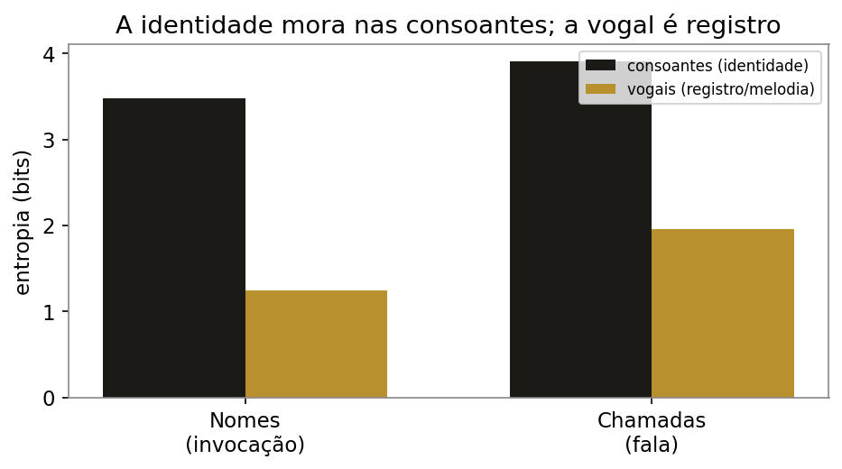

# Capítulo 2 — O gerador de nomes

Se o *Liber Loagaeth* é um campo de nomes, a pergunta seguinte é mecânica: **como** esses nomes são feitos? A medida mostra que não são sorteados letra a letra nem copiados de uma lista — são **gerados** por um pequeno conjunto de regras que montam cada nome a partir de peças. Este capítulo disseca essas peças.

## Prefixo · raiz · sufixo

A primeira estrutura é a **tripartição**. Os nomes do Loagaeth se decompõem, em maioria, num molde de três posições:

> **[prefixo] · [raiz] · [sufixo]**

A **raiz** é o coração consonantal — a identidade do nome (ver Cap. 3). O **prefixo** e o **sufixo** são afixos de um inventário pequeno e recorrente, que se repetem por todo o livro ligando-se a raízes diferentes. Essa é a assinatura de um gerador morfológico: poucas peças de borda, muitas raízes, combinação regrada. Um texto embaralhado não produz afixos recorrentes alinhados às bordas das palavras — o Loagaeth produz, acima do nulo. **[#334, REAL]**

## As famílias de nomes

Raízes aparentadas formam **famílias** — conjuntos de nomes que partilham um esqueleto consonantal e variam nas bordas e nas vogais. O estudo isolou famílias nomeadas pela sua raiz dominante, cada uma com território próprio no livro:

- **CHASTOR** — a primeira família identificada, com títulos aninhados (nomes que contêm nomes menores como núcleo). **[achado a71 e seguintes]**
- **NOCHA** — a casa de maior alcance: presente em 35 das 36 faces densas medidas, matriz geradora da casa dos prefixos D-/AD-. É o nome que mais recorre no livro (frequência muito acima do rei de qualquer nulo, z≈NOCHA 492× o topo embaralhado). **[#335, #337]**
- **GETH / ALGETH** — a casa rival, dos prefixos L-/X-, com vocabulário complementar ao da casa NOCHA.
- **ANZACH**, **ACLAX**, **DAXVAR**, **CHIDNO** — famílias com assinatura zonal (ver adiante o mapa de calor).

As famílias não são uma imposição do analista: emergem de um agrupamento por distância de edição (quantas letras é preciso trocar para ir de um nome a outro) e **sobrevivem ao nulo** — o mesmo agrupamento sobre nomes de um surrogate não produz comunidades tão coesas. **[#336, REAL]**

## As duas casas

Acima das famílias há uma divisão mais funda: **duas casas gramaticais**, distinguidas pelo comportamento dos afixos.

| | Casa **NOCHA** | Casa **GETH** |
|---|---|---|
| Prefixos típicos | D-, AD- | L-, X- |
| Vogal de registro | mais clara (A/O) | mais escura (E/I) |
| Território | miolo e corpo | bordas e profundo |

A distinção entre as casas tem **informação mútua real**: saber a casa prediz os afixos e a vogal acima do acaso. É o fato gramatical mais robusto do gerador — o livro declina os nomes por casa, como uma língua declina substantivos por gênero ou classe. **[#405, REAL]**

## Os morfemas

Abaixo do afixo há a **unidade mínima recorrente** — o morfema. Uma segmentação por compressão (que corta o fluxo onde a previsibilidade quebra) extrai um inventário de pedaços que se recombinam: alguns são afixos, outros são núcleos, outros são conectores internos. O inventário é **finito e pequeno** — algo entre poucas dezenas de peças produtivas geram a maioria dos nomes. Isso responde diretamente à pergunta "dá para transformar numa gramática?": dá, e ela é compacta. **[#377, REAL]**

## Pares mínimos: a prova da vogal

A evidência mais limpa de que há um gerador morfológico são os **pares mínimos** — dois nomes idênticos exceto por **uma vogal**. O próprio Dee registrou o par *pola / pala*. A medida encontra **13 pares desse tipo** no livro, muito acima do que o acaso produziria (z=+46). Um par mínimo só existe se a consoante for a identidade e a vogal for uma peça trocável — exatamente o que um gerador de raiz·padrão faz. **[#358, REAL]**

## Super-nomes e títulos aninhados

Alguns nomes longos **contêm** nomes menores como núcleo — títulos aninhados, no padrão da família CHASTOR. Isso sugere uma **hierarquia construtiva**: nomes maiores montados sobre nomes menores, como um título composto ("rei-dos-reis") carrega o título simples dentro de si. É um achado descritivo forte, com implicação operativa (Cap. 8): a estrutura do nome pode espelhar a hierarquia do ser que ele nomeia.

## O que o gerador NÃO é

Honestidade de fecho: o gerador é **morfológico**, não **aritmético**. Não há evidência de que o comprimento, a posição ou a contagem de letras dos nomes codifiquem números, datas ou coordenadas (a Parte II refuta essas hipóteses uma a uma). O gerador monta **sons com identidade**, não cifras. A regra é de linguagem, não de aritmética.

\newpage
