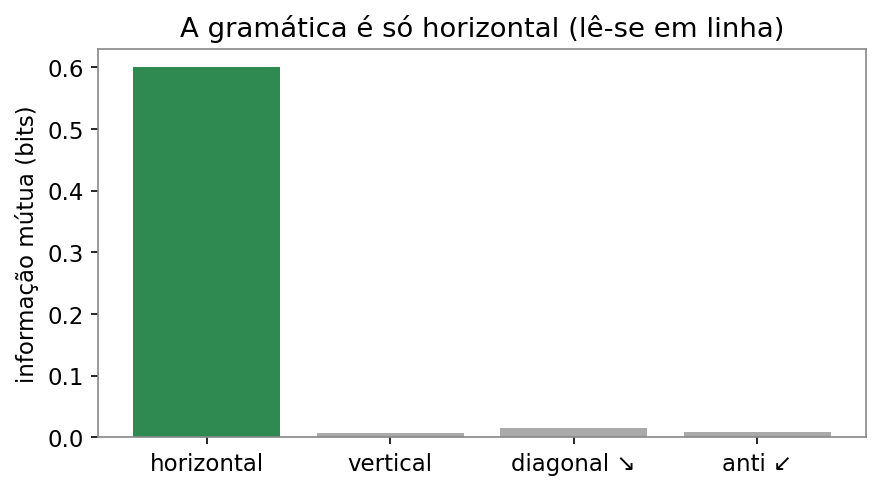

# Capítulo 3 — A língua: consoante, registro, fonotática

O Capítulo 1 mostrou **que** o Loagaeth é uma língua; o Capítulo 2, **como** ela monta nomes. Este capítulo dissseca a língua por dentro: onde mora a identidade, o que faz a vogal, e por que o conjunto de sons é tão equilibrado.

## A identidade é consonantal

A descoberta estrutural central da língua: **a consoante carrega a identidade; a vogal carrega o registro**. É o princípio das línguas semíticas (hebraico, árabe), onde a raiz é um esqueleto de consoantes (*k-t-b*, "escrever") e as vogais que a vestem dão a palavra concreta (*kitab*, *katib*, *kataba*).

A medida prova isso de dois modos:

1. **Entropia.** A incerteza das consoantes (3,48 bits nos nomes) é quase o triplo da das vogais (1,25 bits). A consoante é onde está a informação; a vogal é previsível, de um conjunto pequeno. **[#402, REAL]**

2. **Pares mínimos.** Os 13 pares que diferem só por uma vogal (Cap. 2) provam, caso a caso, que trocar a vogal **não** cria outra identidade — cria outra forma do mesmo nome. **[#358]**

A implicação operativa é direta e guardada para a Parte III: **o nome se reconhece pelas consoantes**; a vogal é onde o operador tem liberdade de registro e melodia.

## A vogal é registro

Se a vogal não é identidade, o que ela é? **Registro** — o "tom" em que o nome é dito. A distribuição vocálica não é uniforme nem aleatória: ela **muda de região para região** do livro, escurecendo de A (aberta, clara) para U (fechada, escura) à medida que se desce para o profundo (Cap. 6). A vogal é o parâmetro que o livro **modula** enquanto mantém as consoantes como âncora. É a camada melódica da língua — o que, no Cap. 4, se mostra ser literalmente **cantável**.

## A fonotática: uma língua bem-formada

Uma língua tem **fonotática** — regras do que pode seguir o quê. O Loagaeth tem, e elas são de uma língua **balanceada e pronunciável**, não de uma sopa de letras:

- **Regra de não-dobrar.** Letras iguais evitam-se em sequência: a repetição imediata (XX, LL) é **muito mais rara** que no acaso (anti-estrutura forte, z negativo). Uma língua feita para ser dita evita o tropeço da geminação. **[REAL, achado a-cedo]**

- **Alternância consoante-vogal.** O livro mantém sílabas abertas e pronunciáveis acima do nulo (ver Cap. 4, pronunciabilidade z=+6,9). Não há os amontoados impronunciáveis de consoantes que um sorteio produziria.

- **Bordas de linha marcadas.** O início e o fim das linhas têm distribuição de letras própria — as palavras não vazam de qualquer jeito pelas bordas; há um gabarito. **[REAL]**

- **Inventário de 21 letras equilibrado.** Nenhuma letra domina a ponto de colapsar a língua, nenhuma é rara a ponto de ser decorativa. O perfil de frequência é o de uma língua de verdade, não o de um código.

## A gramática é só horizontal

Um teste decisivo de direção: **em que eixo as letras "conversam"?** Mediu-se a informação mútua (quanto uma letra prediz a vizinha) em cada direção:

| Direção | Informação mútua |
|---|---|
| **Horizontal** (→) | **0,60 bits** |
| Vertical (↓) | 0,007 bits |
| Diagonal (↘) | 0,016 bits |
| Anti-diagonal (↙) | 0,008 bits |

A gramática mora **inteiramente na horizontal**. As colunas e diagonais não têm sintaxe — o que há nelas é **template** (um molde de forma, não de sentido; Cap. 6). Isso resolve de vez a questão da leitura: **o Loagaeth lê-se em linha, da esquerda para a direita**, como qualquer texto — exceto a costura 26–28, onde o conteúdo migra para a diagonal (Cap. 6). **[#MI, REAL]**

## O horizonte da gramática: curto

Até onde a regra alcança? A informação mútua decai depressa com a distância: letras vizinhas conversam, letras a cinco casas quase não. A gramática do Loagaeth é de **alcance curto** — regras locais de montagem de sílaba e de nome, não períodos longos de sintaxe de frase. É mais uma prova de que são **nomes**, não sentenças: um nome é uma unidade curta e fechada; uma frase encadeia dependências longas. O Loagaeth não as tem. **[#370a]**

## Síntese

A língua do Loagaeth é: **consonantal** na identidade, **vocálica** no registro, **balanceada** na fonotática, **horizontal** e **de alcance curto** na gramática. É uma língua desenhada para **nomear** e para **ser dita** — não para narrar e não para esconder. O próximo capítulo leva isso à sua consequência: o livro foi feito para ser **cantado**.

\newpage
