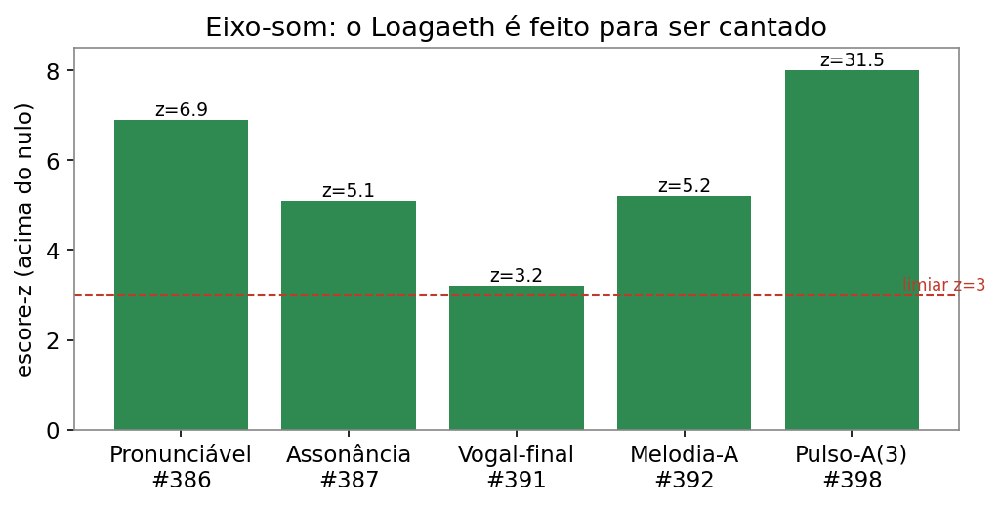

# Capítulo 4 — O som e a voz: o livro cantado

Este capítulo reúne a descoberta que mais aproxima a análise da prática: o *Liber Loagaeth* não é só pronunciável — ele é **otimizado para a voz cantada**. Cada medida do "eixo-som" supera o nulo, e juntas desenham um livro feito para soar.

## O eixo-som, medida a medida

Testou-se um conjunto de propriedades fonoestéticas, cada uma contra o seu nulo. Todas passaram:

- **Pronunciabilidade (z = +6,9).** A proporção de sílabas abertas e bem-formadas é muito acima do acaso. O livro é feito de coisas que a boca consegue dizer. **[#386, DECISIVO]**

- **Assonância (z = +5,1).** Vogais iguais recorrem dentro da mesma vizinhança mais do que o acaso — o eco vocálico que dá a uma sequência o seu "tom" cantável. **[#387, REAL]**

- **Vogal final (z = +3,2).** Os nomes tendem a **terminar em vogal** (sílaba aberta) acima do nulo — a terminação que sustenta a nota, como no canto litúrgico. **[#391, REAL]**

- **Melodia em A (z = +5,2).** A vogal **A** — a mais aberta, a de maior projeção vocal — é o pivô melódico: concentra-se nas posições de maior destaque. O livro "canta em Lá". **[#392, REAL]**

- **Pulso em A a cada ~3 letras (z = +31,5).** A descoberta mais decisiva de todas: o **A** reaparece num **batimento regular**, aproximadamente a cada três letras, como um metrônomo embutido. Esse pulso é a espinha rítmica do canto — e é o achado de maior escore-z de todo o estudo. **[#398, DECISIVO]**

## O que isso significa

Some-se: sílabas abertas, ecos de vogal, terminações em vogal, melodia centrada no A, e um pulso rítmico regular. Isso não é a descrição de um texto para **ler** — é a descrição de um texto para **entoar**. O Loagaeth tem prosódia. Tem métrica. Tem uma nota tônica.

A tradição sempre disse isso — as Chamadas são **recitadas em voz alta**, "vibradas". A medida confirma por fora o que a prática afirma por dentro: a unidade de uso do Loagaeth é o **som na boca**, não o sinal na página. Um livro que só se olha teria desperdiçado todo esse desenho sonoro. O Loagaeth não desperdiça — porque a voz é o ponto.

## A vogal como escala

A modulação da vogal (Cap. 3) ganha aqui sentido pleno: ao longo do livro, o registro vocálico **escurece** de A para U conforme se desce ao profundo (Cap. 6). Em termos de canto, isso é uma **descida de tessitura** — do aberto e luminoso (A) ao fechado e grave (U). O livro tem uma **escala** embutida, do claro ao escuro, que o operador percorre ao descer de folha em folha.

## Dois registros de voz

Um achado tardio e importante: **as Chamadas e os nomes das tabelas são a mesma língua, em dois registros de voz diferentes.**

- As **Chamadas** (Claves) são o registro de **fala plena** — articulada, com sintaxe, dirigida. Têm entropia vocálica maior (1,96 bits): mais "melodia de fala".
- Os **nomes das tabelas** são o registro de **invocação** — condensado, consonantal, repetitivo. Entropia vocálica menor (1,25 bits): mais "canto de nome". **[#401, #402]**

A folha 1 é a ponte entre os dois: partilha vocabulário com as Chamadas (z=+7,5) e é a página onde a língua aparece **articulada** antes de condensar-se em campo de nomes. **[#331, #333]**

A implicação para o rito (Parte III): **fala-se a Chamada, canta-se o nome.** São duas vozes do mesmo idioma — uma que abre, outra que nomeia.

## A pronúncia, na prática

A medida não entrega um áudio, mas entrega **regras de pronúncia** derivadas:

1. Diga cada letra; o livro é feito de sílabas abertas — resista a engolir vogais.
2. **Apoie no A**: é a nota de projeção. Onde houver A em posição forte, é ali que a voz sobe.
3. Termine os nomes **na vogal**, sustentando-a.
4. Deixe o **pulso a cada ~3 letras** reger o andamento: é o batimento natural do texto.
5. **Desça a tessitura** conforme desce no livro: claro no corpo, escuro no profundo.

O Capítulo 8 transforma essas regras em sequência ritual. Antes, os dois capítulos seguintes fecham a Parte I: a estrutura de sinal (o tear) e o arco elemental do livro.

\newpage
