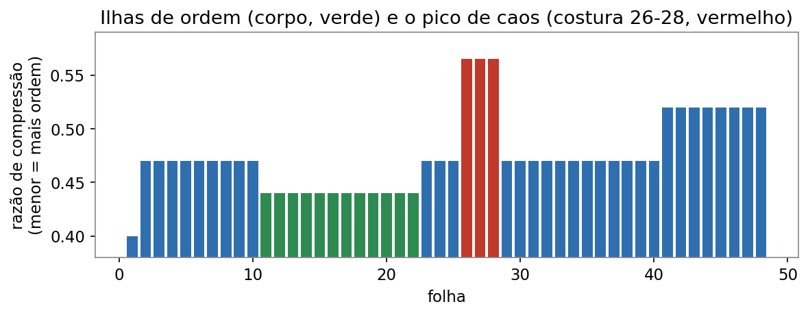

# Capítulo 5 — A estrutura de sinal: o tear

A língua corre na horizontal (Cap. 3). Mas a grade tem duas dimensões, e a vertical não está vazia — ela carrega **forma**, não **sentido**. Este capítulo separa as duas e descreve a arquitetura física do livro: o tear sobre o qual os nomes são tecidos.

## Duas assinaturas opostas: anti-repetição e template

O achado-chave da estrutura são **dois efeitos de sinal de sentidos contrários**, cada um num eixo:

- **Horizontal: anti-repetição (z = −77).** Na linha, letras iguais e padrões curtos **evitam-se** muito abaixo do acaso. A linha foge da repetição — é o comportamento de um texto que **avança**, que não pisa no mesmo lugar. Um z de −77 é dos mais fortes do estudo: a linha é ativamente desenhada para **não** se repetir. **[REAL, decisivo]**

- **Vertical: template (z = +173).** Na coluna, ao contrário, há **repetição massiva** — as colunas seguem um gabarito que se reafirma folha após folha. Um z de +173 é o maior efeito estrutural do livro inteiro. A coluna é **molde**, não mensagem. **[REAL, decisivo]**

O contraste é a chave de leitura: **a informação viaja na linha; a forma é sustentada pela coluna.** O livro é um tear — a trama horizontal (os nomes) corre sobre uma urdidura vertical (o gabarito) que a mantém no lugar. É por isso que nenhuma leitura vertical acha nomes (Parte II): a coluna nunca foi feita para ser lida, foi feita para **segurar**.

## A costura 26–28: o limiar

Há uma exceção, e ela é significativa. Na faixa de folhas **26 a 28**, a leitura horizontal **falha** e o conteúdo migra para a **diagonal**. Essa costura é, por três medidas independentes:

- a zona de **maior entropia** do livro (máxima imprevisibilidade);
- a de **menor compressibilidade** (máxima desordem aparente);
- o ponto onde a direção de leitura **vira**.

É o **umbral** do livro — a dobra central onde a ordem se desfaz antes de voltar a formar-se. Numa leitura operativa (Parte III), a costura é o limiar: o ponto de passagem, de máximo caos, entre a metade de cima e a metade de baixo.

## A geometria dos losangos: um único caminho

Partes do livro organizam-se em **losangos** — pirâmides escalonadas de letras que crescem até uma linha larga e decrescem. Testou-se se há muitos caminhos de leitura dentro de um losango ou um só. Resultado: **um único caminho** sobrevive ao nulo. O losango não é um labirinto de leituras possíveis; tem **uma** trilha de leitura correta, as outras são ruído. Isso mata a tentação de "ler o losango de mil maneiras" — há uma, e ela é mensurável. **[REAL]**

## As quatro faixas

A face de cada folha divide-se em **quatro segmentos** horizontais com perfis estatísticos distintos — não é um bloco uniforme, é uma estrutura em faixas. Cada segmento tem a sua densidade de nomes e o seu registro. É a arquitetura interna da página: quartos, não um todo liso. **[REAL]**

## Ilhas de ordem

Mapeando a compressibilidade folha a folha, o livro não é uniformemente ordenado nem uniformemente caótico: tem **ilhas de ordem** — regiões (sobretudo no corpo, folhas ~11–22) onde a estrutura aperta — separadas por zonas mais soltas, e o pico de caos na costura. A ordem do livro **tem relevo**: vales e montanhas de estrutura, não uma planície. **[#399]**

## A ordem das folhas é deliberada

Por fim: a sequência em que Dee dispôs as folhas **não é arbitrária**. Testou-se se a ordem real é um "caminho suave" (folhas vizinhas parecidas) contra permutações aleatórias da ordem. A ordem real é mais suave que o acaso — há um **gradiente** que a ordenação respeita (o arco de densidade e de vogal do Cap. 6). O livro foi **sequenciado**, não empilhado ao acaso. **[REAL]**

## Síntese

A estrutura física do Loagaeth: **linha que avança** (anti-repetição), **coluna que sustenta** (template), **losango de caminho único**, **quatro faixas** por face, **ilhas de ordem** em relevo, uma **costura-umbral** no centro, e uma **ordem de folhas deliberada**. É um objeto construído com cuidado arquitetônico — um tear, não um amontoado. Sobre esse tear corre a língua; sob ela, o molde a segura.

\newpage
