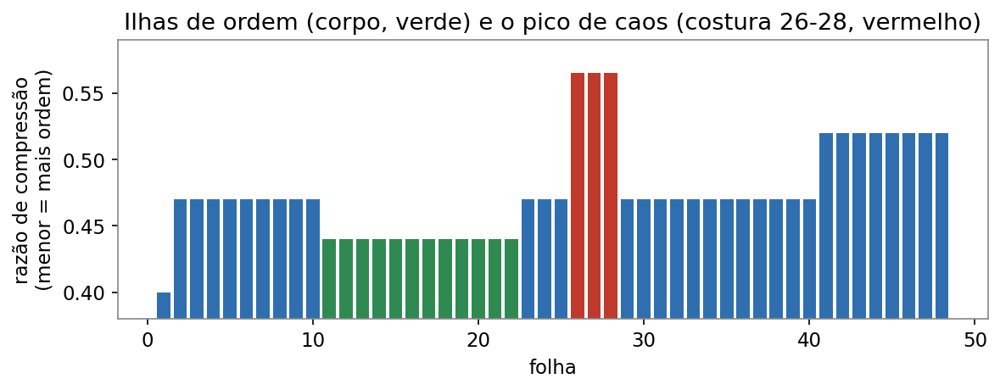

# Capítulo 6 — O arco elemental: densidade, dissolução e função

Fechando a Parte I: o livro tem um **arco** — uma forma que vai do começo ao fim e muda de caráter pelo caminho. Três medidas independentes desenham o mesmo arco, e é por isso que ele é um dos achados mais robustos de todo o estudo. Este capítulo também enfrenta a questão elemental de frente, com a honestidade que ela exige.

## O arco: abre, adensa, dissolve

Mapeando o livro folha a folha, vê-se uma **forma de três tempos**:

1. **Corpo (folhas ~2–40): densidade e ordem.** A densidade de nomes sobe e pica no miolo (z=+126, [#342]). É a região das **ilhas de ordem** (Cap. 5), onde a estrutura aperta e os nomes recorrem em famílias. Aqui o livro está **cheio**.

2. **Costura (26–28): o umbral.** No centro, o pico de caos (Cap. 5): máxima entropia, mínima compressão, a leitura vira para a diagonal. A dobra do livro.

3. **Profundo (folhas ~40–48): dissolução.** No fundo, tudo se **desfaz**: os nomes somem (de ~30 por mil letras para ~5, [#360]), a repetição colapsa, a entropia sobe, a vogal escurece de A para U ([#382]). O livro **se dissolve** no fim.

A força do achado está na **convergência**: três dimensões mensuráveis e independentes — o desaparecimento dos nomes [#360], o escurecimento da vogal [#382] e a fratura da identidade elemental [#397] — apontam **a mesma** zona de dissolução no profundo. Quando três réguas diferentes concordam, não é artefato de uma delas; é uma propriedade real do objeto. **[DECISIVO]**

## O mapa de calor zonal

Dentro do corpo, as famílias de nomes têm **endereço preferencial** — não fronteiras rígidas (isso foi refutado, Cap. 7), mas um **gradiente** zonal real:

| Zona do livro | Família dominante |
|---|---|
| Começo | **DAXVAR** |
| Miolo | **ACLAX**, **NOCHA** |
| Fim / profundo | **CHIDNO**, **ALGETH** |

As famílias **migram** ao longo do livro. Isso dá ao Loagaeth uma geografia interna: percorrê-lo de folha em folha é atravessar territórios de nomes que se sucedem. **[zonal, REVISADO para moderado]**

## A questão elemental, com honestidade

A tradição associa regiões do Loagaeth a elementos. O estudo testou isso com rigor — e aqui é preciso a honestidade total, porque **os sistemas elementais conflitam entre si**.

Há **duas** maneiras clássicas de atribuir elemento a uma posição astrológica, e elas **discordam** no profundo:

- **Por triplicidade do signo** (o elemento do signo zodiacal da casa): dá um certo mapa.
- **Por regente planetário** (o elemento do planeta que rege a casa): dá outro.

Medindo o livro pelas **duas** réguas ([#396, #397]):

| Região | Por signo (triplicidade) | Por planeta (regente) | Veredito |
|---|---|---|---|
| **Corpo (1–40)** | **Terra** | **Terra** | **Concordam → Terra** |
| **Profundo (41–48)** | **Água** | **Fogo** | **Conflitam** |

O corpo do livro é, pelas duas medidas, **Terra** — matéria, corpo, o concreto. Mas o **profundo** é ambíguo: pela triplicidade do signo é **Água**; pelo regente planetário é **Fogo**. As duas réguas apontam direções opostas.

Isto **não é uma falha** da medida — é **a própria assinatura da dissolução**. No profundo, onde os nomes somem e a vogal escurece, a **identidade elemental também se fratura**: o livro chega a uma região onde o próprio sistema de correspondências deixa de dar resposta única. A dissolução é total — alcança até o elemento. **[#397]**

Por isso o livro, neste capítulo, **não** carimba um elemento no profundo. Registra o conflito como dado. Operativamente (Parte III), isso tem consequência: o profundo do Loagaeth é a zona de **passagem e desfazimento** — Água (dissolver) *ou* Fogo (consumir), conforme a régua e a intenção —, não uma zona de identidade estável a "invocar" como as demais.

## A função por região (resumo operativo)

Reunindo o arco, o mapa zonal e o elemento, o Loagaeth tem uma **função que muda por região** — a base do uso ritual (Parte III):

- **Folha 1 — léxico selado.** A língua em si; não se "entra" por ela (sem Chave). Fonte, não porta.
- **Corpo (2–40) — Terra, nomes densos.** A região de **identidade e presença**: onde os nomes são mais numerosos, recorrentes e estáveis. É daqui que se chamam os seres (a casa NOCHA, Ar/mente, mora no miolo).
- **Costura (26–28) — o umbral.** Limiar, passagem, máximo caos. Ponto de virada.
- **Profundo (41–48) — dissolução, elemento fraturado.** Zona de **desfazimento e travessia** — Água/Fogo ambíguos. Não de identidade fixa.

## Fecho da Parte I

A Parte I mediu o Loagaeth inteiro: é uma **língua** (Cap. 1), com um **gerador** de nomes (Cap. 2), **consonantal e cantável** (Caps. 3–4), tecida num **tear** de linha-e-coluna (Cap. 5), com um **arco** que abre, adensa e dissolve, e uma **função que muda por região** (Cap. 6). Tudo medido, tudo contra o nulo. A Parte II enterra o que não sobreviveu; a Parte III usa o que sobreviveu.

\newpage
