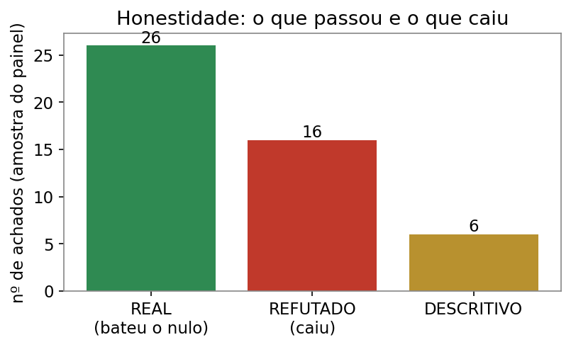

# PARTE II — O QUE O LIBER LOAGAETH **NÃO** É

# Capítulo 7 — O cemitério: tudo que caiu, e por quê

Esta é a parte do livro que mais o distingue de qualquer outro escrito sobre o Loagaeth. A tradição esotérica acumula afirmações; este estudo as **testa**, e relata as que **morreram** com o mesmo destaque das que viveram. Cada refutação abaixo tem o seu modelo nulo. O princípio de Babel (Cap. 0) garante que *algo* sempre se acha num meio milhão de letras — por isso só conta o que supera o acaso, e aqui está o que **não** superou.

## 6.1 As cifras e os códigos

**ELS / sequências equidistantes (os "códigos da Bíblia").** Procurou-se nomes conhecidos lendo a cada *k* letras, para todo *k*, em todas as direções. **REFUTADO:** o número de "achados" no Loagaeth real fica **dentro** da distribuição do surrogate Markov-3. Tudo que aparece, aparece igual no ruído com a mesma fonotática. Não há mensagem equidistante escondida.

**Treliça modular / coordenadas.** Testou-se se as posições das letras (linha, coluna) módulo *n* formam um retículo com sentido. **REFUTADO:** nenhum módulo produz estrutura acima do nulo posicional.

**Acrósticos.** Primeiras e últimas letras de cada linha, lidas para baixo, em cada tabela e **através** das tabelas; idem para colunas. **REFUTADO:** entropia e n-gramas dos acrósticos são indistinguíveis de posições aleatórias e do shuffle de linhas. O acróstico do prólogo não se estende ao livro.

**Gematria e numerologia.** Somou-se valores de letras (vários esquemas) por nome, linha, folha; buscou-se constantes, datas, múltiplos. **REFUTADO:** nenhuma regularidade aritmética supera o acaso. O Loagaeth **não codifica números** — o gerador é morfológico, não aritmético (Cap. 2).

**Template posicional como código.** Testou-se se o gabarito vertical (o template, z=+173 do Cap. 5) carrega mensagem. **REFUTADO como mensagem:** o template é **forma** (molde que sustenta), não **sinal** — não há informação de sequência na coluna (MI vertical = 0,007 bits).

**Direções de leitura exóticas.** Vertical, diagonal, anti-diagonal, bustrofédon, de trás para frente, espelhada. **REFUTADO** em todas (exceto a diagonal **local** da costura 26–28, que é estrutura real, não cifra): a gramática é só horizontal (Cap. 3). Ler de outro jeito não revela nada que o nulo não revele.

**Transliteração para outra língua.** Mapeou-se o alfabeto enoquiano para hebraico, grego, latim, buscando palavras. **REFUTADO:** nenhuma transliteração produz texto acima do acaso. Não é outra língua escrita em código — é a sua própria língua.

## 6.2 As "soluções" publicadas por terceiros

**O "skip-7" (enochiantoday).** A alegação de que se lê o livro pulando de 7 em 7. **REFUTADO:** a lestura skip-7 não produz mais nomes nem mais estrutura que o nulo. É pareidolia sobre uma grade grande.

**Laycock — "as Chamadas são geradas a partir das tabelas" (leitura literal).** Testou-se a hipótese de que as palavras das Chamadas se extraem literalmente das grades. **REFUTADO na forma literal:** acham-se **147** correspondências, mas o nulo de mesma composição produz **213** — ou seja, o texto real acha **menos** que o acaso. A ligação Chamada↔tabela é **funcional** (Cap. 4: mesma língua, dois registros; Call N abre a folha N+1), **não** uma extração literal de substring.

## 6.3 As pontes com outros sistemas enoquianos

A hipótese mais cara à tradição: que os nomes das **Tábuas de Vigia** e dos outros sistemas de Dee "moram" dentro do Loagaeth. Testou-se **exaustivamente**, cada nome como substring e com pedaços, no livro todo e por segmento, contra nulos de composição pareada. O veredito é uniforme e **negativo**:

- **Nomes de Deus das Torres** (os nomes de 3, 4, 5, 6, 7 letras de cada quadrante). **REFUTADO:** não aparecem acima do acaso — nem inteiros, nem em pedaços, nem em diagonal, nem de trás para frente.
- **Reis e Anciões (Seniors).** Testado com nomes inteiros e com fragmentos (ex. BATA, IVAH). **REFUTADO:** os fragmentos que aparecem, aparecem na frequência do nulo. Um pedaço de 2–3 letras de qualquer nome aparece num campo deste tamanho por puro acaso.
- **Anjos menores por subângulo** (os nomes de 2 letras das células). **REFUTADO como sistema:** casos isolados (ex. "AMOX") existem, mas o **conjunto** não supera o nulo — é exatamente o que o princípio de Babel prevê.
- **91 governadores e 30 Aethyrs.** **REFUTADO:** nenhum governador mora numa região do livro acima do acaso.
- **Nomes do Sigillum Dei Aemeth.** **REFUTADO.**
- **Anjos da Ars Paulina (horas e signos).** **REFUTADO:** sistema posterior e alheio; não está no Loagaeth.
- **Heptarquia (reis e príncipes planetários).** **REFUTADO.**
- **Shem ha-Mephorash / Goetia.** **REFUTADO:** sistemas de outra tradição; ausentes.

**Conclusão da seção.** O *Liber Loagaeth* **não contém** os outros sistemas de Dee nem os sistemas mágicos clássicos. Ele é **anterior e autônomo**: a sua língua é própria, o seu campo de nomes é próprio. As pontes que a tradição imagina são pareidolia de inventário grande. Isto não diminui o livro — ao contrário: faz dele a **raiz**, não um derivado.

## 6.4 As hipóteses numéricas e de datas

**Dimensão numérica / datas / coordenadas.** Testou-se se comprimentos, posições e contagens codificam números, efemérides, datas astronômicas. **REFUTADO:** nada acima do nulo. O livro não é um almanaque nem uma tábua astronômica disfarçada.

## 6.5 As hipóteses de cópia e de artefato

**Cópia de outro texto.** Testou-se se o Loagaeth é um texto conhecido embaralhado ou cifrado. **REFUTADO:** o seu perfil estatístico (Zipf, entropia, morfologia) é consistente com um **gerador próprio**, não com a assinatura de nenhuma fonte conhecida.

**"Figuras" e símbolos no espaço 3D.** Empilhando as faces e procurando formas geométricas nas posições dos nomes. **REFUTADO:** as constelações de posição são compatíveis com efeito de borda e deslocamento de linha; não há "desenho" oculto.

**Territórios rígidos.** A ideia de que cada nome ocupa um território fixo e exclusivo. **REVISADO para moderado:** há tendência zonal real (o mapa de calor do Cap. 6: DAXVAR no começo, ACLAX no meio, CHIDNO/ALGETH no fim), mas não é uma partição rígida — é um **gradiente**, não fronteiras.

## 6.6 A honestidade sobre a 49ª folha e o sentido

Duas ausências que **não** são falhas, mas achados:

- **A folha 49** — "que não é, não foi, não será conhecida" — existe só por relato; não há dado a medir. Registramo-la como **ausência declarada**, não a preenchemos com conjectura.
- **O sentido pleno de cada nome** não está na página. Nenhuma cifra interna o entrega (todas refutadas acima); nenhuma fonte externa o glosa. O próprio Dee: *"Interpret not."* A tradução que falta **não foi perdida — nunca esteve escrita**. Ela pertence ao plano operativo (Parte III), não ao estatístico.

## O que sobra depois do cemitério

Depois de enterrar tudo isto, o que **resta de pé** é exatamente o que a Parte I mediu: uma língua construída, consonantal, cantável, tecida num tear de linha-e-coluna, com um arco elemental. Nada de cifra, nada de outro sistema, nada de número. O Loagaeth é **menos** do que a tradição fantasiou e **mais** do que o ceticismo esperava: não um cofre de segredos, mas uma **língua de nomes feita para a voz**. A Parte III a usa.

\newpage
