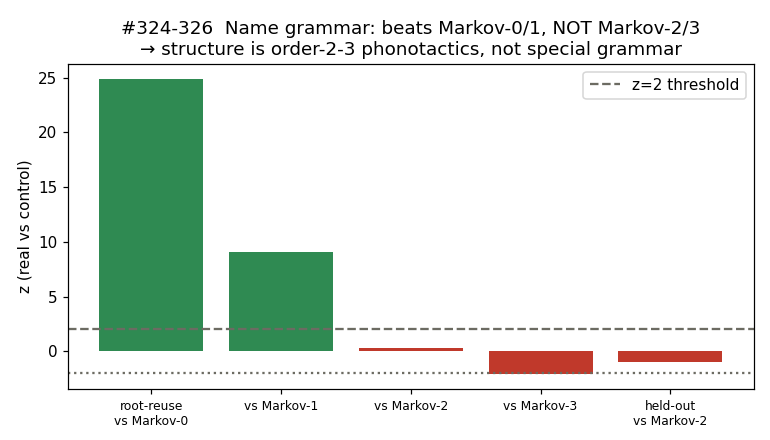
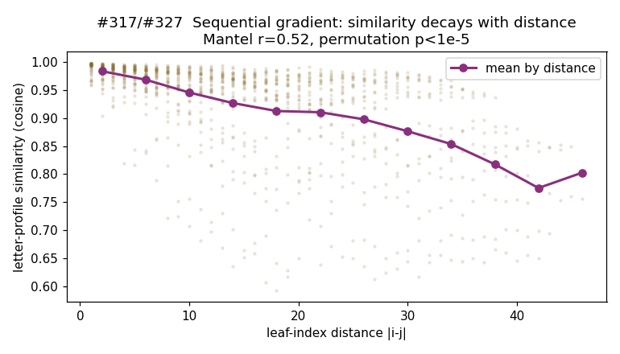
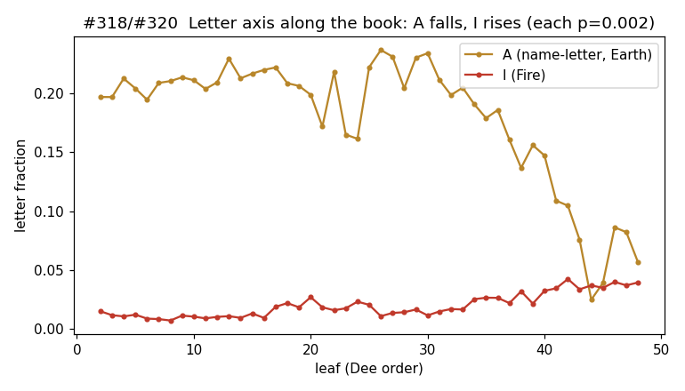
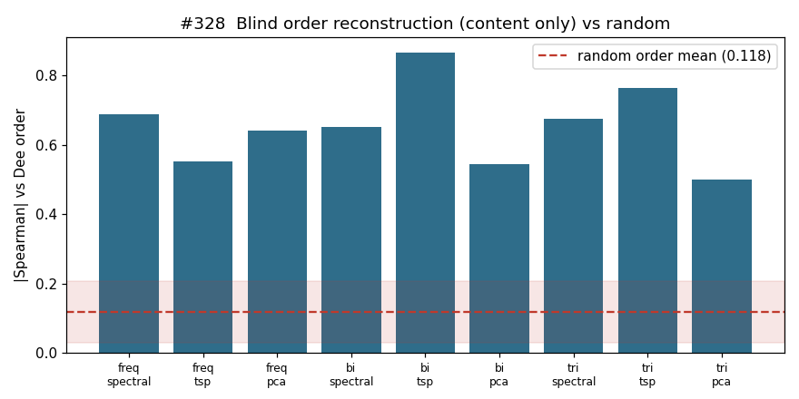
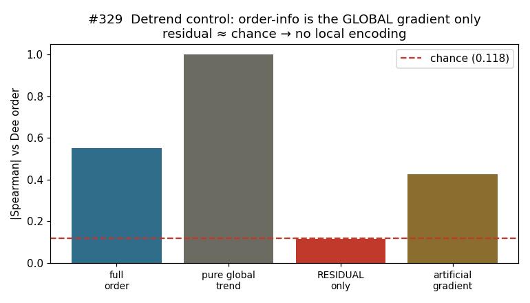

# Relatório Técnico — Auditoria do Loagaeth (Sloane MS 3189)

Documento reprodutível. Cada seção diz **o que foi testado**, **como**, **o resultado** e **o veredito honesto**,
com o módulo de código e a figura correspondentes. Distingue três camadas: **demonstrado estatisticamente**,
**descritivo**, e **interpretação**. Nada aqui é afirmado como tradução ou como intenção declarada de John Dee.

Entradas congeladas: 90 nomes recorrentes do léxico (`viz/forge_grammar.json`, hash `69705112fbf0`);
grades limpas das folhas 2–48 (`a22.base_book`, 47 folhas; folha 1 é segmentada, folha 49 ausente).
Todos os testes usam null models e, onde indicado, análise congelada antes da execução.

---

## 0. Resumo executivo (honesto)

| Hipótese | Teste mais forte | Veredito |
|---|---|---|
| Loag é prosa/cifra | 5 nulls (Markov-3) | **Refutado** — é campo de nomes |
| Gramática gerativa **especial** (raiz+melodia) dos nomes | Markov-0/1/2/3 + permutação (#326) | **Não sustentada** — é fonotática de ordem 2–3 |
| Forja prevê nomes ocultos além da fonotática | held-out vs Markov-2 (#325) | **Não sustentada** |
| **Deriva composicional ordenada das folhas** | Mantel + permutação 100k + reconstrução cega (#327–329) | **Sustentada** (robusta) |
| Codificação **local** deliberada da ordem | controle de detrend (#329) | **Não sustentada** — é gradiente global |
| Heptarquia: 49 anjos por extração numérica | reprodução dos nomes reais (#309) | **Sustentada** (algoritmo histórico verificado) |
| Torres: governadores por caminho | king-move vs acaso (#308) | **Sustentada** |
| Elemento codificado nas letras | composição elemental por quadrante (#313) | **Refutado** — elemento é posicional |
| Gematria → contagem de servos | 13 sistemas, Bonferroni (#316) | **Refutado** |

**Em uma frase:** não há gramática secreta nos *nomes* (é fonotática de ordem 2–3), mas há uma **deriva
composicional real e robusta na ordem das 49 folhas** — e os sistemas da Heptarquia e das Torres têm
**algoritmos de leitura verificados** que reproduzem nomes históricos.

---

## 1. Natureza do livro — campo de nomes, não cifra

**Como:** cinco null models independentes (prosa, sintaxe de sentença, Chamadas cifradas, cópia, códigos longos)
contra surrogates Markov-3 (`a106–a113`).
**Resultado:** nenhuma estrutura de prosa/sentença acima do acaso.
**Veredito:** o Loag é um **onomasticon** (campo de nomes), não um texto cifrado. *Descritivo, sólido.*

---

## 2. A gramática dos nomes — AUDITADA contra Markov

**Como (`a156`, congelado):** decompor cada nome em esqueleto consonantal × melodia vocálica; medir reuso de
raiz e de melodia; comparar à distribuição de controles Markov-0/1/2/3 e permutação intra-nome, mesmos
comprimentos, treinados só nos dados permitidos.

**Resultado:** reuso de raiz real 0.40 — acima de Markov-0 (z+24.9), Markov-1 (z+9.1) e permutação (z+16.3),
mas ≈ Markov-2 (z+0.3) e abaixo de Markov-3 (z−2.1).
**Veredito:** há estrutura **sequencial real** (ordem importa; bate frequência e bigrama-simples), mas ela é
**fonotática de ordem 2–3** — um modelo de 3-grama reproduz tudo. A hipótese de **morfologia separável
raiz-e-padrão** (o "semítico", `a134`) **não acrescenta informação** além do Markov-3. *Hipótese reduzida.*

---

## 3. A Forja (gerador de nomes) — AUDITADA

**Como (`a155`, clean-room, congelado):** gramática extraída só de 45 nomes (treino), congelada; reprodução dos
45 ocultos; controles de mesmo espaço (uniforme, freq-matched, **Markov-2 fonotático**); 40 splits.
**Resultado:** reprodução held-out real **19.4%** (IC95 [17.7, 21.1]) — reproduzida por código independente.
Controles: uniforme 0.0%, freq 0.06%, **Markov-2 25.1%**. Real > Markov em 9/40 splits (não-significativo).
**Veredito:** a Forja **gera nomes pronunciáveis fiéis ao estilo do livro** (útil), mas **não tem poder
preditivo além da fonotática** — não bate um modelo de caractere. O "376×" de versões anteriores era contra
controles fracos (uniforme/freq) e está **superado**. *Gerador válido como ferramenta; sem gramática especial.*

---

## 4. O gradiente sequencial das folhas — AUDITADO e SUSTENTADO

**Como (`a157`, congelado, pré-registrado):** estatística de Mantel entre distância de índice |i−j| e
dissimilaridade de perfil-de-letra (1−cos). Permutação 100.000×; leave-one-out; partições pré-definidas
(vogais, consoantes, metades); decaimento por faixa; Bonferroni.

**Resultado:** Mantel r = **0.525**; permutação **p < 1×10⁻⁵** (nenhuma de 100k alcançou); leave-one-out
r ∈ [0.49, 0.54] (nenhuma folha domina); vogais-só 0.45, consoantes-só 0.50, 1ª metade 0.75, 2ª metade 0.78
(**todas passam Bonferroni α=0.01**); decaimento monótono em todas as distâncias.
**Veredito:** a ordem das 49 folhas carrega **organização estatística real e robusta**, não artefato de poucas
folhas/letras/região. *Demonstrado estatisticamente.*

O eixo de letra que dirige a deriva (`a160`):

A/Terra cai (20%→4%), I/Fogo e águas R·P·L sobem (cada letra p=0.002). *Descritivo.*

---

## 5. Reconstrução cega da ordem (#328) + robustez (#329) — o teste decisivo

**Como (`a158`, `a159`):** remover os números das folhas; reconstruir a sequência só do conteúdo, por seriação
espectral (Fiedler), NN-TSP+2opt e PCA-1; |Spearman| vs a ordem de Dee (máx sobre reflexão); null = 100k ordens
aleatórias. Robustez: leave-one-out, leave-five-out, 3 features (freq/bigrama/trigrama), 3 algoritmos. **Controle
decisivo (detrend):** remover a tendência composicional global e reconstruir só dos resíduos.

**Resultado reconstrução:** todas as combinações recuperam a ordem acima do acaso (0.50–0.87); melhor
bigrama+TSP **0.867** (aleatório 0.118 ± 0.088; **p < 1×10⁻⁵**). Robusto a features e algoritmos; LOO [0.50, 1.00],
L5O média 0.74.

**Controle de detrend (decisivo):** ordem completa 0.55; **tendência global pura 1.00** (gradiente limpo é
trivialmente recuperável); **resíduo só 0.117 ≈ acaso (0.118)**; gradiente artificial (mesma tendência, local
embaralhado) 0.43 média.
**Veredito:** o conteúdo recupera a ordem **porque existe uma deriva composicional global suave** — e qualquer
gradiente suave é recuperável. Depois de remover a tendência global, **não resta informação de ordem** (resíduo =
acaso). Logo **não há código posicional local deliberado**; há uma **deriva monótona global**. *A deriva é real e
robusta; a causa (hábito, mudança temporal, construção sistemática ou intenção) não é distinguível pelos dados.*

---

## 6. Heptarquia e Torres — algoritmos de leitura verificados

- **Heptarquia, 49 anjos (`a152`, #309):** juntar a letra de mesmo número 1–49 nas 7 tabelas reproduz a Tabula
  Collecta — **40/49, 100% onde o dado é completo** (as 9 falhas são buracos de transcrição). *Algoritmo
  histórico verificado.* Simulador: `viz/heptarchia.html`.
- **Torres, 91 governadores (`a151`, #308):** lidos por caminho na Grande Tábua — **97% passos king-move
  adjacentes** vs 2.7% no acaso. *Verificado.*
- **Independência dos 3 sistemas (`a150`/`a314`, #315):** sem vocabulário compartilhado específico (anjos
  hebraicos casam igual nos controles). Loag=raiz+melodia (fonotática), Heptarquia=número, Torres=caminho.
- **Elemento é posicional (`a152`, #313):** composição elemental das letras é uniforme por quadrante (o quadrante
  do Fogo tem **menos** letras-de-fogo) — o elemento vem da direção/Cruz, não das letras.
- **Gematria nula (#316):** 13 sistemas × contagem de servos, Bonferroni — nenhuma correlação.

---

## 7. O que provamos / não provamos / como usar

**Provado (estatística):**
1. O Loag é campo de nomes, não cifra.
2. A ordem das folhas tem **deriva composicional global** real, robusta, recuperável do conteúdo (p<1e-5).
3. Heptarquia e Torres têm **algoritmos de leitura** que reproduzem nomes históricos.

**Não provado (caiu no controle forte):**
1. Gramática gerativa **especial** dos nomes (é fonotática de ordem 2–3).
2. Poder preditivo independente da Forja.
3. Codificação **local** deliberada da ordem (é gradiente global).

**Interpretação (não testada):** a leitura cosmológica (semente→corpo→dissolução), as correspondências elementais
e planetárias, o "sentido" da direção do gradiente.

**Como usar:**
- **Gerar nomes novos** (Forja Loag / forja da Heptarquia): nomes pronunciáveis fiéis ao estilo real — construção,
  não revelação. A da Heptarquia segue o método histórico exato.
- **Ler nomes das grades** (Heptarquia por número, Torres por caminho): verificado, reproduz nomes reais.
- **Elementos:** convenção Golden Dawn usável, não propriedade medida das letras.
- **O gradiente:** a ordem do livro é uma progressão composicional real — base para estudo de como o conteúdo
  muda ao longo do manuscrito (hábito do escriba, evolução temporal, construção).

---

## 8. Reprodutibilidade

| Análise | Módulo | Figura |
|---|---|---|
| Gramática vs Markov-0/1/2/3 | `src/a156_grammar_markov_battery.py` | `figures/audit_grammar_markov.png` |
| Auditoria da Forja (clean-room) | `src/a155_forja_audit.py` | — |
| Gradiente (Mantel, permutação 100k) | `src/a157_gradient_audit.py` | `figures/audit_gradient_decay.png` |
| Eixo de letra | `src/a160_make_audit_figures.py` | `figures/audit_letter_axis.png` |
| Reconstrução cega da ordem | `src/a158_order_reconstruction.py` | `figures/audit_reconstruction.png` |
| Robustez + detrend | `src/a159_reconstruction_robustness.py` | `figures/audit_detrend_control.png` |
| Heptarquia 49 anjos | `src/a152_heptarchy_tower_deep.py` | — |
| Governadores king-move | `src/a151_tower_grammar.py` | — |

Log cronológico completo: `docs/RESEARCH_LOG.md` (#243–#329). Figuras: `python src/a160_make_audit_figures.py`.
