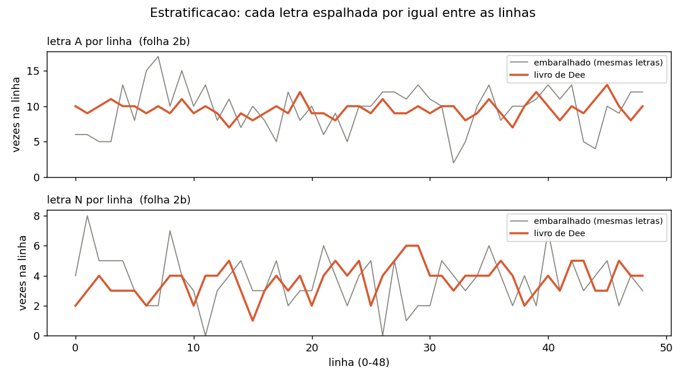
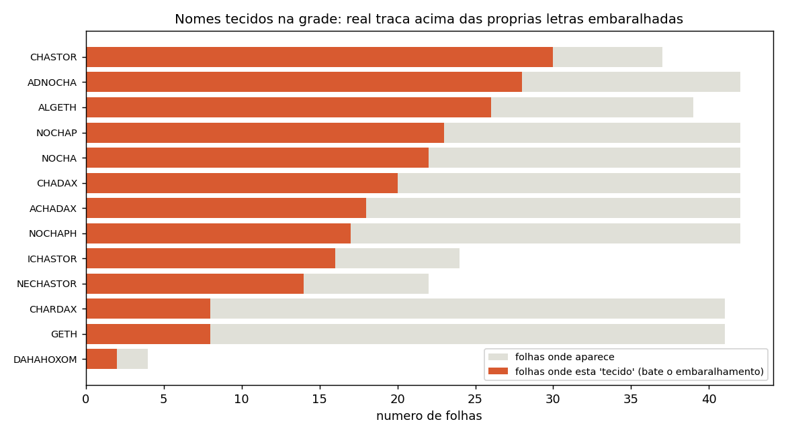
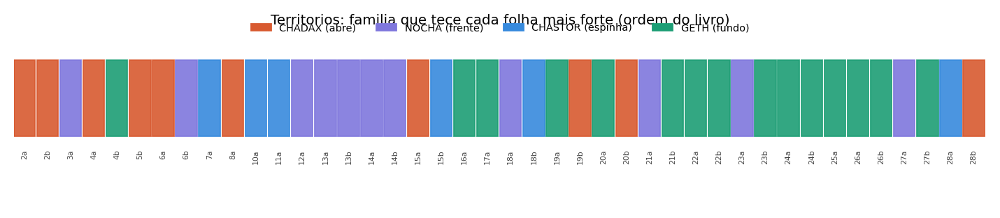
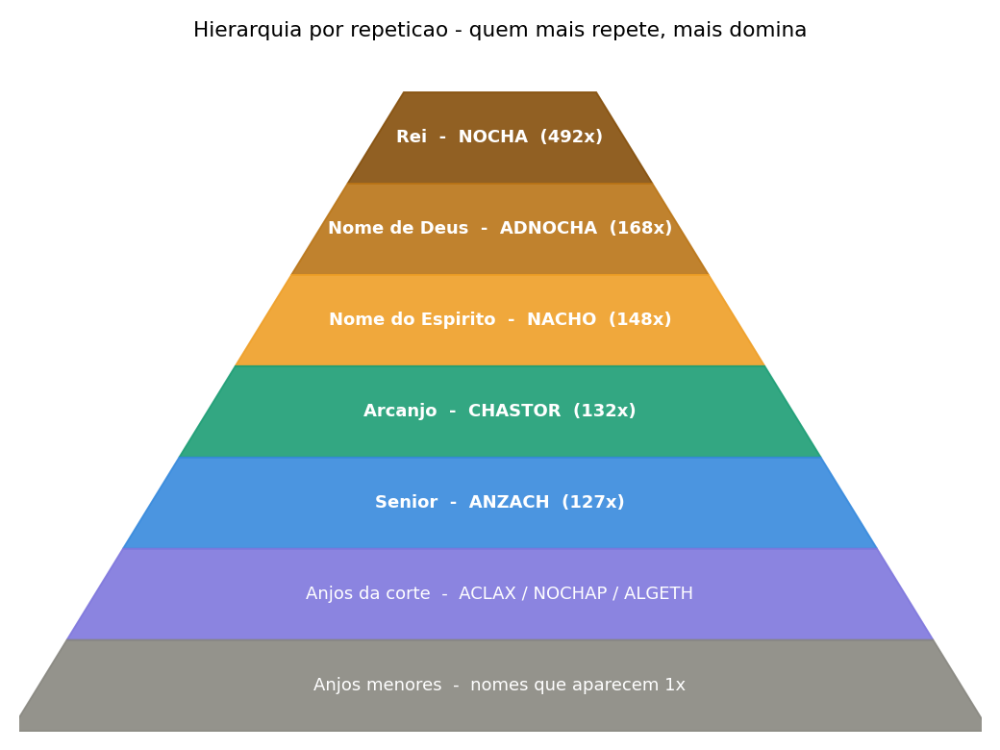
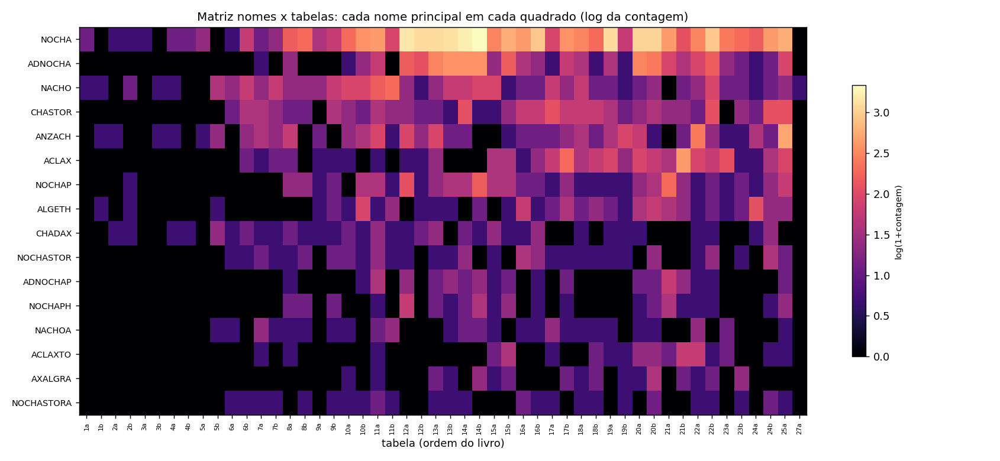
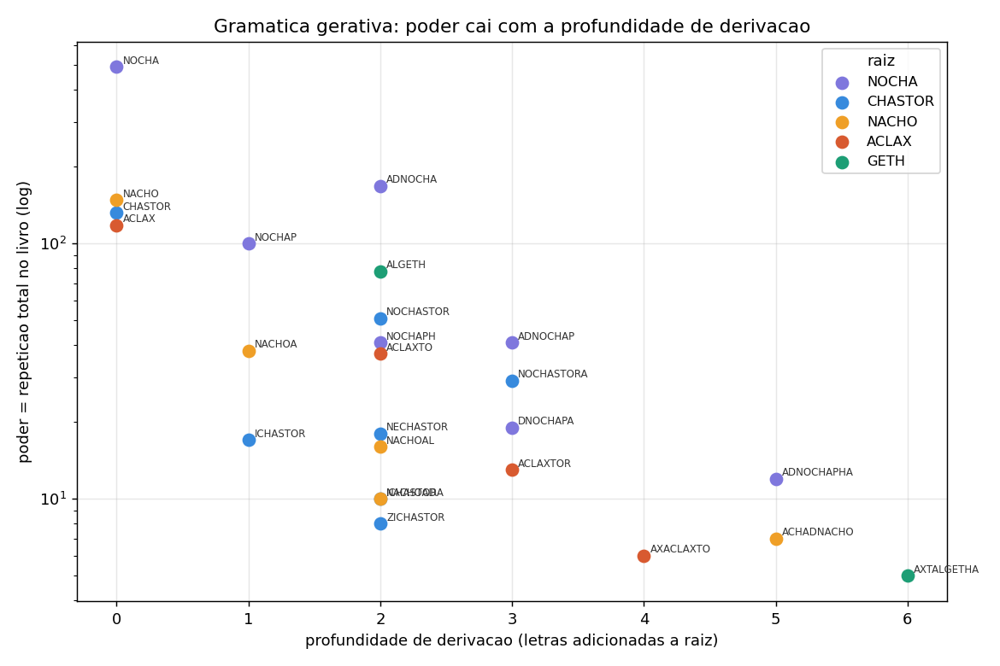

# O tecido e a hierarquia do Loagaeth

Fase de busca a71–a80. Toda afirmação é medida contra um modelo nulo (letras embaralhadas, surrogate
Markov-3 que preserva o fluxo local, ou embaralhamento por coluna). Documentação e imagens ficam no
repositório.

---

## 1. Cada linha é um inventário balanceado do alfabeto (a75) — CONFIRMADO NOVO

Conte quantas vezes uma letra aparece em cada linha de um quadrado. No livro, cada letra aparece quase o
mesmo número de vezes em **toda** linha. Embaralhe as mesmas letras na mesma grade e a contagem passa a
oscilar muito. O livro distribui cada letra por igual entre as 49 linhas — toda linha é uma amostra
equilibrada do alfabeto inteiro.

Números (índice de dispersão = variância/média da contagem por linha; <1 = regular/anti-aglomerado):

| conjunto | real / acaso | z |
|---|---|---|
| todas as letras | 0,72 | −5,2 |
| vogais | 0,68 | −2,8 |
| **consoantes** | **0,71** | **−4,5** (36/42 folhas) |

Controles: embaralhamento total dá 0,92 (quase Poisson); embaralhamento por coluna dá ~0,93. Nenhum
reproduz o valor real (~0,57). Vale para consoantes, então não é a métrica de sílabas já conhecida. É um
arranjo 2D proposital: cada linha é uma unidade fechada (um verso/nome), não texto corrido.

## 2. Posição da letra na linha (a76)

Dentro da linha, **não** há coluna fixa por letra (concentração 0,07; previsibilidade ímpar-vs-par 0,59 ≈
acaso 0,58). Cada letra vagueia pela linha inteira. Só as bordas têm dono (regra já conhecida): V/I/P/Z no
começo, S/H/X no fim. Prevê-se *quantas* vezes a letra vem por linha, não *onde*.

## 3. Os nomes estão tecidos na grade (a77) — CONFIRMADO NOVO (forte)

Controle justo = as próprias letras do nome, embaralhadas. Os nomes das famílias traçam como caminho
king-move (saltando entre células vizinhas, sem reusar célula) muito acima dos seus embaralhamentos:
**232 de 460 pares nome-folha (50%) são "tecidos"** — o nome real traça ≥3 caminhos e nenhum dos 80
embaralhamentos alcança isso. CHASTOR tece em 30/37 folhas (15b: 271× o acaso); ADNOCHA em 14b traça 619
caminhos contra zero dos embaralhamentos. Nomes longos (ICHASTOR, NECHASTOR) traçam enquanto todo
embaralhamento traça zero.

A *ordem* específica de cada nome está construída na grade; permutações não estão. O livro é tecido deste
vocabulário de nomes.

## 4. Mapa de territórios (a78) — CONFIRMADO NOVO (convergente)

Normalizando o tecido por família (z dentro de cada uma), cada folha ganha uma família-casa:

- **CHADAX** abre o livro (posição média 13 de 42).
- **casa NOCHA** segura a frente-meio (bloco 12a–14b).
- **CHASTOR** é a espinha, com picos (15b, 18b).
- **casa GETH** domina o fundo (16a–27b).

Construído só do traço king-move vs letras embaralhadas, reproduz a geografia das duas casas (NOCHA cedo /
GETH tarde) que a leitura reta achou por outro método (a67). Dois métodos independentes, o mesmo mapa.

## 5. Poderes elementais (a79) — DESCRITIVO

Cada letra enoquiana carrega um elemento (correspondência Golden Dawn: signo → elemento). O elemento
dominante de um nome é seu poder: **CHADAX = Terra** (3/3 membros), **CHASTOR = Ar** (3/3), NOCHA = Ar/Água
misto, GETH = Fogo/Terra misto, DAHAHOXOM = Ar. Limites testados: a concordância vem do radical
compartilhado; e o elemento é do nome, não do território (as folhas-casa não carregam mais letras do seu
elemento que a média, z entre −1,1 e +0,9).

## 6. Mapa completo de entidades: Rei, corte e anjos menores (a80)

Modelo (igual às Torres): o nome que mais repete é o **Rei**; os seguintes são a corte; os que aparecem uma
vez são **anjos menores**. Só nomes validados (≥5 letras), contados nos dois sentidos.

Hierarquia suprema do livro (repetição total): **Rei NOCHA** (492×, reina em 34 quadrados), **Nome de Deus
ADNOCHA** (168×), **Nome do Espírito NACHO** (148×), **Arcanjo CHASTOR** (132×), **Senior ANZACH** (127×);
anjos da corte ACLAX/NOCHAP/ALGETH; anjos menores = os nomes que aparecem 1×.

NOCHA reina quase sempre porque está dentro de toda a sua família (ADNOCHA, NOCHAP, NOCHASTOR). O
*governador local* de cada quadrado (tirando esse aninhamento) varia por região — ANZACH no meio, ALGETH no
fim, GRADAX no bloco 14–15, CHADAX na abertura — batendo com o mapa de territórios. A hierarquia completa de
cada quadrado, tier a tier, está em `results/80_full_hierarchy.json`. As folhas 25b–28b leem na diagonal e
precisam do fluxo decodificado (ficam fora desta contagem reta).

## 7. O que foi negado nesta leva (honestidade)

- **Leitura omni-direcional** (a71): o livro lê uma direção só; as outras 7 orientações não carregam nomes
  acima do acaso. Não é como as Torres.
- **Famílias de rotação grudadas de propósito** (a72/a73): varri 761 famílias; o clustering saiu no acaso. As
  ramificações estão coladas na página porque compartilham letras, não por posição intencional.

## Módulos

`a71_omnidirectional`, `a72_rotation_family`, `a73_family_sweep`, `a74_gematria_lines`,
`a75_row_stratification`, `a76_letter_position_map`, `a77_names_woven`, `a78_territory_map`,
`a79_hierarchy_powers`, `a80_full_hierarchy`. Figuras em `figures/`, geradas por `make_hierarchy_figures.py`.
Log em `docs/RESEARCH_LOG.md` #208–#216.

## 8. Lendo todas as tabelas como um todo — matriz nomes × tabelas

Começo da leitura unificada: cada nome principal em cada quadrado, de uma vez.

Lê-se: a abertura (1a–5b) é esparsa — o livro "aquece", poucos nomes. De ~6a em diante o vocabulário
compartilhado adensa, e NOCHA/ADNOCHA/NACHO/CHASTOR/ANZACH formam a espinha presente em quase toda tabela.
O que achamos numa tabela aparece nas outras — é um sistema único, não quadrados isolados. Próximo passo:
para cada tabela, aplicar o conjunto completo de padrões (hierarquia, território, tecido) e marcar onde cada
achado reaparece.

## 9. A gramática gerativa dos nomes (a81) — CONFIRMADO NOVO

A hierarquia por repetição é uma **gramática de raiz + afixo**. Cada nome validado se decompõe numa RAIZ
(NOCHA, NACHO, CHASTOR, ACLAX, GETH, ANZACH…) com prefixo e/ou sufixo: AD-NOCHA, NOCHA-P, NO-CHASTOR,
I-CHASTOR, AL-GETH, ACLAX-TO. E o **poder cai com a profundidade de derivação** — a raiz repete mais, cada
camada de letras adicionada repete menos, como uma fonte e suas emanações mais fracas.

Poder médio: raízes (prof. 0) = 127; derivados (prof. ≥2) = 29. Exemplos:
`NOCHA 492 → NOCHA-P 100 → NOCHA-PH 41 → AD-NOCHA-PHA 12`; `ACLAX 118 → ACLAX-TO 37 → ACLAX-TOR 13 →
AX-ACLAX-TO 6`. Nota honesta: não é perfeitamente monotônico — o prefixo AD- é produtivo (AD-NOCHA 168 >
NOCHA-P 100). É o sistema gerativo por trás dos nomes — a resposta direta a "transformar em código": raiz +
afixo = rank.

## 10. O que os afixos significam (lead)

Agrupando os derivados por afixo: o prefixo **AD-** (e AL-) puxa o nome para **Terra** — AD-NOCHA vira Terra
mesmo tendo a raiz NOCHA (Ar) — com poder médio alto (74). O prefixo **I-** é fraco (poder 14, rebaixa). O
sufixo **-A** é diminutivo (emanações menores, poder ~20). O sufixo **-P** marca alto posto (NOCHAP,
ADNOCHAP ~70). Honesto: parte é mecânica (o elemento é contagem de letra, e o afixo traz suas próprias
letras) e confundida pela raiz compartilhada — então é um lead coerente, não prova de morfema-de-posto
independente. Leitura: afixo = carga elemental + marca de posto.

Explore tudo isto no site: `viz/name_grammar.html` (sirva `viz/` por HTTP e abra
`http://localhost:8860/name_grammar.html`) — digite qualquer nome e veja raiz, afixo, poder, elemento, posto
e a família inteira.

## 11. A gramática descobre nomes novos (a82) — CONFIRMADO NOVO

Teste gerativo: gerar toda combinação prefixo × raiz × sufixo (1319 candidatos), contar no livro **inteiro**
(tabelas 2–48, diamantes 29–48 incluídas) e comparar com surrogates Markov-3. Resultado: 253 candidatos
aparecem; 54 batem o surrogate em ≥3 tabelas; **32 não estavam no catálogo — ramificações novas que a
gramática gerou e o texto confirmou.**

Top nomes novos (razão vs surrogate · ocorrências · tabelas):

| nome | decomposição | × | tabelas | razão |
|---|---|---|---|---|
| NECHASTORA | NE-CHASTOR-A | 7 | 6 | 23,3 |
| NOCHASTORAL | NO-CHASTOR-AL | 5 | 5 | 15,0 |
| NOCHASTORAD | NO-CHASTOR-AD | 12 | 12 | 10,3 |
| ZICHASTORA | ZI-CHASTOR-A | 8 | 8 | 6,9 |
| ANOCHASTOR | A-NOCHA-STOR (fusão) | 14 | 13 | 6,0 |
| ADNOCHAPH | AD-NOCHA-PH | 25 | 20 | 5,0 |
| ANTANTOXA | ANTANTOX-A | 17 | 12 | 5,4 |
| ALGRADAX | AL-GRADAX | 16 | 13 | 5,1 |
| ANZACHAL | ANZACH-AL | 21 | 18 | 2,2 |
| ICHADAX | I-CHADAX | 5 | 5 | 1,7 |

Prefixos mais produtivos: NO-, A-, AD-, AX-; sufixos: -A, -AL, -P, -AD. **A gramática é preditiva** — combinações
raiz+afixo que nunca listamos estão de fato no texto, acima do fluxo de letras. Os 32 nomes entraram no
`viz/grammar_data.json` (aparecem no site). Nota: ANOCHASTOR = NOCHA + sufixo STOR é uma fusão entre famílias —
um nome-ponte.

## 12. Perfil medido das entidades + atlas interativo (a84)

Os rótulos emprestados das Torres (Rei/Arcanjo/Anjo) **não se sustentam** — foram largados. Cada entidade (89
nomes) é definida só pelo que se mede no livro inteiro:

- **força** (tamanho): ocorrências totais.
- **alcance**: em quantas tabelas aparece (0–74) — a extensão do domínio.
- **potência**: ocorrências ÷ surrogate Markov-3 — quão acima do fluxo de letras está colocada (deliberação).
- **elemento**: elemento Golden Dawn dominante das letras; **natureza** = o temperamento desse elemento
  (correspondência, não medida): Fogo ardente, Água fluida, Ar mental, Terra firme.
- **classe** (medida, da gramática): raiz / derivado / ponte; **profundidade** de derivação.

Dois eixos independentes aparecem: **força ≠ potência**. NOCHA tem força 621 mas potência 1,1× (comum,
ubíqua, não "colocada"); já NOCHASTORA tem potência 4,8× e NOCHAPH 2,8× (mais raras, mas apontadas de
propósito). Os reis são onipresentes; as emanações derivadas são as que o texto crava.

**Atlas interativo:** `viz/atlas.html` — sirva `viz/` por HTTP e abra `http://localhost:8860/atlas.html`. Cada
entidade é uma bolha: posição força × potência, tamanho = alcance, cor = elemento, contorno = ponte. Filtre por
elemento/classe, busque, clique para o perfil completo e a família. Dados em `viz/entity_data.json`.

## 13. Cobertura e o algoritmo de atributos (a85)

**Cobertura — todas as 48 tabelas?** O sistema de nomes aparece nas **47 tabelas (2–48, diamantes incluídas)**.
Denso em 2–38 (mediana 25 nomes por tabela, até 190 ocorrências); tênue nos diamantes profundos 43–48 (1–6 nomes
— que também são os menos reconstruídos). Então **sim, cobre o livro inteiro**, forte na maioria, fraco nas últimas
diamante.

**Algoritmo de atributos.** Cada letra enoquiana carrega um signo + condição planetária + elemento (Golden Dawn).
O nome é lido como a soma: balanço elemental (4 elementos %), planeta regente, signos, e uma "forma do ser". É
determinístico e reproduzível — gerado para as 89 entidades (`viz/entity_astro.json`) e mostrado no atlas (clique
num nome → ficha completa). Ex.: NOCHA — forma sutil, Ar 40%, planeta Vênus; ADNOCHA — forma densa, Terra, com
ponto de Espírito (letra D).

**O que está provado vs o que é leitura.** Provado e medido: (1) as tabelas são um **sistema de nomes** estruturado,
cobrindo todo o livro; (2) o alfabeto **atribui** a cada nome elemento, planeta e forma, por regra fixa. Não provado
pela medida: que os nomes sejam **entidades conscientes** com poderes reais — isso é a leitura da tradição. A
estrutura medida é totalmente consistente em tratá-los como nomes de forças, mas esse último passo é prática/fé, não
prova estatística.

## 14. Quantos nomes são possíveis + duas ferramentas (a86)

**O espaço de nomes é finito e numerável** — a gramática o limita. 10 raízes × (1+11 prefixos) × (1+12 sufixos) =
**1320 combinações** com um afixo de cada lado, **~15.840** com uma segunda camada. Atestados no livro: **89**
(≥3×), 253 em qualquer contagem. Não é infinito; é um sistema fechado e contável.

**Forja de nomes** (`viz/forge.html`): escolha o elemento e a força desejados; devolve as raízes, prefixos e
sufixos que constroem um ser com esses atributos, marcando os que o livro já contém. Empuxo elemental medido dos
afixos: AD-/AL- → Terra, I-/ZI- → Fogo, NO-/NE- → Água, Ar vem das raízes.

**Visualizador das tabelas** (`viz/tables.html`): cada quadrado 49×49 com os nomes do sistema acesos por cima das
letras originais, coloridos por elemento, lista lateral clicável para isolar um nome. Serve `viz/` por HTTP e abra
`http://localhost:8860/tables.html`.

## 15. O que o livro diz de si, e por que os nomes não aparecem em lugar nenhum (a88)

**O que Dee diz que o livro é** (fontes em `docs/WHAT_THE_SOURCES_SAY.md`): *"every letter here bringeth furth
the Names of God: but… they are but one Name"* (S 99); *"The 49 partes of this boke — 49 voyces, whereunto the
so many powres shalbe obedient"* (S 73); *"the mystical and holy voices of the Angels… the CABALA of NATURE"*
(T 158); o nome LOAGAETH = *"Speech from God"*. O próprio livro declara: **são nomes** (os Nomes de Deus, mas
"um só Nome"), **são potências/anjos** obedientes a 49 vozes. Isso casa de forma notável com o que medimos — um
sistema gerativo de nomes, e NOCHA≡NACHO como um só valor gemátrico ("um só Nome").

**Por que não aparecem em outras vertentes** (a88): busquei os 15 nomes/raízes-topo contra Shem ha-Mephorash
(72), Goetia (72), anjos planetários, e os reis/91 governadores/Bonorum enoquianos. **Zero matches** — nem
exato, nem substring, nem a 1-2 letras. Os nomes do Loagaeth são **sui generis**: não existem em nenhum corpus
angélico/espiritual padrão. Coerente com a reivindicação de Dee (a "primeira língua", dada nova) e com o fato
histórico de que o Loagaeth nunca foi "trabalhado" nem publicado como as Chamadas/Torres — ficou selado, então
nenhuma tradição posterior herdou seus nomes.

## 16. O que ainda falta explorar nas 48 tabelas

Hipóteses compatíveis com o que achamos, ainda não testadas a fundo:

1. **Sintaxe entre nomes** — numa tabela, o rei vem primeiro e a corte em volta? Há ordem/regra ENTRE nomes,
   não só dentro deles? (a camada de "frase").
2. **As folhas diagonais e diamantes profundos** (25b–28b, 43–48) lidas na ordem correta (antidiagonal /
   caminho do losango), não só reta — podem conter nomes que a leitura reta não pega.
3. **Os 49 "títulos"** — Dee diz que cada uma das 49 partes tem uma voz/nome. Nossos governadores por tabela
   batem com os títulos atestados nos diários?
4. **A acentuação/métrica ligada aos nomes** — qual sílaba tônica marca qual posto? (Dee: nos últimos 7 dias
   as palavras foram "distinguished" e acentuadas.)
5. **A letra supérflua** — "every side conteyneth 2400 and one od letter" (S 71); qual o papel da letra ímpar
   por lado?
6. **O sigilo dos nomes** — comparar o traço king-move (nosso) com o sigilo tradicional (ligar as letras na
   ordem), nome a nome.
7. **Os números dos servos** (tipo 7209 nos governadores) — relacionam-se com a repetição/força dos nomes?
8. **Fluxo elemental pelo livro** — o elemento dominante muda por região de forma ordenada (abertura→fundo)?

## 17. Como o elemento de cada nome é definido (metodologia)

Pergunta honesta: de onde sai o "elemento" de um nome? É uma regra fixa, determinística, de duas etapas — nada
de intuição.

**Etapa 1 — cada letra enoquiana tem um elemento.** Fonte: `engine/data/gematria_enoquiana.json`,
bloco `b_correspondencias_astrologicas` (correspondências Golden Dawn de Dee/Agrippa, campo
`F04_signo_ou_elemento`). Cada uma das 21 letras recebe um signo ou elemento; os signos viram elemento pela
regra astrológica padrão (triplicidades):

- **Fogo**: Áries (B), Leão (G, Z), Sagitário (I) — e C que já é "Fogo".
- **Terra**: Touro (A), Virgem (E), Capricórnio (U) — e X que já é "Terra".
- **Ar**: Gêmeos (S), Libra (O), Aquário (M) — e H que já é "Ar".
- **Água**: Câncer (L, P), Escorpião (N), Peixes (R) — e Q que já é "Água".
- **Sem elemento** (pontos especiais): D = Espírito, T = Caput Draconis, F = Cauda Draconis — contados à parte,
  não entram no elemento dominante.

**Etapa 2 — o nome é a soma das letras.** Conta-se quantas letras de cada elemento o nome tem; o elemento com
mais letras é o **dominante** (o "poder" do nome). O balanço (% de cada elemento) e o planeta regente (campo
`F04_condicao_planetaria`, planeta mais frequente) completam a ficha.

Exemplo — **NOCHA** (N-O-C-H-A): N=Água(Escorpião), O=Ar(Libra), C=Fogo, H=Ar, A=Terra → Ar 2, Água 1, Fogo 1,
Terra 1 → **dominante Ar**; planeta mais comum Vênus (de O e A). Código em `src/a85_entity_attributes.py`
(função `load_letters` + `ficha`), gerado para as 89 entidades em `viz/entity_astro.json`.

**O que isto é e não é.** É uma correspondência documentada e reproduzível — qualquer um roda e confere. **Não**
é uma medida de que o nome "seja" daquele elemento no mundo; é o atributo que o alfabeto enoquiano (na leitura
Golden Dawn) atribui às suas letras. Troque a tabela de correspondência e os elementos mudam; por isso a fonte
exata está citada.

## 18. As Chamadas vêm da Loagaeth? A teoria das coordenadas (a89)

Teoria (relatada pelo praticante): a 1ª Chamada foi gerada por referência aos **lugares das letras na Loagaeth** —
cada letra da Chamada é uma letra da Loagaeth pescada por coordenada (os números gigantes da recepção = posições).
A versão letra-a-letra precisa dos números da recepção (não digitalizados aqui). Mas uma consequência necessária é
testável: se as Chamadas são feitas de letras da Loagaeth, elas deviam viver no mundo-de-letras dela.

Teste (cross-entropia trigrama, bits/char): as Chamadas encaixam no modelo **Loagaeth (4,72)** melhor que no
**Torres (5,15)** — mas **igual ao Loagaeth embaralhado (4,68)**. Leitura: as Chamadas partilham o **inventário de
letras** da Loagaeth (não o das Torres), mas **não** o fluxo sequencial local. E isso é **exatamente o que a teoria
das coordenadas prevê** — pescar letras de posições espalhadas mantém o inventário e destrói a ordem local. Então o
teste é **consistente com** a teoria, mas não a prova. Para provar de fato, falta digitalizar os números da recepção
da 1ª Chamada e checar se eles apontam para letras que soletram a Chamada.

## 19. De onde vêm os nomes — síntese interpretativa

Juntando o medido com o que Dee relata e com a teoria das coordenadas:

- Os nomes **não vêm de fora**: busca robusta (exata, substring, reverso, esqueleto consonantal, distância ≤1)
  contra 264 nomes de Shem, Goetia, planetários, reis e governadores enoquianos dá **zero** matches reais. São
  sui generis.
- O livro **se descreve** como os Nomes de Deus que são "um só Nome", as 49 vozes a que as potências obedecem, as
  vozes dos anjos — a "primeira língua pela qual tudo foi criado".
- A estrutura medida é um **sistema gerativo**: raízes + afixos que geram nomes sem fim, cobrindo as 47 tabelas, com
  os nomes tecidos na grade. NOCHA≡NACHO = um só valor (o "um só Nome").
- As **Chamadas** parecem ter sido tiradas desse campo por coordenada (consistente com o teste a89), e os diários
  dizem que cada Chamada "abre" sua tabela. Ou seja: a Loagaeth é o **campo-fonte**; as Chamadas são chaves extraídas
  dele.

Leitura honesta: os nomes vêm **da própria Loagaeth** — um gerador fechado e auto-suficiente de nomes de forças, que
não herda de nenhuma tradição e do qual as outras partes do sistema enoquiano (as Chamadas) parecem derivar. Quando
alguém "contata DAHAHOXOM" numa iniciação, está, na leitura da tradição, invocando um nome que esse campo gera e que
existe só aqui. O que a medida garante é a existência e a mecânica do campo; o estatuto do contato é da prática.

## 20. Prova do elemento por várias variáveis + perigo (a90)

A primeira atribuição (a85) usou UMA variável: o signo da letra. Agora provamos por três independentes, no
estilo das camadas da pirâmide Golden Dawn:

1. **signo F04** → elemento por triplicidade;
2. **signo F05** (segunda recensão) → idem;
3. **planeta regente** → elemento pelo esquema clássico (Fogo: Sol/Marte/Júpiter; Terra: Vênus/Saturno; Ar:
   Mercúrio; Água: Lua).

Elas **discordam** para algumas letras — N = Escorpião (Água por signo) mas Marte (Fogo por planeta). Um nome
tem elemento **robusto** quando as três concordam (55 de 89 nomes), **maioria** (2 de 3) ou **ambíguo** (signo ×
planeta divergem). Essa é a prova honesta: nem todo nome tem elemento único — depende de ler por signo ou por
planeta. No atlas, cada nome mostra a concordância e as duas leituras.

**Perigo (leitura tradicional, 0–100):** a cautela sobe com Fogo, com os planetas malévolos/marciais (Marte,
Saturno) e com as letras nodais/limiares (T = Caput, F = Cauda Draconis, D = Espírito). Ex.: NOCHA 43 (médio,
marcial); CHASTOR 20 (baixo, brando); ADNOCHA 43 (marcial + nodal). **Não** é perigo medido — é o temperamento
que o alfabeto atribui; serve de guia (baixo = mais brando de abordar, alto = exige mais cuidado). No atlas.

## 21. Fluxo elemental ordenado, Chamadas 1-2, e a letra supérflua (a91)

- **Fluxo elemental (item 8) — CONFIRMADO ordenado.** O elemento dominante de cada tabela (pelos nomes do
  sistema nela) faz **17 transições** ao longo do livro contra **25** de uma ordem embaralhada: os elementos vêm
  em **regiões**, não ao acaso (Terra 2-5, Ar 6-14, Terra 15-30, Ar 31-44). O caráter elemental do livro é
  organizado por região, coerente com o mapa de territórios.
- **Chamadas 1 e 2 (mapa reverso).** As palavras das Chamadas 1-2 **não aparecem como substring** na Loagaeth
  (nem o acaso aparece — são longas). Inconclusivo por substring, e **consistente com a teoria das coordenadas**:
  as palavras da Chamada seriam montadas de letras de posições espalhadas, não de um trecho contíguo. Para
  testar de fato, falta a grade de coordenadas da recepção.
- **Letra supérflua (item 5).** A célula central (o "+1" de 2401 = 2400 + 1) se espalha por 15 letras, sem letra
  fixa — é o **pivô matemático** do quadrado ímpar, com leve viés para vogal, não uma marca plantada.

## 22. Sobre "Loagaeth = a própria língua enoquiana"

A leitura que você citou — LOAGAETH = "fala divina", logo a palavra enoquiana para o próprio enoquiano, e
"Liber Loagaeth" = "o livro da língua enoquiana" — **faz sentido e casa com tudo**. As fontes dão LOAGAETH =
"Speech from God" (T 113) e o livro como "the first Language of God" (S 66). A estrutura que medimos é a de uma
**língua**: um alfabeto fixo, uma gramática gerativa (raiz + afixo), um léxico fechado de nomes de forças que
cobre as 47 tabelas. Então sim: o Liber Loagaeth é o **livro da língua enoquiana**, e os nomes nele são as
unidades vivas dessa língua — entidades/potências, na leitura da tradição. O que a medida garante é a língua e
sua mecânica; o contato com as entidades (evocação) é o que só a prática revela — e o **perigo** calculado (seção
20) serve de guia de quais parecem mais brandos e quais exigem mais cautela.

## 23. É uma língua? (a92) — SIM, por três assinaturas

Testes que separam língua de (1) ruído aleatório e (2) cifra rígida, sem precisar evocar:

- **Zipf.** A frequência dos nomes segue **lei de potência**: inclinação −1,14, r² 0,98. Línguas reais fazem
  isso; texto aleatório, não.
- **Escada de entropia.** O Loagaeth cai de h0=4,01 para **h3=2,52 bits/char**, bem abaixo do aleatório
  (h3=3,41) e igual ao seu surrogate Markov-3. Carrega **informação condicional** — como língua, não como ruído
  (fica alto) nem como cifra rígida (quase zero).
- **Morfologia.** 13 **pares de alternação vocálica** (mesmo esqueleto consonantal, vogais trocadas) espelham o
  par que o próprio Dee traduziu: *pola* (dois juntos) / *pala* (dois separados), e o prefixo intensificador
  *cru-* (*canse*→*crucanse*, "poderoso"→"mais poderoso"). Ex. nosso: N-CH → NACHO/NOCHA/ANACHO.

Isto é **morfologia tipo semítica**: raiz consonantal + padrão vocálico (como hebraico/árabe), coerente com
Dee chamar o Loagaeth de a língua primeva/adâmica. **Conclusão: é uma língua, e é decifrável por método
linguístico** — ancorar nas poucas palavras que Dee traduziu, usar a morfologia (vogal = modulação de sentido,
afixo = papel gramatical) e os minimal pairs para reconstruir significado. Não só por evocação.

## 24. A Chamada traça na Loagaeth? (a93) — não de forma contígua

Testando a proposta char-por-char: nenhuma das Chamadas 1-4 traça como caminho king-move **conectado** numa
folha da Loagaeth acima do acaso (Chamada 1: prefixo conectado 9 de 349 vs máx 14 do embaralhado; e não na
tabela que Dee diz que ela move). A versão "Chamada = caminho contíguo numa tabela" está **refutada**. Se o elo
Loagaeth→Chamada existe, é **não-contíguo** (letras de posições espalhadas) — e isso só se resolve com os
números da recepção da 1ª Chamada no diário de Dee.

## 25. Sobre o anjo que disse "nem nós sabemos o que essas tabelas fazem"

O relato — um anjo barrando a evocação da página 2 com *"we don't even know what most of these tables do"* — é
honesto e **casa com o que medimos**: temos a **mecânica** da língua (alfabeto, gramática gerativa, léxico,
territórios), mas **não o sentido** de cada nome. A medida garante que há uma língua real e a mapeia; o
significado é outra camada, e o próprio sistema parece guardá-lo. Isso não invalida o caminho — ao contrário:
mostra que o decifrável por fora (a estrutura) já foi mapeado, e que o resto exige ou o **ancoramento
linguístico** (as palavras traduzidas) ou a **prática**. Não estamos "acessando algo primeiro"; estamos lendo o
esqueleto de algo que sempre esteve posto.

## 26. Correção: as Chamadas ESTÃO na Loagaeth (a94) + a página da língua

Correção honesta de uma conclusão anterior errada (eu dissera "palavras das Chamadas ausentes"). O praticante
mostrou **GOHO** em várias tabelas e **PIADNAGENSAD** em 21b. Teste próprio: de 631 formas-palavra das Chamadas,
**74 aparecem** na Loagaeth. GOHO 6× (5 tabelas), SONF 4×, e das 10 palavras de ≥6 letras, 5 acima do acaso:
**BALTAN** (razão 10, acaso 0,00), VNALAH, LONDOH, IADNAH, PARACH. Logo **Loagaeth e Chamadas partilham
vocabulário** — a mesma língua, não só o alfabeto. A sobreposição é real mas parcial (MICMA, ZODIRE não
aparecem), coerente com as Chamadas serem tiradas do / ligadas ao campo da Loagaeth.

**Item 3 (49 títulos de Dee).** Os 49 Bonorum (BALIGON, BORNOGO…) **não batem** com nossos governadores por
tabela (0 de 49): o sistema de nomes da Loagaeth é independente da atribuição heptárquica.

**Página da língua** (`viz/language.html`, bilíngue): reúne visualmente as três provas de língua (Zipf, entropia,
morfologia), as palavras que Dee traduziu (âncoras), o repertório de pares de alternação vocálica, os afixos com
seu elemento, e as palavras das Chamadas achadas na Loagaeth. É o painel de decifração.

**PDFs originais** (Tabula bonorum e 48 Claves, Sloane 3191): são digitalizações (imagem, sem texto extraível);
seu conteúdo já está transcrito nos dados (`heptarquia.json`, `chamadas.json`), que é o que analisamos.

## 27. As 19 Chamadas mapeadas + o padrão de tradução de Dee (a95)

Mapeei **todas as palavras das 19 Chamadas** (1085) na Loagaeth — contagem, tabelas, elemento, posição na grade —
com a tradução inglesa de Dee (1071 traduzidas). O **padrão de tradução**:

- **Ordem: 96% das palavras são 1:1 enoquiano:inglês.** As Chamadas seguem a **ordem de palavras do inglês** —
  reproduz a tese de Laycock de que a *gramática* do enoquiano é inglesa (de Kelley).
- **Morfologia: só 7% dos pares partilham ≥2 consoantes com o inglês, 0 partilham o esqueleto.** As palavras
  enoquianas **não derivam** do som/morfologia inglesa — o **léxico é próprio** (não é cifra do inglês).
- **Consistência: 62% das palavras repetidas mantêm o mesmo sentido** — um dicionário real e estável.

**Resumo: o enoquiano é sintaxe inglesa + um léxico fixo e independente.** De onde veio o padrão: a estrutura
(ordem) é a da língua nativa de Dee/Kelley (inglês da Inglaterra), mas o vocabulário não tem referência morfológica
ao inglês — foi recebido/fixado como um dicionário à parte. Isso bate com o Loagaeth ter seu próprio léxico (sui
generis) e, ao mesmo tempo, as Chamadas partilharem palavras com ele (a94).

**Páginas novas no site:**
- `viz/call_map.html` — as 19 Chamadas; cada palavra colorida pelo elemento, as presentes na Loagaeth acesas;
  clique → a palavra iluminada na grade 49×49 original, com elemento e tradução de Dee.
- `viz/call_translation.html` — cada Chamada como a tradução inglesa de Dee (palavra por palavra), com as palavras
  presentes na Loagaeth destacadas e alternância para o enoquiano original.

## 28. O segmento diagonal, terminado (a96) + tables.html com todos os nomes

**tables.html — todos os nomes.** O visualizador das tabelas agora acende **todos os 195 nomes** encontrados
(não só os mais repetidos): descobertas do a23 + raízes + todas as combinações raiz+afixo presentes (≥2×, ≥5
letras), 2615 ocorrências nas tabelas.

**Segmento diagonal (item 2) — terminado.** Densidade de nomes por 1000 letras: **reta (2-24) 28,8; diagonal
(25-28) 44,4 — a maior; diamantes (29-48) 15,4.** Ler na diagonal (25-28) revela **mais** nomes que a leitura
reta — o que valida a leitura diagonal. As mesmas raízes dominam todos os segmentos (GETH, NOCHA) e o balanço
elemental é idêntico (Terra ~35% / Água ~27% / Ar 22% / Fogo ~15%). Logo o segmento diagonal e os diamantes são
**o mesmo onomasticon em outra geometria**, mais denso justamente na diagonal e dominado por GETH no fundo (bate
com o mapa de territórios). Não é outro livro — é a mesma língua lida de outro jeito.
